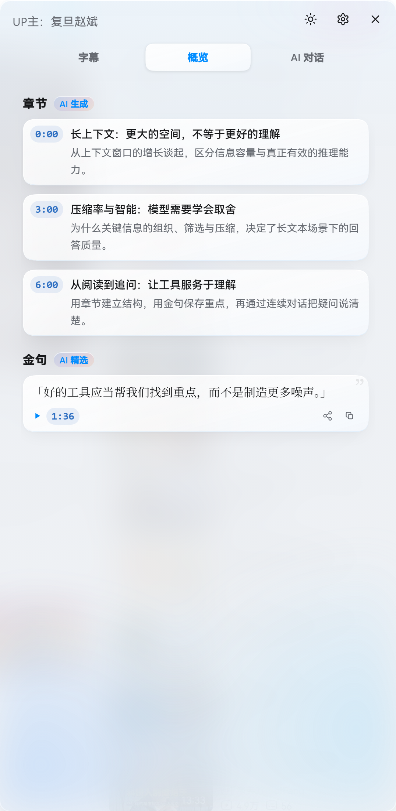
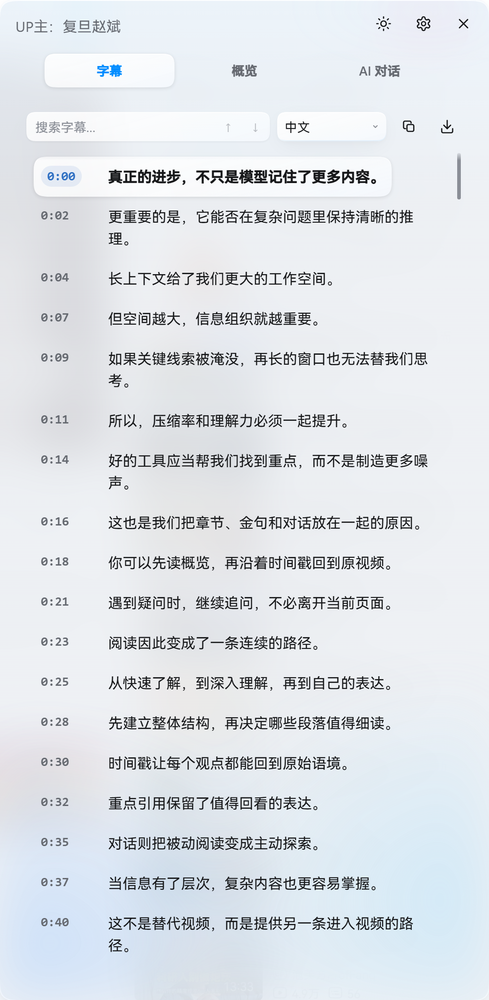
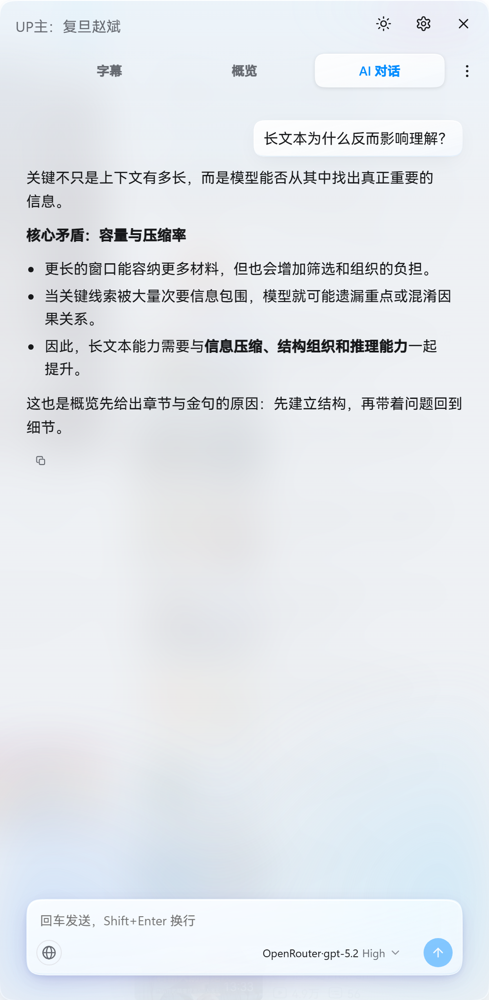

<div align="center">
  
  <h1>BiliScript · B 站视频文摘</h1>
  <p>集成字幕精读、AI 章节概览、多模态对话与实时音画伴看的开源 B 站浏览器扩展</p>
  <p>
    <a href="https://microsoftedge.microsoft.com/addons/detail/nhjeecahklhcjknimgapihnjbeiolpmn"></a>
    <a href="https://github.com/Edmund724/BiliScript/releases"></a>
    
    <a href="LICENSE"></a>
  </p>
  <p>
    <a href="#功能特性">功能特性</a> · <a href="#快速开始">快速开始</a> · <a href="#进阶选配">进阶选配</a> · <a href="#常见问题">常见问题</a> · <a href="#隐私与安全">隐私与安全</a> · <a href="#参与开发">参与开发</a>
  </p>
  
</div>

## 功能特性

- **字幕精读与双语翻译**：进入视频或切换分 P 自动抓取字幕，逐句点击时间戳跳播，支持句内搜索、跟随滚动及复制导出（Markdown / `srt` / `txt`）。播放器控制栏原生集成字幕菜单，支持多轨双语对照与 LLM 流式翻译；无字幕视频自动回退至语音识别转写（硅基流动或本地 Whisper）。
- **章节概览与金句卡片**：优先提取作者简介、置顶评论时间轴或官方章节，均无时由 AI 生成分段摘要并随播放实时高亮；精选金句内置 6 组噪点渐变与 5 款几何纹样，可一键复制或导出高清分享图。
- **多模态 AI 对话**：围绕视频内容多轮追问，支持选中字幕弹出「解释」卡、粘贴图片提问及模型按需截取视频关键帧；支持独立切换模型与思考强度、LaTeX 公式与 Mermaid 图表渲染，以及 Edge / Natural 高清语音朗读。
- **实时音画伴看**：支持 **MOSS Live** 与 **Google Gemini Live** 原生多模态协议，在视频页与 B 站直播间提供低延迟双向语音互动、实时画面采样与双端字幕；默认收纳为液体玻璃迷你胶囊浮窗，支持说话自动压音与背景音闪避。
- **双套主题与播放增强**：内置 **Flyme 蓝雾** 与 **数字刊物 Editorial** 两套深浅色外观，支持调节面板宽度（400–650px）与字号行距；播放器控制栏可选开启 3x / 4x 倍速按钮。
- **本地 Agent 联动**：通过本机 WebSocket 桥接供 Kimi Code、DeepSeek Harness、Antigravity 等编程 Agent 读取当前视频字幕、热评与关键帧，数据全程留在本机（详见 [本地 Agent 桥接指南](docs/agent-bridge.md)）。

| 字幕精读与检索 | 金句分享卡片 |
| :---: | :---: |
|  |  |
| **多轮 AI 对话** | **模型与思考强度调节** |
|  |  |

## 快速开始

> 支持 **Chrome / Edge 120+**（适用 `bilibili.com/video` 视频页、稍后再看列表页及直播间伴看；核心能力依赖 `offscreen` 等 Chromium 专属 API，不支持 Firefox）。API Key 需自行准备，配合下文推荐平台的免费额度即可零成本日常使用；项目本身不中转任何请求。

### 1. 安装扩展

- **Edge 应用市场（推荐）**：前往 [Edge 加载项商店](https://microsoftedge.microsoft.com/addons/detail/nhjeecahklhcjknimgapihnjbeiolpmn) 安装，支持自动更新（新版发布后需等待商店审核）。
- **手动安装（Chrome / Edge 通用）**：从 [GitHub Releases](https://github.com/Edmund724/BiliScript/releases) 下载最新的 `BiliScript-v<版本>-Chromium.zip`，解压到**长期保留**的文件夹；打开 `chrome://extensions/` 或 `edge://extensions/`，开启右上角「开发者模式」，点击「加载已解压的扩展程序」并选择解压后的文件夹。

<details>
<summary>零命令行基础？展开复制提示词，让编程 Agent 一步步带你安装</summary>

把下面这段话发送给你的编程 Agent：

> 请把这个项目下载或克隆到我选择的长期保留文件夹，告诉我准确的完整路径，并让 Chrome「加载已解压的扩展程序」使用同一个文件夹。如果我在第一次安装时需要位置建议，可以推荐 macOS 或 Linux 上的 `~/Documents/biliscript`，或 Windows 上的 `%USERPROFILE%\Documents\biliscript`，但不要假设我一定使用这些路径。请用简单易懂的语言一步一步指导我完成安装和配置。https://github.com/Edmund724/BiliScript

安装后请勿移动或删除该文件夹，且**不要把 API Key 发送给 Agent**，由你本人在扩展设置页粘贴。

</details>

### 2. 配置免费 API Key

打开任意 B 站视频页，点击播放器下方的**文摘按钮**（或浏览器扩展图标）展开面板，点击右上角齿轮打开「设置」（即改即存；对话、概览解释与字幕翻译可各自独立选择模型）：

1. **AI 总结与对话**：进入「AI 模型平台 → + 添加平台」，支持 **OpenAI 兼容 / Anthropic / Gemini 原生**协议，内置 DeepSeek、通义千问、智谱 GLM、Kimi、MiniMax、OpenRouter、ModelScope、Ollama 等 14 种平台预设，拉取模型并点击「测试」通过即自动保存。
   - **免费方案推荐**：前往 [ModelScope 官网](https://modelscope.cn/) 注册登录，创建 `ms-` 开头的 SDK Token（[API 文档](https://modelscope.cn/docs/intro/model-service)），每日签到免费积分即可满足日常总结与对话；预设中亦内置 AMD Radeon Cloud、SenseNova 商汤等免费平台。
2. **无字幕语音转写**：前往 [硅基流动官网](https://siliconflow.cn/) 创建 API Key 并填入语音识别设置。转写模型首选推荐 **`XingChenAGI/XingChenASR-V3.2`**（免费、带句级时间戳、实测最快；如需说话人区分可选免费的 `XingChenASR-Diarize-V3.0`）。

## 进阶选配

- **联网搜索（装上即用，免 Key）**：点击对话输入框右侧地球图标即可开启。默认采用 **Tavily** 链首与 Firecrawl / AnySearch / Parallel 等免 Key 引擎智能回退，带 `[n]` 内联引用与来源时间线；也可在「设置 → 联网搜索」配置豆包（每月 500 次免费）、Exa（新号赠金）或复用官方 DeepSeek Key。
- **实时音画伴看**：在「设置 → 实时伴看」填入 **MOSS Live** 官方 API Key（默认模型 `moss-live-1.0`），或直接一键复用已配置的 **Google Gemini** 凭据启用 `Gemini Live`（支持原生 Google 搜索与页面查证）。
- **本地 Agent 远程控制**：在「设置 → 本地 Agent 连接」开启开关后，在宿主机终端运行一键安装脚本（需 Node.js 22.20+）：
  - **Windows（PowerShell）**：`irm https://raw.githubusercontent.com/Edmund724/BiliScript/main/scripts/install-agent.ps1 | iex`
  - **macOS / Linux**：`curl -fsSL https://raw.githubusercontent.com/Edmund724/BiliScript/main/scripts/install-agent.sh | sh`
  - 多实例路由、接入其他 Agent 目录与卸载清理方法请查阅 [本地 Agent 桥接指南](docs/agent-bridge.md)。

## 常见问题

<details>
<summary>为什么有些视频没有字幕？</summary>

播放器控制栏无「字幕」选项代表视频没有原生字幕轨。在设置中配置语音识别平台并开启「无字幕自动语音识别」后，扩展会自动抓取音轨转写；已有原生字幕的视频不会触发转写或下载音频。

</details>

<details>
<summary>模型下拉列表为空或点击「测试」报错怎么办？</summary>

依次检查：1) 首次拉取时是否在浏览器弹窗中授予了该域名访问权限；2) API Base URL、API Key 与模型名称是否正确且网络可达；3) 若第三方平台未实现 `/v1/models` 接口，直接在输入框手动填入模型名即可。

</details>

<details>
<summary>开启代理软件时，语音转写提示「音轨下载或解码失败」怎么办？</summary>

B 站音频 CDN 依赖本地运营商 Local DNS 调度与防盗链鉴权，代理接管 DNS 易导致节点错位被拒连：
1. **推荐解法**：在代理客户端 DNS 设置中，将 **Direct Nameserver（直连 DNS）** 设为 `system`（或路由器 IP `192.168.1.1`），让国内直连流媒体走本地解析；
2. **快捷解法**：开启代理软件的「追加系统 DNS」，或在转写期间临时暂停系统代理。

</details>

<details>
<summary>ModelScope 提示积分不足或硅基流动转写失败怎么办？</summary>

ModelScope 请前往官网完成当日签到领取免费积分；硅基流动转写失败请查看面板报错提示（已区分 Key 无效、额度不足、防盗链或网络问题），按提示补齐额度或切换可用免费模型。

</details>

<details>
<summary>联网搜索没生效怎么排查？</summary>

1) 确认输入框右侧地球图标处于激活态，且当前对话模型支持工具调用（Function Calling）；2) 查看提示属于「未配置」还是「全部在冷却中」（后者等待数分钟自动恢复）；3) 检查搜索模式是否误设为「单选」某一家，切回「智能回退」即可按序兜底。

</details>

## 隐私与安全

- **直连无中转**：所有请求由浏览器直接发往 B 站及你选用的 AI、语音识别和搜索服务商，无后端服务器、无账号系统、无广告与统计追踪。
- **本地与同步隔离**：API Key、对话历史与最近 3 个视频的字幕/概览缓存仅保存在本机 `chrome.storage.local`；非敏感外观偏好经 `chrome.storage.sync` 随浏览器账号同步。
- **最小权限原则**：仅在 B 站目标页面按需运行；自定义平台域名权限在保存或拉取模型时动态申请，删除平台即回收。完整权限与数据策略见 [PRIVACY.md](PRIVACY.md)。

## 参与开发

```bash
git clone https://github.com/Edmund724/BiliScript.git
cd BiliScript
pnpm install
pnpm run dev   # 监听源码改动并构建到 dist/，在浏览器扩展管理页加载 dist/ 目录调试
```

模块目录结构、二次开发校验命令与评测基准说明请查阅 [开发与架构指南](docs/development.md)。

## 致谢与许可

本项目基于 [haixiong1997/Bilibili-Obsidian-Clipper](https://github.com/haixiong1997/Bilibili-Obsidian-Clipper) 二次修改，UI 设计参考了 [YouTube Digest](https://github.com/zarazhangrui/youtube-digest)，思考档位适配表参考了 [hana-model-catalog](https://github.com/liliMozi/hana-model-catalog) 与 models.dev。

遵循 [MIT License](LICENSE)。

> ▎ **用户自负责任条款**：本工具仅在用户已登录 B 站、且有访问权限的前提下，通过用户本地浏览器与 Cookie 获取数据，不经过任何第三方服务器，也不存储或分发任何 B 站内容。使用本工具产生的所有后果由用户自行承担，请遵守 B 站用户协议与相关法律法规。
