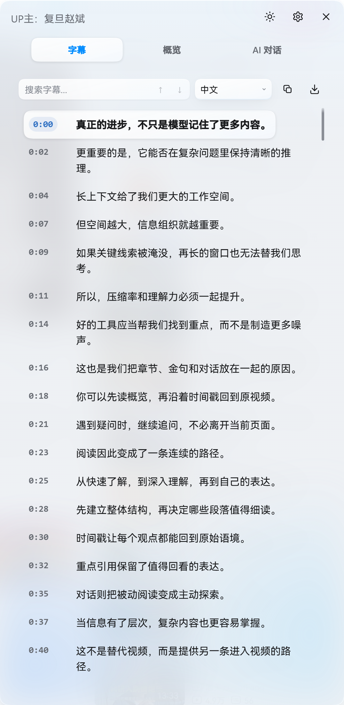
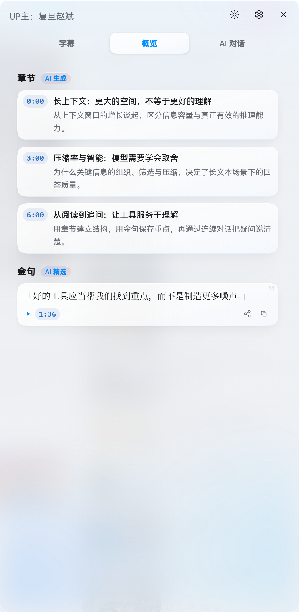
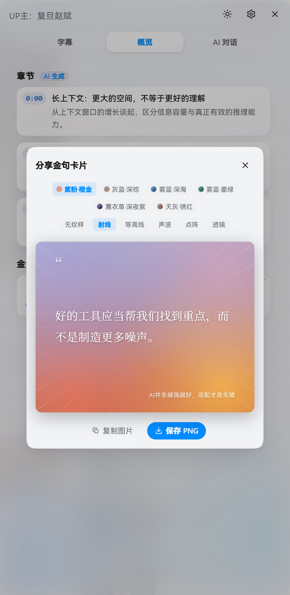
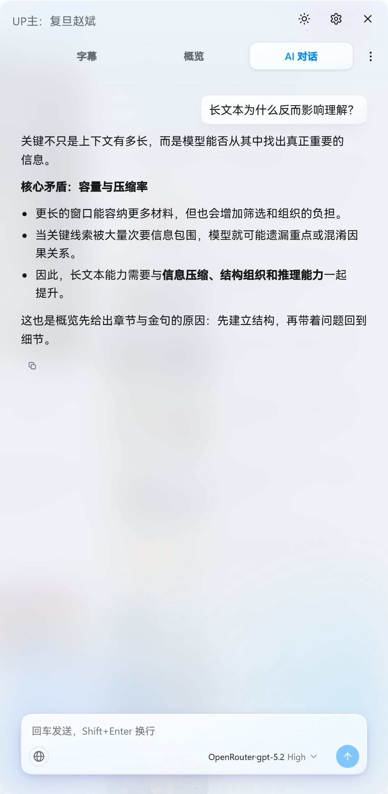
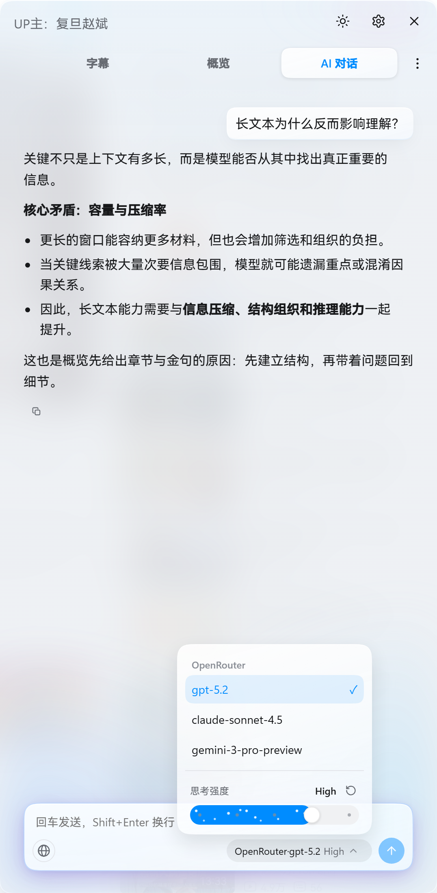

# BiliScript｜B 站视频文摘

> 本项目基于 [haixiong1997/Bilibili-Obsidian-Clipper](https://github.com/haixiong1997/Bilibili-Obsidian-Clipper) 二次修改，沿用 MIT License。UI 设计参考了 [YouTube Digest](https://github.com/zarazhangrui/youtube-digest)。

一个开源的浏览器扩展，在 B 站视频页右侧的文摘面板中提供字幕阅读、导出、AI 总结和内容讲解，无需离开视频页面。

API Key 需自行准备，但无需付费：下文推荐的硅基流动和 ModelScope 均提供免费额度，日常使用足够。项目本身不提供 Key，也不中转任何请求。

[](https://microsoftedge.microsoft.com/addons/detail/nhjeecahklhcjknimgapihnjbeiolpmn) [](https://github.com/Edmund724/BiliScript/releases)

跳转：[功能](#功能) · [安装方式](#安装方式) · [配置与 API Key](#配置与-api-key) · [隐私与权限](#隐私与权限) · [常见问题](#常见问题) · [项目结构](#项目结构)

## 功能

### 字幕与时间戳跳转

- 进入视频页或切换分 P 时自动抓取字幕，支持复制为 Markdown 或下载 `srt/txt`
- 多字幕轨视频支持手动切换轨道（默认中文优先）；展开轨道选择可在页脚开启「双语字幕」并选择副轨语言，主副两行对照显示并随复制/导出一并输出（跨视频自动按语言匹配，缺失时退回单轨）
- 字幕逐句带时间戳，点击跳转对应播放位置；支持句内搜索与跟随播放自动滚动
- 无字幕视频自动回退至语音识别转写（硅基流动或本地 Whisper），失败时明确提示 Key、额度、防盗链或网络原因

### 章节概览与金句收集

- 「概览」标签页自动生成视频章节分段（附单句简介）与重点引用（金句），点击时间戳直接跳播，生成途中可随时取消
- 章节优先采用作者在简介或置顶评论中提供的时间轴，其次使用 B 站官方章节，均无时由 AI 生成
- 金句支持「分享」卡片弹窗：白边相纸版式、底栏双段标记与品牌角标，内置 6 组噪点渐变底色与 5 款矢量几何纹样，可一键复制或导出高清分享图

### AI 对话栏

- 围绕字幕内容多轮对话，支持模型切换、思考强度调节与历史会话管理；选中字幕可弹出「解释」卡片一键追问，播放器内提供 AI 快捷摘要按钮
- 支持在输入框粘贴截图或图片随消息发送（单条最多 4 张，本地自动压缩，需模型支持视觉输入）
- 可选联网搜索（默认关闭）：内置免 Key 搜索服务，装上即用；回答附带可展开的搜索时间线、来源链接与 `[n]` 内联引用
- 回答中的时间戳可点击跳播；支持行内 `$...$` 与块级 `$$...$$` LaTeX 公式排版，以及 ` ```mermaid ` 流程图与时序图渲染

### 外观与阅读排版

- 面板宽度支持在 400px–650px 间调节（默认 540px），可选进入视频页自动展开；支持调节字号、行高与段落间距
- 内置 **Flyme 蓝雾**（半透明雾壳与白玻璃卡片，HarmonyOS Sans SC 字体栈）与 **数字刊物 Editorial**（暖调羊皮纸底与衬线排版，推荐系统安装「思源宋体 / Noto Serif SC」）两套风格，均支持浅色 / 深色模式切换

## 功能图片演示











## 安装方式

> 支持 Chrome / Edge 120 及以上版本（适用 `bilibili.com/video` 视频页及稍后再看列表页）；因核心功能依赖 `offscreen` 等 Chromium 专属 API，不支持 Firefox。安装后点击视频下方的**文摘按钮**或浏览器**扩展图标**即可打开面板。

### 方式一：Edge 应用市场（推荐）

| 浏览器 | 安装链接 | 状态 |
| --- | --- | --- |
| Edge | [Edge 加载项商店](https://microsoftedge.microsoft.com/addons/detail/nhjeecahklhcjknimgapihnjbeiolpmn) | 已上架，自动更新（新版发布后需等待商店审核） |
| Chrome | 无 | 暂未上架，请使用下方方式二 |

### 方式二：手动安装（下载打包版本）

从 [GitHub Releases](https://github.com/Edmund724/BiliScript/releases) 下载最新的 `BiliScript-v<版本>-Chromium.zip` 并解压到长期保留的文件夹，打开 `chrome://extensions/` 或 `edge://extensions/`，开启「开发者模式」，点击「加载已解压的扩展程序」并选择解压后的文件夹。

### 方式三：从源码构建

```bash
git clone https://github.com/Edmund724/BiliScript.git
cd BiliScript
pnpm install
pnpm run build          # 生成 dist/（含 sourcemap）
pnpm run dev            # watch 模式，修改代码持续重建到 dist/
pnpm run build:release  # 生成发布包到 release/（不含 sourcemap）
```

日常开发运行 `pnpm run dev`，在扩展管理页加载 `dist/` 目录即可。

### 方式四：让编程 Agent 帮你安装

无需命令行基础，把下面这段话发送给你的编程 Agent：

> 请把这个项目下载或克隆到我选择的长期保留文件夹，告诉我准确的完整路径，并让 Chrome「加载已解压的扩展程序」使用同一个文件夹。如果我在第一次安装时需要位置建议，可以推荐 macOS 或 Linux 上的 `~/Documents/biliscript`，或 Windows 上的 `%USERPROFILE%\Documents\biliscript`，但不要假设我一定使用这些路径。请用简单易懂的语言一步一步指导我完成安装和配置。https://github.com/Edmund724/BiliScript

你的 Agent 应该帮你确认保存路径并下载项目、指导你注册硅基流动和 ModelScope 账号、在浏览器中加载扩展文件夹、指出填写 API Key 的位置，并打开 B 站视频验证功能。注意：安装后请勿移动或删除该文件夹，且**不要把 API Key 发送给 Agent**，由你自己在设置页面粘贴。

## 配置与 API Key

点击文摘面板右上角的齿轮按钮打开「设置」抽屉即可配置全部选项（即改即存）。BiliScript 不收款也不转售 API，请勿将 Key 发到对话或公开渠道中。

### 1. 配置 AI 模型平台（总结与对话）

1. 在设置抽屉「AI 模型平台」区域点击「+ 添加平台」，选择平台预设或「自定义」。
2. 确认协议（**OpenAI 兼容 / Anthropic / Gemini 原生**，切换协议时预设 Base URL 自动联动）。
3. 粘贴 API Key，点击模型名称旁的箭头拉取可用模型列表（内置模型目录会自动标注上下文窗口及「思考」「图片」能力徽标），点击「测试」验证通过后自动保存。

**内置平台预设**：DeepSeek、阿里通义千问（Qwen）、智谱 GLM、月之暗面 Kimi、MiniMax、Mimo、Opencode Go、OpenRouter、阶跃星辰（Stepfun）、ModelScope、AMD Radeon Cloud（免费）、SenseNova 商汤（免费）、Ollama（本地）、Google Gemini。

**免费方案推荐（ModelScope）**：前往 [ModelScope 官网](https://modelscope.cn/) 注册登录，在用户页或 API 管理页创建 `ms-` 开头的 SDK Token。ModelScope 提供每日签到免费积分，登录官网签到即可用于日常总结与对话（详见 [ModelScope API 文档](https://modelscope.cn/docs/intro/model-service)）。

**思考档位适配**：点击发送框底部的模型 chip 可通过胶囊滑轨切换思考强度（`Default` / `Off` / `Minimal` 至 `Max`）。扩展内置「平台 × 模型」适配表（参考 [hana-model-catalog](https://github.com/liliMozi/hana-model-catalog) 与 models.dev 词表），自动转换为目标平台对应的请求参数。

### 2. 配置语音识别 API Key（无字幕视频转写）

1. 前往 [硅基流动官网](https://siliconflow.cn/) 注册登录，在控制台创建 API Key 并粘贴到设置中的 **硅基流动 API Key**。
2. 点击模型名右侧箭头选择转写模型（60 分钟音频、10 并发、5 分钟/片实测对比，复现可运行 `pnpm run eval:run`）：
   - `XingChenAGI/XingChenASR-V3.2`：**首选推荐**，免费，带句级时间戳，实测最快（墙钟约 68 秒，RTF 0.019）。
   - `XingChenAGI/XingChenASR-Diarize-V3.0`：免费，带句级时间戳与说话人区分，速度次之（约 108 秒）。
   - `XingChenAGI/XingChenASR-V3.2-Ultra`：免费，带句级时间戳，耗时约为 V3.2 的 2.5 倍（约 169 秒）。
   - `FunAudioLLM/SenseVoiceSmall`：免费，不返回句级时间戳，仅按音频分片粗略定位。
   - `Qwen/Qwen3-ASR-1.7B`：收费模型，按量计费（详见 [硅基流动定价](https://siliconflow.cn/pricing)）。

### 3. 配置联网搜索平台（可选，内置免 Key）

联网搜索**装上即可用，无需配置账号或 Key**。首次开启对话输入行右侧的地球图标时会弹出数据流向说明，确认后生效。

| 平台 | 接入形态 | 免费额度 / 计费说明 |
| --- | --- | --- |
| **Tavily（默认链首）** / Firecrawl / AnySearch / Parallel | `keyless`（内置免 Key） | 开箱直连，无须账号；Tavily 配自有 Key 后享每月 1,000 credits |
| 豆包 | `free-quota`（自备 Key） | 火山控制台申请 Key，每月 500 次免费 |
| Exa | `free-quota`（自备 Key） | 每月 10 美元赠送额度（新号另赠 10 美元），搜索 7 美元 / 1,000 次 |
| DeepSeek | `paid`（复用 AI 平台凭据） | 自动复用 AI 平台中官方 DeepSeek 的 Key；默认在智能链中关闭，需单选或开启「允许智能搜索使用付费平台」 |

**排序与回退机制**：支持置顶的「**智能**」模式（默认按列表顺序逐家回退，总预算 30 秒；单引擎连续失败 3 次自动进入 5–60 分钟指数退避冷却，5 分钟内相同查询命中本地哈希缓存直接复用）与「**单选**」模式（仅请求指定平台，失败不回退）。列表顺序可拖拽调整或一键恢复默认，单轮搜索上限默认 5 次（可调 1–20）。

## 隐私与权限

- **直连无中转**：所有请求由浏览器直接发往 B 站及你选用的 AI、语音识别和搜索服务商，本项目无后端服务器、无账号系统、无广告与统计追踪。
- **本地与同步隔离**：API Key、对话历史与最近 3 个视频的字幕/概览缓存仅保存在本机 `chrome.storage.local`；非敏感偏好经 `chrome.storage.sync` 随浏览器账号同步。
- **最小权限原则**：仅在 B 站视频页注入面板；无字幕语音转写时才通过会话规则访问音轨 CDN；自定义 AI / ASR 平台域名权限在保存平台或拉取模型列表时按需申请，删除平台即回收。
- 完整的 Chrome 权限逐项说明、数据流向与留存策略请查阅 [PRIVACY.md](PRIVACY.md)。

## 常见问题

### 为什么有些视频没有字幕？

播放器无「字幕」选项代表视频无原生字幕轨。配置语音识别平台并开启「无字幕自动语音识别」后会自动抓取音频转写；已有原生字幕的视频不会触发转写或下载音频。

### 模型下拉列表为空或「测试」报错怎么办？

检查：1) 首次点击拉取箭头时是否在浏览器弹窗中授予了域名访问权限；2) API Base URL、API Key 与模型名称是否正确且网络可达；3) 若平台不兼容 `/v1/models` 接口，直接手动输入模型名即可。

### 为什么只支持 Chrome / Edge，不支持 Firefox？

音频解码和流式转写依赖 `offscreen` 等 Chromium 专属 API，需 Chrome / Edge 120 及以上版本。

### ModelScope 提示积分不足或硅基流动转写失败怎么办？

ModelScope 请先去官网完成当日签到领取免费积分；硅基流动转写失败请查看横幅报错提示（区分 Key 无效、额度不足、防盗链或网络问题），在对应平台补齐额度或更换可用模型。

### 语音转写的并发为什么固定为 10？

音频按 5 分钟/片切分后最多 10 片并发转写。这是 `eval/` 对硅基流动实测得出的最优值：超过 12 并发会触发服务端排队，20 并发整体耗时反而慢于 9 并发（可运行 `pnpm run eval:sweep` 复测）。

### 联网搜索没生效怎么排查？

1. 确认输入框右侧地球图标处于开启状态（蓝框浅蓝底），且当前模型支持工具调用（function calling）。
2. 查看提示是「未配置」还是「全部在冷却中」（后者等几分钟自动恢复）。
3. 检查搜索平台是否误设为「单选」某一家；切回「智能」模式可自动按序回退。

## 项目结构

```text
extension/
├── manifest.json          # 扩展清单
├── entry/                 # 入口（background、content、offscreen）
├── ai/                    # AI 客户端、SSE 流式解析、播放器 AI 按钮
├── asr/                   # 语音识别（音频分片、转写、WAV 编码）
├── bilibili/              # B 站 API 网关与视频 ID 解析
├── chat/                  # 对话运行时与会话存储
├── search/                # 联网搜索（多平台适配器、回退链与执行器）
├── core/                  # 核心状态、运行时、消息处理
├── notes/                 # 导出渲染（Markdown、SRT、TXT）
├── subtitle/              # 字幕抓取、缓存与处理
├── reader/                # 阅读视图（生命周期、同步、布局）
├── ui/                    # UI 渲染（面板、Markdown、时间戳导航）
├── shared/                # 跨模块工具（DOM、日志、字符串处理等）
└── icons/                 # 扩展图标
```

> `extension/entry/content-bootstrap.iife.js`、`entry/content-main.mjs` 与 `entry/chunks/` 为 `pnpm run build` 生成的构建产物，请勿手动编辑。`mermaid` 是唯一的运行时依赖，按需懒加载，不影响常驻包体积。

## 二次开发与个性化

你可以克隆源码后配合 AI 编程工具（如 Codex、Kimi Code、ZCode、DeepSeek Harness 等）按个人需求定制功能（如调整总结提示词与触发方式、新增生词本或 Anki 导出、接入本地模型等）。修改后请让编程 Agent 执行以下检查并在真实 B 站视频页验证：

```bash
pnpm test
pnpm run typecheck
pnpm run build
```

请保持在设置界面填写 API Key 的机制，切勿将密钥硬编码进源码。

## 开源许可与免责声明

遵循 [MIT License](LICENSE)。

> ▎ **用户自负责任条款**：本工具仅在用户已登录 B 站、且有访问权限的前提下，通过用户本地浏览器与 Cookie 获取数据，不经过任何第三方服务器，也不存储或分发任何 B 站内容。使用本工具产生的所有后果由用户自行承担，请遵守 B 站用户协议与相关法律法规。
