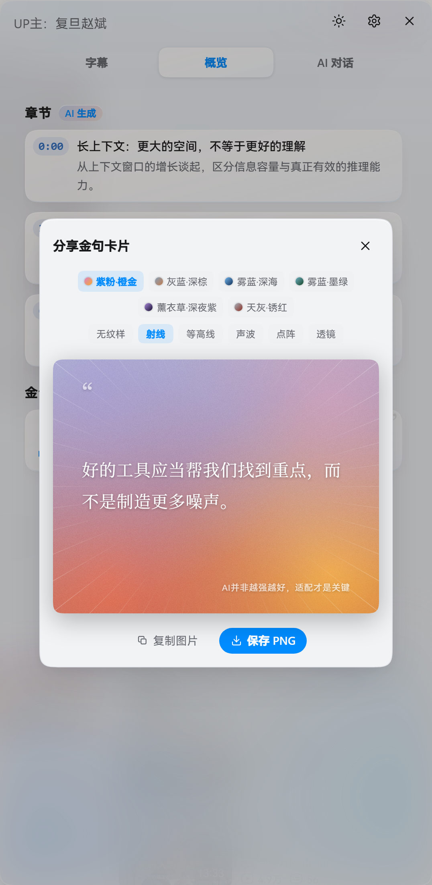
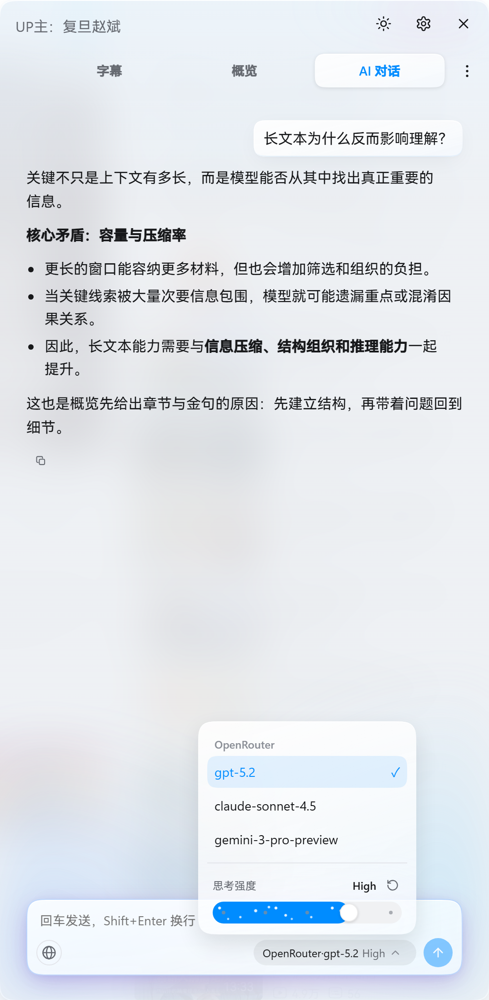

<div align="center">
  
  <h1>BiliScript · B 站视频文摘</h1>
  <p>在 B 站视频页提供字幕精读、AI 概览、多模态对话与实时音画伴看的开源浏览器扩展</p>
  <p>
    <a href="https://microsoftedge.microsoft.com/addons/detail/nhjeecahklhcjknimgapihnjbeiolpmn"></a>
    <a href="https://github.com/Edmund724/BiliScript/releases"></a>
  </p>
  <p>🎬 <a href="https://www.bilibili.com/video/BV1zwWh61E8D">在 B 站观看演示视频</a></p>
  
</div>

## 核心能力

- **字幕与双语翻译**：逐句时间戳跳播、搜索与导出（Markdown / SRT / WebVTT / TXT），集成播放器双语字幕叠层与原生风格菜单、内置免 Key `Index-Translate` 字幕翻译、自定义 LLM 语境流式翻译与无字幕语音转写。
- **章节概览与金句**：自动提取时间轴或生成 AI 章节摘要（长视频状态卡接力与章节索引固化），精选金句支持一键复制或导出高清分享图。
- **多模态 AI 对话**：支持章节路由与 BM25 混合召回长视频问答、多视频页并发总结、划词解释、粘贴图片与关键帧采样，内置思考强度调节、免 Key 联网搜索和语音朗读。
- **实时音画伴看**：接入 MOSS Live 与 Gemini Live，支持语音控制播放器（倍速 / 进度 / 音量）、视频原声压低与直播间双向音画互动。
- **本地 Agent 桥接**：通过本机 WebSocket 供编程 Agent 读取当前视频字幕、热评与关键帧。

| 字幕精读与检索 | 金句分享卡片 |
| :---: | :---: |
|  |  |
| **多轮 AI 对话** | **模型与思考强度调节** |
|  |  |

## 快速开始

> [!NOTE]
> **环境与隐私边界**：需 Chrome / Edge 120+（不支持 Firefox）。本项目无后端服务器，也不售卖或中转 API Key；所有请求由浏览器直连目标服务商，密钥与历史仅保存在本机（详见 [PRIVACY.md](PRIVACY.md)）。

### 1. 安装扩展

- **Edge 商店（推荐）**：从 [Edge 加载项商店](https://microsoftedge.microsoft.com/addons/detail/nhjeecahklhcjknimgapihnjbeiolpmn) 直接安装并自动更新。
- **离线包安装（Chrome / Edge）**：从 [Releases](https://github.com/Edmund724/BiliScript/releases) 下载最新 `Chromium.zip` 并解压到**长期保留**的目录，打开 `chrome://extensions/` 开启「开发者模式」，点击「加载已解压的扩展程序」选择该目录。

<details>
<summary>零命令行基础？展开复制提示词，让编程 Agent 引导安装</summary>

> 请把这个项目下载或克隆到我选择的长期保留文件夹，告诉我准确的完整路径，并让 Chrome「加载已解压的扩展程序」使用同一个文件夹。如果我在第一次安装时需要位置建议，可以推荐 macOS 或 Linux 上的 `~/Documents/biliscript`，或 Windows 上的 `%USERPROFILE%\Documents\biliscript`，但不要假设我一定使用这些路径。请用简单易懂的语言一步一步指导我完成安装和配置。https://github.com/Edmund724/BiliScript

安装后请勿移动或删除该文件夹，且**不要把 API Key 发送给 Agent**，由你本人在扩展设置页粘贴。

</details>

### 2. 开箱即用与配置 API Key

- **字幕翻译（免 Key 开箱即用）**：字幕翻译已支持内置免 Key 的 `Index-Translate`（默认 `Index-Translate-35B-A3B`，可在设置中切换 `9B` / `2B` 或切回自定义 AI 平台），无需配置任何 API Key 即可直接在视频页使用。
- **联网搜索（免 Key 开箱即用）**：对话栏点亮地球图标即可启用免 Key 联网搜索。

如需使用 AI 总结、多轮对话或无字幕语音转写，请打开任意 B 站视频页右侧文摘面板，点击右上角齿轮进入「设置」：

1. **总结与对话**：添加 [ModelScope](https://modelscope.cn/)（每日签到免费积分，创建 `ms-` Token）或任意 OpenAI / Anthropic / Gemini 协议平台。
2. **无字幕转写**：填入 [硅基流动](https://siliconflow.cn/) API Key，推荐选择免费模型 `XingChenAGI/XingChenASR-V3.2`。
3. **宿主机接入编程 Agent（可选）**：可执行一键安装（需 Node.js 22.20+）：

```bash
# macOS / Linux
curl -fsSL https://raw.githubusercontent.com/Edmund724/BiliScript/main/scripts/install-agent.sh | sh
# Windows (PowerShell)
irm https://raw.githubusercontent.com/Edmund724/BiliScript/main/scripts/install-agent.ps1 | iex
```

## 开发

```bash
git clone https://github.com/Edmund724/BiliScript.git && cd BiliScript
pnpm install && pnpm run dev   # 监听构建到 dist/，在浏览器扩展管理页加载 dist/ 调试
```

编程 Agent 参与开发请遵循 [`AGENTS.md`](AGENTS.md)。

## 文档

在线文档站：[edmund724.github.io/BiliScript](https://edmund724.github.io/BiliScript/)（下方保留仓库相对路径，方便在 GitHub 直接查阅）。

| 文档 | 内容归属 |
| :--- | :--- |
| [配置与排障指南](docs/guide.md) | 支持平台清单与 ASR 模型对比，联网搜索、实时伴看配置及常见问题（FAQ） |
| [本地 Agent 桥接指南](docs/agent-bridge.md) | WebSocket 桥接机制、多实例路由与其他 Agent 目录接入及卸载清理 |
| [开发与架构指南](docs/development.md) | 构建与校验命令、`extension/` 模块结构、评测基准与 [ADR 索引](docs/adr/README.md) |
| [隐私政策](PRIVACY.md) | Chrome 权限逐项说明、数据流向与本地存储隔离策略 |
| [`AGENTS.md`](AGENTS.md) / [`GLOSSARY.md`](GLOSSARY.md) | 编程 Agent 协作规范、工具链约束与领域统一词汇表 |

## 致谢与许可

基于 [haixiong1997/Bilibili-Obsidian-Clipper](https://github.com/haixiong1997/Bilibili-Obsidian-Clipper) 二次修改，UI 参考 [YouTube Digest](https://github.com/zarazhangrui/youtube-digest)，思考档位词表参考 [hana-model-catalog](https://github.com/liliMozi/hana-model-catalog) 与 models.dev。

遵循 [MIT License](LICENSE)。请仅在已登录且有访问权限的前提下合规使用，遵守 B 站用户协议与相关法律法规，使用本工具产生的一切后果由用户自行承担。
