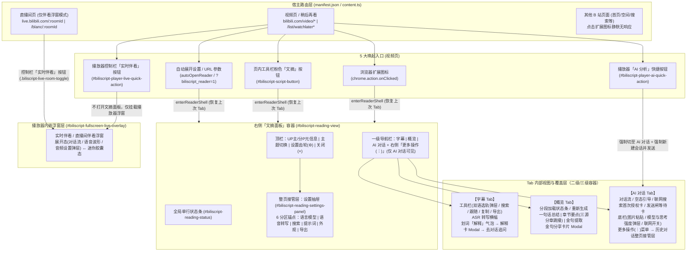
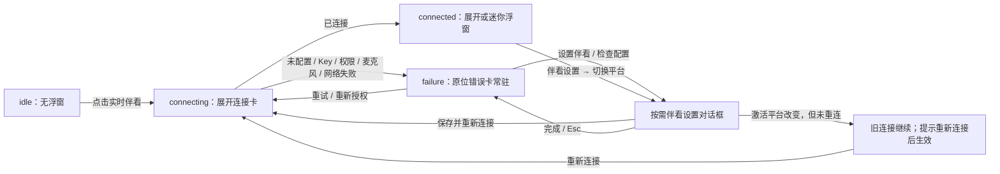

# BiliScript 信息架构与用户流程宏观走查（UX Audit Roadmap）

本文档聚焦 **【信息架构（Information Architecture）】** 与 **【用户流程（User Flows）】** 两个宏观维度，以真实用户的认知负担、寻路直觉与链路完整性为标尺，对当前版本进行全局拆解、问题诊断与后续分会话走查排期。

---

## 一、全局路由与信息架构全景图

BiliScript 是无独立 Popup 页面、直接注入 B 站宿主页的浏览器扩展。其全局信息架构横跨 **2 类宿主页面上下文**、**5 类唤起入口** 与 **4 层容器嵌套结构**。

---

## 二、核心链路拆解（5 大核心体验模块 / 子流程）

按真实用户使用场景与心智阶段，将产品拆分为 **5 个独立的“核心体验模块/子流程”**，作为后续分会话深度走查的单元：

### 模块 M1：唤起、寻路与文摘面板生命周期（Entry, Navigation & Shell Lifecycle）
* **用户场景**：用户在不同 B 站页面发现并使用扩展，打开/关闭右侧文摘面板，在三栏 Tab 与设置抽屉之间切换，或在非标布局/全屏下浏览。
* **核心链路**：
  1. **多入口唤起**：扩展图标 [`background.ts`](file:///d:/src/BiliScript/extension/entry/background.ts#L168-L176)、视频下方工具栏粉色「文摘」按钮 [`script-button.ts`](file:///d:/src/BiliScript/extension/ui/script-button.ts#L50-L79)、播放器内快捷按钮 [`player-ai.ts`](file:///d:/src/BiliScript/extension/ai/player-ai.ts#L140-L185)、自动展开与 `?biliscript_reader=1` [`content.ts`](file:///d:/src/BiliScript/extension/entry/content.ts#L1393-L1443)。
  2. **面板挂载与布局自适应**：贴合右栏（`docked`）与浮层降级（`floating`）[`shell.ts`](file:///d:/src/BiliScript/extension/reader/shell.ts#L100-L180)、拖拽调宽、明暗主题同步。
  3. **一级导航与整页接管切换**：`字幕` / `概览` / `AI 对话` 三栏切换与跨视频 Tab 记忆 [`script-tab-activation.ts`](file:///d:/src/BiliScript/extension/reader/script-tab-activation.ts#L1-L90)；顶栏设置齿轮开启「设置抽屉」整页接管与返回 [`settings-panel.ts`](file:///d:/src/BiliScript/extension/ui/settings-panel.ts#L60-L150)。
  4. **切 P / SPA 切视频与关闭面板回收**：同页切视频重置上下文 [`content.ts`](file:///d:/src/BiliScript/extension/entry/content.ts#L1180-L1260)、关闭面板时的流式请求与伴看状态回收 [`content.ts`](file:///d:/src/BiliScript/extension/entry/content.ts#L655-L685)。

### 模块 M2：首次配置与四族平台管理（Onboarding & Multi-Family Provider Setup）
* **用户场景**：新用户首次打开扩展配置 API Key，或进阶用户配置多模型平台、语音转写、实时伴看与联网搜索回退链。
* **核心链路**：
  1. **未配置冷启动引导**：在概览/对话/转写/伴看触发未配置拦截 → 点击「前往设置」跳入设置抽屉对应锚点 [`chat-notices.ts`](file:///d:/src/BiliScript/extension/reader/chat-notices.ts#L50-L120)。
  2. **四族平台差异化管理**：设置抽屉 6 分区导航 [`settings-panel-html.ts`](file:///d:/src/BiliScript/extension/ui/settings-panel-html.ts#L120-L260) 下的 `AI 模型平台`（多选启用+目录勾选）、`实时伴看平台`（单选激活）、`语音转写平台`（单选激活）、`搜索平台`（智能模式回退链拖拽排序 vs 单平台指定 + 付费开关）。
  3. **单平台编辑 Modal 闭环**：预设模板选择、协议切换（`OpenAI` / `Anthropic` / `Gemini`）、API Key 填写、动态域名权限申请（`chrome.permissions.request`）、远端拉取模型目录二级弹窗、连通性测试、删除二次确认弹窗 [`provider-editor-modal.ts`](file:///d:/src/BiliScript/extension/ui/provider-editor-modal.ts#L1-L220)。
  4. **跨族「凭据引用」配置**：`Gemini Live` 与 `DeepSeek Search` 复用已启用 AI 模型平台 Key 的跨列表依赖链路 [`provider-editor-modal.ts`](file:///d:/src/BiliScript/extension/ui/provider-editor-modal.ts#L430-L510)。

### 模块 M3：字幕精读、双语对照与即席解释（Subtitle Reading, Bilingual & Inline Explain）
* **用户场景**：用户边看视频边浏览时间轴字幕、切换双语字幕、搜索台词定位进度、对无字幕视频发起语音转写，或划词解释陌生概念并追问。
* **核心链路**：
  1. **字幕获取与无字幕 ASR 兜底**：B 站原生字幕抓取 → 无字幕空态展示 ASR「语音转写」横幅（自动转写开关、进度与取消、失败重试）[`transcribe-banner.ts`](file:///d:/src/BiliScript/extension/reader/transcribe-banner.ts#L1-L160)。
  2. **主副双语选轨弹层**：主轨/副轨双列联动选择、双语对照开关、无副轨引导态 [`subtitle-tab-ui.ts`](file:///d:/src/BiliScript/extension/reader/subtitle-tab-ui.ts#L180-L360)。
  3. **检索、跟随与导出**：关键字过滤高亮、自动跟随视频播放滚动（手动滚动暂停跟随，点击「跟随」恢复）、点击时间戳跳播、一键复制与多格式（SRT/TXT/JSON/MD）导出。
  4. **划词即席解释 → 对话追问移交**：字幕选中文本弹出「解释」胶囊 [`explain-pop-ui.ts`](file:///d:/src/BiliScript/extension/reader/explain-pop-ui.ts#L1-L120) → 弹出「解释卡」流式生成术语释义与语境说明 [`explain-card.ts`](file:///d:/src/BiliScript/extension/reader/explain-card.ts#L1-L180) → 点击「去对话追问」写入「待解释意图（`PendingExplainIntent`）」并自动切至 `AI 对话` Tab 发起首轮追问。

### 模块 M4：AI 概览生成与金句消费（AI Overview & Quote Share）
* **用户场景**：用户想在几秒内掌握长视频核心内容、按章节跳看重点片段，或提取视频金句生成海报分享。
* **核心链路**：
  1. **概览触发与分段生成反馈**：切换至 `概览` Tab 自动触发（或手动点击生成）→ 等待字幕就绪 → 长视频分段提炼进度展示、取消生成、部分分段失败黄色状态条与「重试失败部分」[`overview-ui.ts`](file:///d:/src/BiliScript/extension/reader/overview-ui.ts#L80-L260)。
  2. **结构化概览阅读与三源分章跳播**：一句话核心总结、按优先级采用（简介/评论时间轴 > B 站官方章节 > AI 生成章节）的章节列表、随播放进度高亮当前章节、点击时间戳跳播。
  3. **金句提取与分享卡片制作**：时间戳回跳、单条复制、点击「分享」打开金句分享卡片 Modal（切换配色方案、背景纹样、字体，复制图片或下载 PNG）[`quote-share-modal.ts`](file:///d:/src/BiliScript/extension/reader/quote-share-modal.ts#L1-L200)。

### 模块 M5：AI 多轮对话与双端实时伴看（AI Chat & Multimodal Live Companion）
* **用户场景**：用户针对视频内容向 AI 深度提问（含发图、让 AI 回看历史画面、联网查证），或在看视频/看直播时开启全双工语音「实时伴看」边看边聊。
* **核心链路**：
  1. **对话输入与「发送闸」拦截**：快捷提示词胶囊启动、自由输入与剪贴板贴图；字幕未就绪时触发「发送闸」挂起消息并展示等待提示（可取消），确定无字幕时拦截回填 [`chat-tab.ts`](file:///d:/src/BiliScript/extension/reader/chat-tab.ts#L600-L760)。
  2. **模型/思考强度切换与联网搜索授权**：底栏模型胶囊弹出模型与思考强度面板（离散档位滑轨）[`chat-model-panel.ts`](file:///d:/src/BiliScript/extension/reader/chat-model-panel.ts#L1-L190)；开启联网开关时首次弹出「联网搜索授权（Opt-in）」内嵌卡片 [`opt-in-notice.ts`](file:///d:/src/BiliScript/extension/search/opt-in-notice.ts#L1-L90)；工具调用状态条（联网检索、抽帧回看历史画面 `inspect_video_frames`）与来源引用渲染。
  3. **会话管理与排版/朗读控制**：顶栏右侧「更多操作 (⋮)」菜单 → 开启新会话、打开「历史对话」整页接管层（恢复/删除会话）、调节对话行高/段距与 TTS 朗读音量 [`chat-popovers.ts`](file:///d:/src/BiliScript/extension/reader/chat-popovers.ts#L1-L180)。
  4. **视频页与直播间「实时伴看」**：点击播放器控制栏「实时伴看」按钮 → 挂载播放器内浮窗 [`fullscreen-live-overlay.ts`](file:///d:/src/BiliScript/extension/live/fullscreen-live-overlay.ts#L1-L260) → 麦克风/视频伴音采集、音频设置弹层（伴看音量/分享视频声音/语音优先）、语音打断、最小化为迷你胶囊态与拖拽吸附。

---

## 三、宏观问题诊断（信息架构 × 用户流程）

### 3.1 信息架构维度（Information Architecture）

#### IA-01 【高危】设置抽屉整页接管缺乏局部返回锚点，极易误触关闭整个文摘面板
* **代码位置**：[`ui-renderer.ts`](file:///d:/src/BiliScript/extension/ui/ui-renderer.ts#L50-L95)、[`settings-panel-html.ts`](file:///d:/src/BiliScript/extension/ui/settings-panel-html.ts#L120-L155)、[`settings-panel.ts`](file:///d:/src/BiliScript/extension/ui/settings-panel.ts#L60-L120)
* **现象与认知负担**：
  * 点击顶栏齿轮 `#biliscript-reading-settings-btn` 后，设置抽屉接管了面板第 3～4 行（隐藏了 `字幕 / 概览 / AI 对话` 导航栏与内容区），但**设置抽屉内部没有任何“← 返回”或“完成/关闭设置”按钮**。
  * 此时面板右上角最显眼的退出符号是紧挨着齿轮的 `×`（`#biliscript-reading-close-btn`）。用户在全屏设置视图下按直觉点击右上角 `×` 想要“关掉设置回到刚才的 Tab”，结果直接**退出了整个文摘面板**（且触发 `closeChatSession` 断开正在进行的流式对话！）。
  * 当前退出设置的路径只有“再次点击高亮的齿轮图标”或“点击 B 站网页空白处”，严重违背浮层/次级页面返回直觉。

#### IA-02 【高危】视频页「实时伴看」入口孤立在播放器控制栏，且报错反馈跨容器分裂
* **代码位置**：[`player-ai.ts`](file:///d:/src/BiliScript/extension/ai/player-ai.ts#L155-L210)、[`content.ts`](file:///d:/src/BiliScript/extension/entry/content.ts#L1055-L1085)、[`live-overlay-binding.ts`](file:///d:/src/BiliScript/extension/live/live-overlay-binding.ts#L45-L120)
* **现象与认知负担**：
  * **入口单向孤立**：在 `AI 对话` Tab 内部没有任何开启「实时伴看」的入口，用户必须把视线移回左侧 B 站播放器底部控制栏（且仅鼠标移入播放器激活控制栏时可见）寻找 `#biliscript-player-live-quick-action`。
  * **盲区报错（严重断点）**：当文摘面板处于**关闭**状态时，用户点击播放器控制栏的「实时伴看」按钮，`handlePlayerLiveQuickActionClick` 仅调用 `ensureUiReady()`（构建隐藏 DOM，**不展开文摘面板**）并执行 `chat.startLiveCompanion()`。若用户尚未配置实时伴看平台或连接失败：
    * 播放器浮窗在 `failure` 状态下执行 `overlay?.hide()` 不显示任何内容；
    * 错误提示与「前往设置」按钮通过 `showConversationContextNotice` 被渲染进了**处于隐藏状态的文摘面板 `#biliscript-reading-chat-messages` 中**！
    * 用户在播放器上点击「实时伴看」后，肉眼看到的是**完全没有任何反应**。

#### IA-03 【中危】「AI 对话」高频核心操作（新建会话 / 历史记录）与低频排版滑块混装藏匿
* **代码位置**：[`ui-renderer.ts`](file:///d:/src/BiliScript/extension/ui/ui-renderer.ts#L75-L95)、[`chat-template.ts`](file:///d:/src/BiliScript/extension/reader/chat-template.ts#L85-L150)、[`chat-popovers.ts`](file:///d:/src/BiliScript/extension/reader/chat-popovers.ts#L30-L120)
* **现象与认知负担**：
  * `开启新会话` 与 `历史对话` 是多轮对话最高频的会话生命周期操作，却被收进了顶栏右侧的 `更多操作 (⋮)` 二级下拉菜单中，每次新建或切换会话均需 2 次点击。
  * 该二级菜单同时塞入了 `对话行高`、`对话段落间距`、`朗读音量` 三个低频偏好滑块，导致“动作触发器（Action）”与“全局偏好设置（Preference）”混杂。
  * 此外，点击菜单中的 `历史对话` 后，`#biliscript-reading-chat-history-popover` 整页覆盖对话区，同时把触发它的 `更多操作 (⋮)` 按钮隐藏（`chat-popovers.ts:72`），用户只能去左上角找 `<` 返回按钮，交互空间跳变剧烈。

#### IA-04 【中危】外观排版与音频设置散落 3 处容器，缺乏统一寻路心智
* **代码位置**：[`settings-panel-html.ts`](file:///d:/src/BiliScript/extension/ui/settings-panel-html.ts#L220-L250)、[`chat-template.ts`](file:///d:/src/BiliScript/extension/reader/chat-template.ts#L105-L145)、[`fullscreen-live-overlay.ts`](file:///d:/src/BiliScript/extension/live/fullscreen-live-overlay.ts#L160-L230)
* **现象与认知负担**：
  * **排版设置一分为二**：`文摘面板字体大小`、`文摘面板宽度` 在「设置抽屉 → 外观与布局」；而 `对话行高`、`对话段落间距` 却只存在于「AI 对话 → 更多操作 (⋮)」，设置抽屉里反而找不到。
  * **音频设置一分为二**：文本对话 TTS 的 `朗读音量` 在「AI 对话 → 更多操作 (⋮)」；而实时伴看的 `伴看音量`、`分享视频声音`、`语音优先` 仅存在于播放器伴看浮窗顶部的「音频设置」小弹窗中，设置抽屉的「实时伴看平台」分区完全没有相关说明或入口。

#### IA-05 【低危】多层弹窗/浮层叠放（Modal-over-Drawer-over-Panel）的层级与退出心智复杂
* **代码位置**：[`provider-editor-modal.ts`](file:///d:/src/BiliScript/extension/ui/provider-editor-modal.ts#L180-L320)、[`confirm-dialog.ts`](file:///d:/src/BiliScript/extension/ui/confirm-dialog.ts#L1-L90)
* **现象与认知负担**：
  * 在 ~400px 宽的侧边文摘面板内，存在高达 **4 层垂直叠放**：`文摘面板` → `设置抽屉` → `平台编辑 Modal (.provider-editor-host)` → `拉取模型二级弹窗 (.provider-editor-fetch-dialog)` 或 `删除确认弹窗 (.biliscript-confirm-backdrop)`。
  * 同时，点击面板外部网页空白处在「设置抽屉打开」时仅关闭设置抽屉，而在「拉取模型弹窗/平台编辑弹窗」中又有各自的遮罩点击与 `Esc` 拦截逻辑，窄视口内多层遮罩叠加容易产生视觉幽闭感。

---

### 3.2 用户流程维度（User Flows）

#### UF-01 【高危】直播间伴看的“无头配置”死胡同（Dead End on `live.bilibili.com`）
* **代码位置**：[`content.ts`](file:///d:/src/BiliScript/extension/entry/content.ts#L45-L62)、[`live-room-entry.ts`](file:///d:/src/BiliScript/extension/live/live-room-entry.ts#L180-L245)、[`background.ts`](file:///d:/src/BiliScript/extension/entry/background.ts#L168-L176)
* **断点机制**：
  * 根据 `ADR-0024`，直播间页（`live.bilibili.com`）采用极简的纯浮窗加载路径：`content.ts` 仅调用 `loadLiveRoom()` 后直接 `return`，**不挂载文摘面板 `#biliscript-reading-view`，也不挂载设置抽屉**；且点击浏览器右上角扩展图标在直播间页被 `isSupportedBilibiliPage` 直接忽略。
  * 当用户在直播间点击播放器控制栏的「实时伴看」按钮时，若尚未配置实时伴看平台（或 API Key 失效），[`live-room-entry.ts`](file:///d:/src/BiliScript/extension/live/live-room-entry.ts#L204-L212) 只会在播放器内弹出一个 4 秒后消失的纯文本提示（如 `"请先在设置中配置实时伴看平台"`）。
  * **死胡同**：当前直播间页面上**没有任何打开「设置」的入口**！用户必须先自己想办法打开一个普通的 B 站视频页（`bilibili.com/video/BV...`），点开文摘面板，进入设置配好实时伴看平台，再切回直播间页面才能使用。

#### UF-02 【高危】四族平台配置与跨族「凭据引用」对首次上手用户认知负荷过重
* **代码位置**：[`settings-panel-html.ts`](file:///d:/src/BiliScript/extension/ui/settings-panel-html.ts#L130-L220)、[`provider-editor-modal.ts`](file:///d:/src/BiliScript/extension/ui/provider-editor-modal.ts#L430-L520)
* **绕路与高认知负荷机制**：
  * **四种完全不同的选择模型**：
    1. `AI 模型平台`：列表项只有 `启用/禁用` 开关，没有“当前使用”单选框——真正选用哪个模型要退出设置、回到 `AI 对话` Tab 底部点模型胶囊。很多新用户在设置里配完 AI 平台后，不知道当前到底哪个模型在生效，也不知道 `概览` 和 `解释` 默认用哪个模型。
    2. `实时伴看平台` & `语音转写平台`：列表项既有 `启用` 开关，又有左侧 radio 单选框决定唯一激活平台。
    3. `搜索平台`：默认折叠在 `
` 下，展开后混合了顶部“智能”单选、列表内单平台单选、拖拽排序手柄、`免 Key / 免费额度 / 付费` 徽章以及底部的“允许消耗付费额度”独立开关（涵盖「零成本组」与「链首平台」概念）。
  * **跨族「凭据引用」折返跑**：当用户想配置 `Gemini Live`（实时伴看）或 `DeepSeek`（联网搜索）时，点开编辑弹窗会发现**没有 API Key 输入框**，只有一句说明要求“复用已启用的官方 Gemini / DeepSeek AI 模型平台（且请求地址必须精确匹配官方域名）”。如果用户还没配 AI 平台，或者 AI 平台填的是第三方中转地址，就会在此处卡住，被迫关掉弹窗去另一个列表折返配置。

#### UF-03 【中危】播放器「AI 分析」快捷按钮带有隐式破坏性副作用（强制新建会话）
* **代码位置**：[`player-ai.ts`](file:///d:/src/BiliScript/extension/ai/player-ai.ts#L140-L154)、[`content.ts`](file:///d:/src/BiliScript/extension/entry/content.ts#L1035-L1054)、[`chat-tab.ts`](file:///d:/src/BiliScript/extension/reader/chat-tab.ts#L868-L885)
* **断点机制**：
  * 用户在视频页有多个看似相近的入口：视频下方粉色「文摘」按钮、浏览器扩展图标、播放器内「AI 分析」按钮。
  * 点击前两者仅打开/聚焦文摘面板并停留在上次激活的 Tab；而点击播放器内的「AI 分析」按钮会调用 `runQuickActionPrompt`，**无条件执行 `await startNewConversation()`** 并立即发送默认提示词。
  * 如果用户正在 `AI 对话` 中进行了一半的多轮探讨（甚至文摘面板本来就是打开的），不小心点了一下播放器上的「AI 分析」按钮，当前对话视图会被立即清空重置为新会话，原会话虽存入历史但没有任何确认提示，打断感极强。

#### UF-04 【中危】关闭文摘面板即强制中断流式生成与视频页实时伴看
* **代码位置**：[`content.ts`](file:///d:/src/BiliScript/extension/entry/content.ts#L655-L685)、[`chat-tab.ts`](file:///d:/src/BiliScript/extension/reader/chat-tab.ts#L887-L905)
* **断点机制**：
  * 用户点击文摘面板右上角 `×`（或再次点击扩展图标收起面板）以恢复宽屏观看视频时，`exitReaderShell` 会调用 `closeReadingView()` → `chat.closeChatSession()`：
    1. 正在生成的 AI 回复流被立即 `abort` 丢弃；
    2. 正在排队等待字幕的「发送闸」意图被直接清空；
    3. 视频页正在运行中的「实时伴看」（`liveController?.dispose()`）被直接挂断销毁！
  * 对比之下，开启实时伴看时并不强制要求打开文摘面板，但**一旦打开过文摘面板再将其关闭，就会顺带杀死播放器里的实时伴看**，前后生命周期逻辑自相矛盾。

#### UF-05 【低危】非视频/非直播 B 站页面点击扩展图标“静默无响应”
* **代码位置**：[`background.ts`](file:///d:/src/BiliScript/extension/entry/background.ts#L168-L176)
* **断点机制**：
  * 当用户在 B 站首页（`www.bilibili.com`）、搜索结果页、UP 主空间或番剧页（`bilibili.com/bangumi/play/*`）点击浏览器工具栏上的 BiliScript 图标时，`if (!tabId || !isSupportedBilibiliPage(tab.url)) return;` 直接静默返回。
  * 用户既打不开设置面板预先配置 API Key，也得不到任何“请在 B 站普通视频页或直播间使用”的轻量反馈，容易误以为扩展崩溃或安装失败。

---

## 四、深度走查排期表（UX Audit Todo Roadmap）

后续我们将按 **模块重要性 × 问题严重度** 分 5 个专场会话逐一深挖（每场聚焦一个模块，输出具体交互改版方案与代码级修复清单）：

| 优先级 | 走查场次与目标模块 | 核心解决的宏观问题 | 会话深度走查 Todo 清单 | 核心涉及代码范围 |
| :--- | :--- | :--- | :--- | :--- |
| **P0** | **Session 1：模块 M5 & M1（跨端实时伴看闭环与入口对齐）** | **UF-01**（直播间无设置死胡同） **IA-02**（视频页伴看盲区报错与单入口） **UF-04**（关面板误杀伴看与流） | - [ ] **打通直播间配置死胡同**：评估在直播间提供轻量设置唤起路径（或扩展 Popup/独立 Options 页/按需挂载设置宿主） - [ ] **修复视频页伴看盲区报错**：面板关闭时点击播放器「实时伴看」若未配置/失败，须在播放器内给出可见反馈或自动展开面板定位至提示/设置 - [ ] **补齐面板内伴看入口与音频设置寻路**：评估在 `AI 对话` 内提供伴看状态感知与开关，解耦“关闭文摘面板”与“销毁播放器伴看会话”的强绑定 | [`live-room-entry.ts`](file:///d:/src/BiliScript/extension/live/live-room-entry.ts) [`live-overlay-binding.ts`](file:///d:/src/BiliScript/extension/live/live-overlay-binding.ts) [`fullscreen-live-overlay.ts`](file:///d:/src/BiliScript/extension/live/fullscreen-live-overlay.ts) [`content.ts`](file:///d:/src/BiliScript/extension/entry/content.ts) |
| **P0** | **Session 2：模块 M1（文摘面板壳层导航与唤起一致性）** | **IA-01**（设置抽屉无返回按钮易误关面板） **UF-03**（播放器 AI 按钮强制重置会话） **UF-05**（非支持页点击扩展图标静默无响应） | - [ ] **重构设置抽屉顶栏导航**：为设置抽屉增加明确的「← 返回」出口，消除误触右上角 `×` 关闭整个文摘面板的陷阱 - [ ] **收敛 5 大入口行为预期**：消除播放器「AI 分析」按钮在已有活跃会话时的静默清空副作用（增加保护或复用判断） - [ ] **补齐非视频页点击扩展图标反馈**：评估在非视频页点击扩展图标时的引导提示或独立设置入口 | [`ui-renderer.ts`](file:///d:/src/BiliScript/extension/ui/ui-renderer.ts) [`settings-panel.ts`](file:///d:/src/BiliScript/extension/ui/settings-panel.ts) [`player-ai.ts`](file:///d:/src/BiliScript/extension/ai/player-ai.ts) [`background.ts`](file:///d:/src/BiliScript/extension/entry/background.ts) |
| **P1** | **Session 3：模块 M2（首次配置冷启动与四族平台减负）** | **UF-02**（四族平台配置模型割裂与「凭据引用」折返跑） **IA-05**（4 层弹窗叠放负担） | - [ ] **走查新用户 0→1 首配路径**：从空状态拦截卡片点击「前往设置」到完成首个 AI 模型可用性的最短路径优化 - [ ] **统一四族平台选择与激活反馈**：明确 AI 模型平台在 `概览`/`解释`/`对话` 中的默认生效指示，降低跨列表认知差 - [ ] **消除「凭据引用」折返跑**：当用户在 `Gemini Live` / `DeepSeek Search` 遇到未配置主 AI 平台或域名不匹配时，提供一键跳转创建或内联配置引导 - [ ] **审视搜索回退链（「零成本组」/「链首平台」）与多层 Modal 交互细节** | [`settings-panel-html.ts`](file:///d:/src/BiliScript/extension/ui/settings-panel-html.ts) [`provider-editor-modal.ts`](file:///d:/src/BiliScript/extension/ui/provider-editor-modal.ts) [`chat-notices.ts`](file:///d:/src/BiliScript/extension/reader/chat-notices.ts) |
| **P1** | **Session 4：模块 M5（AI 对话高频交互、模型面板与工具反馈）** | **IA-03**（新建/历史会话藏匿于更多菜单） **IA-04**（排版与音频设置散落 3 处） | - [ ] **提升高频会话操作可见性**：重新审视 `开启新会话` 与 `历史对话` 的层级位置，将其与低频排版滑块解耦 - [ ] **优化「历史对话」整页接管体验**：解决打开历史记录后顶栏触发按钮消失、进出动画与返回心智割裂问题 - [ ] **归拢排版与音频偏好设置**：梳理设置抽屉「外观与布局」与对话内快捷调节的职责边界 - [ ] **走查「发送闸」、模型与思考强度面板、联网搜索首次授权卡（Opt-in）与历史视频帧工具状态反馈** | [`chat-template.ts`](file:///d:/src/BiliScript/extension/reader/chat-template.ts) [`chat-tab.ts`](file:///d:/src/BiliScript/extension/reader/chat-tab.ts) [`chat-popovers.ts`](file:///d:/src/BiliScript/extension/reader/chat-popovers.ts) [`chat-model-panel.ts`](file:///d:/src/BiliScript/extension/reader/chat-model-panel.ts) |
| **P2** | **Session 5：模块 M3 & M4（字幕精读、双语选轨、即席解释与概览金句）** | 跨 Tab「待解释意图」移交体验、双语选轨六态心智、概览分段失败重试体验 | - [ ] **走查主副双语选轨专用弹层**：验证单轨/多轨/双语开启/无副轨六种状态下的选项禁用与文案引导清晰度 - [ ] **走查无字幕 ASR 语音转写横幅全状态机**：未配置/待转写/自动转写/转写中取消/失败重试的视觉反馈 - [ ] **走查划词「解释」→ 解释卡 →「去对话追问」跨 Tab 移交**：验证从 `字幕` 切至 `AI 对话` 时的上下文衔接感与回退路径（想要回到刚才读到的字幕行是否顺畅） - [ ] **走查概览三源分章、分段部分失败重试与金句分享卡片 Modal** | [`subtitle-tab-ui.ts`](file:///d:/src/BiliScript/extension/reader/subtitle-tab-ui.ts) [`transcribe-banner.ts`](file:///d:/src/BiliScript/extension/reader/transcribe-banner.ts) [`explain-card.ts`](file:///d:/src/BiliScript/extension/reader/explain-card.ts) [`overview-ui.ts`](file:///d:/src/BiliScript/extension/reader/overview-ui.ts) [`quote-share-modal.ts`](file:///d:/src/BiliScript/extension/reader/quote-share-modal.ts) |

Session 1 的详细方案见第五节；执行工单为 `.scratch/tickets/live-companion-closure/issues/01-13`。

---

## 五、Session 1 深度走查方案：跨端实时伴看闭环与生命周期解耦（已裁定）

> 范围：UF-01、IA-02、UF-04 与伴看浮窗微观体验。本节是交互与实现方案，不代表业务代码已经修改。

### 5.1 代码复核结论与设计总原则

当前问题不只是“提示位置不对”，而是三种不同生命周期被当成了一个：

1. **文摘面板可见性**：`closed / entering / open / exiting`，只决定右侧阅读形态是否展示。
2. **AI 文本对话任务**：空闲、发送闸等待、流式生成；由当前视频身份与回合状态约束。
3. **实时伴看会话与浮窗呈现**：连接状态是 `idle / connecting / connected / failure` 加重连标志；呈现状态是展开、迷你、隐藏。连接状态不应由文摘面板是否打开决定。

代码走查确认：

- 视觉呈现其实已经分离：伴看浮窗直接挂载在播放器宿主内，默认迷你态，启动伴看不会打开右侧文摘面板。真正没解耦的是**所有权与启动链**——控制器归 `chat-tab.ts` 所有，启动路径仍先初始化隐藏阅读壳和整个 AI 对话，关闭面板又会反向销毁控制器。
- `live-overlay-binding.ts:152-163` 在任何非连接态都执行 `overlay?.hide()`，包括 `failure`；同时 `onStateChange(state, error)` 的 `error` 没有传进浮窗。这是“失败后肉眼无反应”的直接原因。
- 视频页 `player-ai.ts:680-717` 为启动伴看先构建隐藏阅读壳、初始化整个 AI 对话 Tab；控制器提示则写进 `#biliscript-reading-chat-messages`。面板关闭时，启动错误、权限错误、工具状态都可能不可见。
- 直播间 `live-room-entry.ts:42-51` 只有 4 秒纯文本提示，没有动作；`showNotice` 固定挂播放器宿主，进入浏览器全屏后还可能随原宿主一起不可见。
- 直播间创建控制器后没有执行 `refreshTarget()`，首次权限申请可能仍按默认 MOSS Live 目标发起；而同页切换平台后也没有直播间的设置变更监听。这会破坏“切换伴看平台”的闭环。
- `reader/lifecycle.ts:492-542` 关闭面板会调用 `closeChatSession()`；后者在 `chat-tab.ts:823-853` 同时销毁 Live 控制器、断文本流并取消发送闸。
- 换片语义不能被误写成“当前已经挂断”：`tests/live/live-cross-tab-and-video-switch.test.ts:226-273` 明确要求换片/分 P 保留 Live 连接，并通过 `context_update` 切换上下文。
- 当前浮窗没有快捷提问胶囊；Live 端口协议也没有文本提问 action。当前只有边界钳制，没有拖拽吸附；浮窗也没有自行监听 `fullscreenchange` 来重挂载。

总原则：**错误回到触发它的播放器；设置可以按需出现；收起面板不等于挂断；换内容更新上下文，显式挂断才销毁连接。**

### 5.2 UF-01：直播间按需「伴看设置」，不加载阅读壳

#### 推荐路径

在直播间增加一个**仅由用户动作懒加载的伴看设置对话框**，不引入文摘面板、字幕、概览、文本对话或右栏锚点。它只包含：

- 实时伴看平台单选列表、当前激活状态；
- 添加、编辑、删除平台与连通性测试；
- Gemini Live 所需的官方 Gemini AI 平台凭据引用入口；
- 保存状态与“重新连接”动作。

这符合 ADR-0024 的轻量注入目标，但会改变其“配置入口仍在视频页”的后果；获批实施时应同步修订 ADR-0024 与 `GLOSSARY.md`，明确“无常驻面板，允许按需伴看设置对话框”。

#### 状态流转

设置对话框是独立的界面状态，不把控制器改成一个新的 `configuring` 连接态。已有连接在浏览设置时继续运行；切换激活平台也不静默挂断旧连接。

#### 触发与文案

| 场景 | 主文案 | 主动作 | 次动作 |
| --- | --- | --- | --- |
| 未配置平台 | 还没有配置伴看平台。 | 设置伴看 | 无 |
| 自有 Key 缺失 | 当前伴看平台还没有 API Key。 | 填写 Key | 切换平台 |
| Gemini 凭据引用缺失 | 需要先配置官方 Gemini AI 平台 Key。 | 配置 Gemini Key | 切换平台 |
| Key 被平台拒绝 | 伴看平台拒绝了密钥，请检查 API Key。 | 检查配置 | 重试 |
| 平台域名权限被拒绝 | 需要访问伴看平台域名的权限。 | 重新授权 | 设置伴看 |
| 主动切换平台 | 伴看平台已切换，重新连接后生效。 | 重新连接 | 暂不 |

“配置 Gemini Key”必须能直接打开预置为官方 Gemini 的 AI 平台编辑器；保存后回到伴看设置并刷新凭据状态。只提供 Live 平台编辑器会把这个分支再次变成死胡同。

#### DOM 挂载与复用边界

- 新增 `#biliscript-live-room-settings`，使用原生 `<dialog>`，挂到 `document.fullscreenElement || 当前直播播放器宿主`；不能固定挂 `document.body`。
- 平台编辑器与删除确认框增加可选挂载宿主；直播间里挂到该对话框内部，视频页仍默认挂 `#biliscript-reading-view`。一次 Esc 只关闭最上层。
- 从 `settings-panel.ts` 抽出可复用的 Live 平台列表/事务组件，直播间与视频页共用；不在直播间渲染整套 `buildSettingsHtml()`。
- 对话框打开时把焦点移到标题或首个平台控件；关闭后焦点回到触发按钮。保存失败的草稿保留，不因外点或 Esc 静默丢弃。
- 换房间时结束旧伴看、清空转写并关闭设置对话框；不得把上一房间的“保存并重新连接”意图带入新房间。

### 5.3 IA-02：视频页原位失败反馈 + AI 对话稳定状态条

#### A. 面板关闭时，反馈仍必须在播放器内完成闭环

点击播放器「实时伴看」后立即展开**播放器内的伴看连接卡**，而不是先等初始化或默认只出现迷你胶囊。这里的“展开”不打开文摘面板；现有伴看浮窗本就独立挂载在播放器上，阅读面板保持关闭。需要设置时，才由错误卡的主按钮按需打开阅读设置。

当前只是视觉呈现解耦；控制器仍归 `chat-tab.ts` 所有，面板关闭仍会通过 `closeChatSession()` 销毁它。因此启动链路不应再为了伴看初始化隐藏的 AI 对话，面板关闭也不应再挂断浮窗：

1. `connecting`：显示“正在连接伴看…”与“首次使用需要允许麦克风。”，提供“取消”。
2. `connected`：显示“正在伴看”；首次启动保持展开，之后尊重用户上次选择的迷你态。
3. `failure`：显示常驻错误卡，不再自动 `hide()`；主按钮按错误类型导向重试、授权或设置。
4. `idle`：只有用户取消、显式结束或关闭错误卡后才隐藏浮窗。

视频页“设置伴看 / 检查配置 / 切换平台”的动作为：打开阅读壳 → 展开设置抽屉 → 定位到实时伴看平台锚点。增加 `open-settings` 的 `{ anchor: "live" }` 载荷和实际滚动定位，不能只打开设置首页让用户自行寻找。若错误指向 Gemini 凭据引用，则定位到对应 Gemini 配置编辑器。

所有 Live 启动错误和工具状态统一走播放器反馈层；面板打开时可以由 AI 对话状态条同步连接状态，但不再把唯一反馈写进消息区。`player-ai.ts` 最外层异常也不能只写隐藏的全局阅读状态行。

#### B. AI 对话 Tab 增加稳定伴看状态条

在 `chat-template.ts` 的历史整页之后、待解释卡之前新增 `#biliscript-reading-chat-live`。它是独立区域，**不得放入 `#biliscript-reading-chat-messages`**，否则历史回放、空态清场和上下文重建会把状态条抹掉。

| 连接状态 | 状态条内容 | 操作 |
| --- | --- | --- |
| idle | 实时伴看 | 开启 |
| connecting | 正在连接伴看… | 取消 |
| connected | 正在伴看 | 显示浮窗；结束 |
| reconnecting | 连接中断，正在重连 | 显示浮窗；结束 |
| failure | 伴看未连接 | 重试；设置 |

“显示浮窗”只恢复浮窗，不重启连接、不停止文本流。只有从非活跃状态真正点击“开启”时才进入启动链。显式“结束”只结束 Live，不删除文本会话。

为避免状态条和控制器继续互相倒置，建议把视频页 Live 控制器、浮窗与 Live 工具桥从 `chat-tab.ts` 的 `bindEvents()` 中抽成独立的 `reader/live-companion-session.ts`：播放器按钮和 AI 对话状态条都消费同一个会话单例。启动伴看不再需要初始化对话壳、历史会话、消息区或发送闸，但不能因此丢掉文本模型工具链：`summarize_video` 仍需经概览协调器调用文本模型，新的会话装配点必须提供一个窄的 Live 文本工具宿主（文本 provider + 概览来源），并按需懒加载。控制器不再因 `chat-tab.ts` 的 `requireShell()` 而被壳 DOM 绑架。

### 5.4 UF-04：面板收起、任务销毁与内容切换分别定义

#### 生命周期矩阵

| 用户/系统事件 | 文摘面板 | AI 文本回合 / 发送闸 | 实时伴看与浮窗 |
| --- | --- | --- | --- |
| 点击面板 ×、扩展图标再次收起 | 关闭 | **终止**当前文本生成，取消发送闸等待并停止朗读；不保留后台文本生成 | **保留**连接、音画采集、转写和展开/迷你状态 |
| 切走 AI 对话 Tab | 面板仍开 | 保持回合；停止文本朗读 | 保持 |
| 重新打开面板 / AI 对话 | 打开 | 不复活已终止的流；按已落盘内容恢复文本会话 | 状态条同步现有连接 |
| 点击文本“停止” | 不变 | 只停止当前文本回合并按现有规则落盘 | 不影响 |
| 新会话、删除/清空、切换历史会话 | 不变 | 按既有拆除事务处理 | 不影响 |
| 切 P / 切视频 | 按现有壳规则 | 旧视频的等待发送不得带到新视频；在途回复归旧会话，不在新上下文继续生成 | **保留底层连接**，先清空旧转写、取消旧视频委派任务，再发送新 `context_update` |
| 直播间换房间 | 不适用 | 不适用 | 停止旧会话并清空浮窗，不自动开启新房间伴看 |
| 浮窗 × / AI 状态条“结束” / 控制栏激活态点击 | 不变 | 不影响 | 显式挂断并隐藏 |
| 跨标签页被接管 | 不变 | 不影响 | 停止旧标签页采集与连接；提示“伴看已切换到另一个标签页” |
| 页面卸载 / 内容脚本销毁 | 销毁 | 销毁 | 销毁 |
| 仅切后台标签页或浮窗最小化 | 不销毁 | 不销毁 | 不销毁 |

切 P / 切视频的“保留”只指传输与麦克风会话，不保留旧内容语义：浮窗清空上一轮消息，短暂显示“已切换到当前分P，继续伴看。”或“已切换到当前视频，继续伴看。”。若新上下文尚未就绪，先发送空上下文，避免 AI 继续引用旧视频。

#### 代码边界重构

- `exitReaderShell()` 继续只负责阅读壳退出事务；`closeReadingView()` 仍按既有文本会话拆除规则收尾，但不再调用 `liveController.dispose()`。
- `closeChatSession()` 继续承担文本会话销毁：终止流、取消发送闸、停止朗读并落盘；它不再拥有或销毁 Live 控制器。
- Live 控制器、浮窗和工具桥改由独立伴看会话持有，阅读壳关闭只影响文本界面，不影响 Live 连接。
- 关闭面板不保留后台文本生成：不需要隐藏 DOM 继续接收流，也不需要重开时投影在途回合；重开只按已落盘历史恢复。
- 上下文身份变化是发送闸的失效条件：等待中的提示词取消，不在新视频自动发送；在途文本回合按旧会话终态规则结算后再装载新上下文。

### 5.5 伴看文本模型调用的可视化与留档

伴看调用文本模型时，结果不再只变成一段瞬时语音或隐藏状态。它成为可查看的「伴看记录」，但始终是**工具产物**，不伪装成用户自己发出的普通消息。

#### 展示边界

- 面板已打开时，在 AI 对话的稳定伴看区域增量显示记录卡：
  - 运行中：「伴看调用文本模型 · 正在生成全片概览」
  - 完成：「伴看调用文本模型 · 全片概览」，显示任务目标、结果摘要、耗时和展开后的完整 Markdown
  - 失败：保留原因，并提供重试或继续伴看的出口
- 触发问题展示为伴看模型给出的任务目标或查询，例如「总结当前视频」「检索这段关于 XX 的内容」；不展示系统提示词、整段字幕或凭据。
- 记录与伴看的口语回答分开展示：前者是文本工具产物，后者是 Live 对结果的转述，避免用户误以为回答了两遍。
- 记录不写入普通消息数组，不进入文本模型上下文，也不触发发送闸。

#### 不主动呼出面板

- 面板关闭时，记录只进入伴看会话状态，不创建可见 DOM，不执行 `ensureUiReady()`，不打开面板。
- 全屏观看、迷你胶囊态或切后台标签页期间，记录保持静默；用户主动打开面板或历史后才看到。
- 文本模型调用失败也不会强制展开面板；错误仍由播放器浮窗和伴看状态条承接。

#### 独立历史

- 新增「伴看记录」历史条目，与普通 AI 对话线程分开；条目展示视频标题、时间、文本模型调用次数。
- 记录只保存文本模型调用：任务目标、结果摘要、完整结果、状态、错误、视频身份和时间。不保存语音问答转写、系统提示词、字幕全文或凭据。
- 打开历史只读回记录，不恢复伴看连接、不启动浮窗，也不自动打开面板。
- 记录写入有容量上限和文本截断；删除记录与清空历史时行为明确，不静默残留。
- Gemini 的后台分析委托与 MOSS 的全片总结工具都归一为同一记录形状，避免两套展示。

### 5.6 伴看浮窗微观体验走查

#### 展开态 ↔ 迷你胶囊态

- 首次连接需要展示连接与权限反馈，默认展开；用户主动最小化后，后续自动重连尊重迷你态，只有新的失败需要处理时才展开错误卡。
- 迷你胶囊从“圆点 + 麦克风图标”改为带文本的原生按钮：`正在伴看` / `连接中` / `重连中` / `需要处理`；静音时换用麦克风关闭图标并给出“已静音”无障碍文本。
- 点击胶囊只展开，不挂断；展开后焦点落在浮窗标题或最小化键。最小化后焦点移到胶囊。两态都暴露 `aria-expanded` / `aria-controls`。
- `toggle()` 不得制造“连接仍活跃但浮窗完全隐藏”的第三态；活跃态的收起一律进入迷你胶囊，完全隐藏只随 idle/显式结束发生。

#### 拖拽与吸附

- 当前实现只有边界钳制，没有吸附。拖拽松手后按最近左右边缘吸附，保留 16px 间距和当前纵向位置；拖动过程中不抢吸附，减少动态偏好下不做吸附动画。
- 点击判定阈值从 4px 提到约 8px，并补 `setPointerCapture`、`pointercancel` 与 `touch-action: none`，避免轻微手抖被当成拖拽、滑出窗口后卡住。
- 位置模型从单一 `{right, top}` 改为 `{edge: left|right, offsetX, top}`，并随容器尺寸变化重新钳制；否则左侧吸附在窗口缩放后会漂移。
- 监听 `fullscreenchange`、宿主替换与 `ResizeObserver`，把展开浮窗和胶囊一起迁移到新宿主。迁移只改 DOM 与几何，不重建 Live 会话。

#### 音频设置小弹窗

- 音频键补 `aria-expanded` / `aria-controls`；支持外点与 Esc 关闭，Esc 只关弹层不结束伴看，关闭后焦点回音频键。
- 弹层按可用空间向左/向上翻转，不能被浮窗圆角、播放器边缘或全屏宿主裁掉。
- “分享视频声音”保留现有开关名，首次/悬停说明“让 AI 听到当前视频或直播声音”；“语音优先”说明“你说话或 AI 回答时降低视频音量”。说明放在帮助提示中，不增加常驻次级说明行。
- 音量拖动时只实时预览，`change`/指针结束时持久化一次；移除当前 `input` 与 `change` 双写存储。
- 开启原声共享但没有采到音轨时，开关保留用户选择，弹层内显示“未获取到视频音轨，仍可语音伴看”；不能假装开关开启就等于采集成功。
- 浮窗左侧提供“伴看平台与密钥”设置按钮，直播间打开按需设置对话框，视频页打开阅读设置并定位 Live 锚点。这样主动切换平台不再只能等待一次失败。

#### 麦克风异常

启动失败不再使用四秒 Toast，而是在浮窗内保留原因与下一步：

- 弹窗被关闭：“未允许麦克风，伴看尚未开启。” → “重新授权”。
- 权限被拒绝：“麦克风权限已被拒绝。请在地址栏左侧的网站设置中允许麦克风。” → “我已允许，重试”。
- 无设备：“未检测到麦克风。连接或启用设备后重试。” → “重试”。
- 设备占用/读取失败：“麦克风暂时无法读取。关闭占用它的应用后重试。” → “重试”。
- 运行中设备断开或权限撤回：恢复被降低的视频音量、停止无效采集、进入可见 failure；不要只在控制台记录。

主文案不展示“麦克风或摄像头”“关闭码/错误详情”等泛化或技术内容；原始诊断可放折叠详情与日志。

#### 快捷提问胶囊：现状纠偏与范围建议

当前 `fullscreen-live-overlay.ts` 没有快捷提问胶囊，`MossLiveClientAction` 也只有音视频、上下文、工具和停止等动作，没有文本提问通道。因此它不是本次可以直接修复的既有交互。

若后续要新增，须先补齐 MOSS Live 与 Gemini Live 的文本发送协议，再设计为：仅在 `connected + 展开态 + 当前无进行中的轮次` 显示至多两条；点击后上屏用户气泡并进入生成态；连接中、失败、迷你态不显示；直播间文案不得承诺回看。建议另列 P1，不把协议扩建混入本次 P0 修复。

### 5.7 可执行代码改动清单（获批后实施）

#### 第一批：原位状态与错误闭环

- `extension/live/live-chat-controller.ts`：把启动/连接失败整理为带类别、平台 id、用户文案和详情的失败对象；`onStateChange` 传递完整失败信息；主动重连使用明确的 stop → start 序列。
- `extension/live/live-session-tracker.ts`、`extension/shared/messaging-protocol.ts`：`live-session-prepare` 失败回包增加稳定错误类别与平台 id，不回传 Key；连接期 401/403 映射为凭据错误，域名权限与麦克风错误分别分类。
- `extension/live/live-overlay-binding.ts`：failure 不再 hide；把错误传给浮窗；提供统一的播放器 notice/feedback 出口；区分“真正启动”和“仅恢复浮窗”。
- `extension/live/fullscreen-live-overlay.ts`：增加连接卡、常驻错误卡、按错误类型分派动作和迷你态文本。
- `extension/ai/player-ai.ts`：所有启动异常进播放器反馈层，不再写隐藏阅读状态行。

#### 第二批：入口对齐与控制器解耦

- 新增 `extension/reader/live-companion-session.ts` 及窄懒加载接口：持有视频页 Live 控制器、浮窗绑定、工具桥和文本工具宿主，不依赖阅读壳是否打开。
- 文本工具宿主只装载当前文本 provider 与概览来源，不初始化对话历史、消息区或发送闸；`summarize_video` 与后台分析委托仍可调用文本模型。
- `extension/reader/chat-tab.ts`：移除 Live 控制器创建/销毁归属，改为消费共享会话；分离 `startLiveCompanion()`、`showLiveCompanion()` 与 `stopLiveCompanion()`。
- `extension/reader/chat-template.ts`：增加稳定伴看状态条；`chat-tab.ts` 只投影状态，不把状态写进消息流。
- `extension/entry/styles/player-ai.css`：补状态条、错误卡、迷你文本和弹层边界样式。

#### 第三批：关闭面板终止文本任务

- `extension/reader/shell.ts`：保持阅读壳事务职责，不新增任何 Live 停止调用。
- `extension/reader/lifecycle.ts`：关闭视图继续走文本会话收尾，终止生成、发送闸和朗读；不再销毁 Live 控制器。
- `extension/reader/chat-tab.ts`：关闭面板不保留后台生成；重开按已落盘内容恢复，不复活已终止的流；换片使旧发送闸失效。
- `extension/reader/lazy-chat-tab.ts`：同步收窄并文档化新的对外接口。

#### 第四批：直播间按需设置闭环

- `extension/live/live-room-entry.ts`：未配置/鉴权错误提供动作；启动初始化时读取目标平台，并监听设置变化；换房间关闭设置并清理旧会话。
- 新增 `extension/live/live-room-settings.ts`：按需 `<dialog>`、焦点管理、保存后重连、全屏宿主接入。
- 从 `extension/ui/settings-panel.ts` 抽出 Live 平台设置组件；`extension/ui/settings-panel-html.ts` 增加 Live 定位锚点。
- `extension/ui/provider-editor-modal.ts`、`extension/ui/confirm-dialog.ts`：支持注入挂载宿主，默认视频页行为不变；支持 Gemini 凭据引用的直接配置入口。
- `extension/ui/ui-renderer.ts`、`extension/reader/view-render.ts`：`open-settings` 支持 `{anchor:"live"}`，待设置首次渲染/水合完成后可靠定位。

#### 第五批：伴看文本模型记录与历史

- `extension/live/video-backend-task.ts`、`extension/live/live-chat-controller.ts`：保留后台任务返回的目标、摘要、完整结果和来源，不再只转成口语简报；同一次调用去重。
- `extension/live/live-tools-bridge.ts`：把 MOSS 全片总结结果归一为同一种记录形状，与后台分析委托共用状态机。
- 新增独立的伴看记录存储：仅保存文本模型调用，限制条数与文本长度，不保存语音转写、系统提示词、字幕全文或凭据。
- `extension/reader/chat-tab.ts`、`extension/reader/chat-template.ts`：面板打开时在稳定伴看区域增量渲染记录卡；关闭时不创建 DOM、不打开面板。
- 历史列表增加可区分的「伴看记录」条目；打开只回看，不恢复连接或浮窗。
- `extension/entry/styles/reader.css`：补记录卡运行、完成、失败和展开态样式。

#### 第六批：浮窗微交互与真机边界

- `extension/live/viewport-drag.ts`：点击阈值、pointer capture/cancel、左右吸附与边缘位置模型。
- `extension/live/fullscreen-live-overlay.ts`：全屏/宿主迁移、尺寸变化钳制、焦点恢复、音频弹层 Esc/外点/翻转、音量单次持久化。
- `extension/live/page-media-capture.ts`：输出麦克风专用错误类别，去掉摄像头泛化与重复括号文案；运行中设备异常上浮到同一失败卡。

### 5.8 验收清单

- 更新 `tests/live/live-overlay-binding.test.ts`：failure 可见且错误/动作不丢失；重连尊重迷你态；恢复浮窗不重启连接。
- 更新 `tests/live/fullscreen-live-overlay.test.ts`：首次展开、状态文案、焦点、吸附、pointercancel、全屏迁移、弹层 Esc/外点、音量只提交一次。
- 更新 `tests/live/live-room.test.ts`：未配置可打开设置、保存后可重连、Gemini 凭据引用可闭环、换房间不串会话。
- 更新 `tests/reader/chat-tab.test.ts` 与 `chat-tab-urlsync.test.ts`：关面板终止文本流、取消发送闸并停止朗读，但保留 Live；重开不复活已终止的流；换片不把等待消息发到新视频。
- 新增伴看记录测试：两类文本工具归一、失败保留、同一调用去重、面板关闭不写 DOM、历史持久化与容量截断。
- 保留并扩展 `tests/live/live-cross-tab-and-video-switch.test.ts`：切 P/切视频仍复用 Live 连接，但旧转写和旧委派任务被清理。
- 真机跑 `pnpm harness:browser`，至少覆盖：面板关闭态启动与失败、设置后重试、AI 状态条显示/结束、全屏中打开设置、麦克风拒绝后重试、切 P 后续聊、跨标签页接管、面板打开可见文本记录、全屏关闭后从独立历史回看。

### 5.9 已裁定的产品决策

1. **关闭面板**：终止当前文本生成、取消发送闸等待并停止朗读，不保留后台文本任务；实时伴看连接和浮窗继续存在。
2. **直播间配置形态**：采用按需伴看设置对话框；不跳独立 Options 页，也不加载整套文摘面板。
3. **切 P / 切视频**：保留 Live 传输与麦克风，只销毁旧内容轮次和委派任务，再发送新上下文。
4. **首次启动呈现**：首次展开播放器内连接卡，之后记住用户的迷你态选择；需要处理的 failure 始终展开，不做四秒自动消失。
5. **伴看文本模型记录**：面板打开时可见，不主动呼出面板；历史使用独立「伴看记录」条目，只保存文本模型调用，不保存语音转写。
