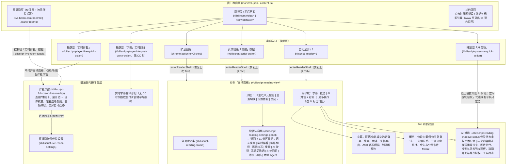

# BiliScript 信息架构与用户流程全景（UX Audit Roadmap）

本文档记录 BiliScript 当前的全局信息架构（IA）、五大核心用户流程、UX 走查收官状态（Session 1–4 已完成，M2 深度复审 P0/P1 已修复、P2/P3 已归入 [UX_AUDIT_BACKLOG.md](UX_AUDIT_BACKLOG.md)，Session 5 放弃）及已落地的核心产品裁定。

---

## 一、全局路由与信息架构全景图

BiliScript 无独立 Popup 或 Options 页面，直接注入 B 站宿主页运行，覆盖 **2 类宿主页面**、**多类唤起入口** 与 **文摘面板 / 播放器浮窗双主容器**。

---

## 二、五大核心模块现状

### M1：唤起、壳层导航与生命周期
* **入口语义对齐**：扩展图标（[`background.ts`](../extension/entry/background.ts)）、页内「文摘」按钮（[`script-button.ts`](../extension/ui/script-button.ts)）、`autoOpenReader` 与 `?biliscript_reader=1` 只负责幂等打开/聚焦文摘面板并恢复上次 Tab；播放器「AI 分析」（[`player-ai.ts`](../extension/ai/player-ai.ts)）不再破坏既有会话；非支持页点击扩展图标由 [`unsupported-page-feedback.ts`](../extension/entry/unsupported-page-feedback.ts) 提供 `tab` 级 `!` 徽标与标题引导，`www.bilibili.com` 额外注入 6 秒顶部提示。
* **壳层与几何**：[`shell.ts`](../extension/reader/shell.ts) 统一进入/退出事务；[`script-host.ts`](../extension/reader/script-host.ts) 按右栏锚点 → 播放器右侧降级 → 居中浮层自适应，并在用户显式调节宽度后在三种形态下均生效。
* **设置内容模式**：点击顶栏齿轮后，[`ui-renderer.ts`](../extension/ui/ui-renderer.ts) 保留并轻微灰化顶栏，设置内容区左上角提供独立「← 返回」（[`settings-panel-html.ts`](../extension/ui/settings-panel-html.ts)），点击返回、再次点齿轮、点击灰化顶栏非按钮区、按 `Esc` 或点击面板外均只退出设置并按规则归还焦点；全局 `×` 仍关闭整个文摘面板。

### M2：首配冷启动与四族平台管理
* **一次性「设置并继续」**：概览、AI 对话、解释卡与 ASR 转写遇到无平台/缺 Key 阻断时，经各自内存级 resume 意图直达对应编辑器（无记录直接新建，缺 Key 精确编辑并聚焦 Key），保存后自动退出设置并续跑原任务；AI 对话仅恢复草稿与附件并提示确认发送，不自动触发付费请求。
* **四族激活与搜索降密**：[`settings-panel.ts`](../extension/ui/settings-panel.ts) 区分 AI 模型默认摘要与对话精确选择；实时伴看与语音转写使用「使用 / 使用中」单选激活；搜索区按「智能搜索（有序回退）/ 仅单平台（失败不回退）」切换折叠摘要与控件显隐，拖拽排序与付费开关仅在智能模式展示。
* **跨族凭据引用与编辑器降层**：Gemini Live 与 DeepSeek 搜索经 [`ai-credential-link.ts`](../extension/ui/ai-credential-link.ts) 同层往返官方 AI 平台编辑器并保留消费草稿；「获取可用模型」（[`provider-editor-fetch-dialog.ts`](../extension/ui/provider-editor-fetch-dialog.ts)）内联为编辑器子视图，并用会话级 `Set` 保留过滤前勾选；[`provider-editor-modal.ts`](../extension/ui/provider-editor-modal.ts) 补齐表单字段校验、焦点圈禁、`inert` 与权限手势链提示。
* **M2 深度复审（P0/P1 已修复并验证，P2/P3 已归入 [UX_AUDIT_BACKLOG.md](UX_AUDIT_BACKLOG.md)）**：
  * **冷启动与首配闭环**：对话模型选择器（[`model-picker.ts`](../extension/ui/model-picker.ts)）补齐空态闭环与 `models: []` 导回编辑；首配模型编辑器增加空模型行校验（[`provider-editor-validation.ts`](../extension/ui/provider-editor-validation.ts)）；ASR 缺配/无 Key 实现一次配置闭环（[`asr-setup.ts`](../extension/asr/asr-setup.ts)）。
  * **编辑器遮罩、并发与样式隔离**：内联子视图与弹窗补齐 `inert` 隔离与 Flyme 实底防透字（[`provider-editor-modal.ts`](../extension/ui/provider-editor-modal.ts)、[`provider-editor-fetch-dialog.ts`](../extension/ui/provider-editor-fetch-dialog.ts)）；异步操作补齐并发与防重入锁；错误语义色统一 `--biliscript-reader-danger` 并收窄 `:user-valid` 作用域。
  * **四族交互、排序与跨族凭据一致**：行内删除/单选/排序防吞错与搜索激活 ID 清理；搜索拖拽补齐键盘排序（[`provider-row-drag.ts`](../extension/ui/provider-row-drag.ts)）；动态跨族凭据引用与跨族恢复提示改用内置 Modal 且关闭不回抢焦点（[`ai-credential-link.ts`](../extension/ui/ai-credential-link.ts)）；AI 设为默认与对话侧文案保持一致。
  * **遗留改进项**：本轮 M2 深度复审产出的 P2（8 项）/ P3（4 项）已归入 [UX_AUDIT_BACKLOG.md](UX_AUDIT_BACKLOG.md)，作后续按需参考。

### M3：字幕精读、双语对照与即席解释
* 抓取 B 站 CC 字幕或通过 [`transcribe-banner.ts`](../extension/reader/transcribe-banner.ts) 触发 ASR 转写；无 CC 视频的播放器「字幕」入口还支持实时字幕翻译。
* [`subtitle-tab-ui.ts`](../extension/reader/subtitle-tab-ui.ts) 提供主/副双语选轨专用弹层（真副轨及伪轨译文副轨）、句内搜索、自动跟随、一键复制与多格式导出。
* 划词弹出「解释」气泡 → [`explain-card.ts`](../extension/reader/explain-card.ts) 流式释义 →「去对话追问」写入待解释意图并切至 `AI 对话`。

### M4：AI 概览与金句分享
* [`overview-ui.ts`](../extension/reader/overview-ui.ts) 支持自动/手动生成概览、长视频分段进度与部分失败重试、三源分章跳播与随播放高亮，以及 [`quote-share-modal.ts`](../extension/reader/quote-share-modal.ts) 金句海报导出。

### M5：AI 对话与双端实时伴看
* **会话管理与偏好同源**：标签行右侧保留 `⋮` 菜单收纳「开启新会话」「历史对话」「对话行高 / 段落间距 / 对话朗读音量」及「更多显示设置」深链；新建会话对草稿、图片与在途回合做合并确认；[`chat-popovers.ts`](../extension/reader/chat-popovers.ts) 将历史对话作为 `hidden` 单源驱动的内容模式（定位当前项、流式切换等待 `settleTurn()` 落定、单条删除 6 秒撤销）；7 项排版与音频偏好在设置抽屉与场景面板/浮窗间同源持久化、重置与同步。
* **输入、模型与工具闭环**：[`send-gate.ts`](../extension/chat/send-gate.ts) 在字幕/转写等待期展示输入卡上方可取消等待卡，并按快照保护等待期间新输入的草稿与图片；[`chat-model-panel.ts`](../extension/reader/chat-model-panel.ts) 切模型后保持面板打开并同屏刷新思考强度与 clamp 说明；[`opt-in-notice.ts`](../extension/search/opt-in-notice.ts) 在确认框拒绝后关闭 `webSearchEnabled` 并无搜索继续，视图销毁走 `view-destroyed` 中止本回合；[`chat-stream-render.ts`](../extension/chat/chat-stream-render.ts) 为联网搜索与历史视频帧（[`tool-loop.ts`](../extension/ai/tool-loop.ts) `capture_video_frame_at_time`）提供进行中与统一终态，停止态支持复制/朗读/导出，截断支持继续生成，重新生成校验原视频上下文。
* **独立伴看生命周期**：视频页由 [`live-companion-session.ts`](../extension/live/live-companion-session.ts) 持有伴看会话，关闭文摘面板仅终止文本流与发送闸、保留伴看连接与浮窗；AI 对话内置稳定状态条 `#biliscript-reading-chat-live-status`（[`chat-live-status.ts`](../extension/reader/chat-live-status.ts)）与独立只读「伴看记录」历史；播放器伴看浮窗（[`fullscreen-live-overlay.ts`](../extension/live/fullscreen-live-overlay.ts)）内聚连接卡、常驻错误卡、左右边缘吸附与全屏迁移；直播间（[`live-room-entry.ts`](../extension/live/live-room-entry.ts)）通过 [`live-room-settings.ts`](../extension/live/live-room-settings.ts) 提供按需 `<dialog>` 伴看设置闭环。

---

## 三、UX 走查执行总览与核心裁定

### 3.1 走查场次状态

| 优先级 | 场次与目标模块 | 状态 | 说明 |
| :--- | :--- | :--- | :--- |
| **P0** | **Session 1**：M5 & M1 跨端实时伴看闭环与生命周期解耦 | ✅ 已完成 | 独立伴看会话、播放器原位错误卡、直播间按需设置、伴看文本模型记录与浮窗微交互已落地 |
| **P0** | **Session 2**：M1 文摘面板壳层导航与唤起一致性 | ✅ 已完成 | 设置内容模式与「← 返回」、播放器「AI 分析」非破坏续发、非支持页反馈与宽度全形态生效已落地 |
| **P1** | **Session 3**：M2 首配冷启动、四族平台与凭据引用 | ✅ 已完成 | 四入口「设置并继续」、四族激活与搜索降密、跨族同层凭据往返、内联拉取子视图与校验焦点已落地 |
| **P1** | **Session 4**：M5 AI 对话高频交互、模型面板与工具反馈 | ✅ 已完成 | 保留 `⋮` 菜单收口并保留历史内容模式、7 项偏好归拢、发送闸快照保护、模型同屏联动与工具/消息终态已落地 |
| **P0/P1** | **M2 深度复审**：首配冷启动、编辑器隔离与四族交互细节 | ✅ P0/P1 已修复（P2/P3 已归入 [UX_AUDIT_BACKLOG.md](UX_AUDIT_BACKLOG.md)） | 对话模型选择器空态闭环与 `models: []` 导回编辑、首配空模型行校验、内联子视图/弹窗 `inert` 隔离与 Flyme 实底防透字、异步并发与防重入锁、错误语义色 `--biliscript-reader-danger` 与 `:user-valid` 作用域收窄、行内删除/单选/排序防吞错与搜索激活 ID 清理、动态跨族凭据引用、AI 设为默认与对话文案一致、搜索拖拽键盘排序、ASR 一次闭环、跨族恢复提示内置 Modal 与焦点不回抢已落地并通过构建验证；P2/P3 已归入 [UX_AUDIT_BACKLOG.md](UX_AUDIT_BACKLOG.md) |
| **P2** | **Session 5**：M3 & M4 字幕精读与概览金句深度走查 | ⏹️ 不实施 | P2 优先级，本轮走查不再推进 |

### 3.2 已落地的核心产品决策

1. **双生命周期解耦**：关闭文摘面板终止在途文本流、取消发送闸并停止朗读，但不销毁实时伴看连接与浮窗；切 P / 切视频保留伴看传输与麦克风并清理旧轮次和委派任务；显式挂断才销毁伴看连接。
2. **直播间轻量闭环**：直播间不加载阅读壳，配置通过按需伴看设置 `<dialog>` 就地完成；视频页伴看由播放器浮窗主承载，AI 对话顶部状态条同步展示状态与文本模型委托记录。
3. **设置与历史均为内容模式**：设置接管内容区并保留灰化顶栏，内部提供「← 返回」，`Esc` 与外点一次只结算最上层叠层；历史对话同为 `hidden` 单源投影的内容模式，退出回原触发焦点，选中后回输入框。
4. **入口非破坏与非支持页反馈**：播放器「AI 分析」在空闲会话直发/续发，在忙态或存在草稿/附件时只定位并提示；非支持页统一显示扩展图标 `!` 徽标与标题引导，`www.bilibili.com` 另出 6 秒页内提示。
5. **对话动作入口收口**：经最终裁定，对话标签行保留 `⋮` 单一触发键收纳「开启新会话」「历史对话」「对话排版与朗读」与「更多显示设置」，不拆为多枚一级图标键，优先保住面板横宽与视觉简洁度。
6. **首配单次内存意图**：概览 / 解释 / ASR 配置完成后自动退出设置并续跑一次，对话仅恢复草稿并交由用户确认发送；意图只存页面内存，换片、取消或关闭即作废。
7. **四族与凭据边界**：搜索保留智能有序回退与单平台无回退两态，对用户隐藏实现术语；Gemini Live 与 DeepSeek 搜索的 Key 只读引用官方 AI 记录，同层编辑器往返不增新遮罩，拉取模型收为编辑器内子视图。
8. **偏好同源与任务保护**：7 项对话排版及音频偏好以设置抽屉为完整权威入口，场景内保持同源同步；发送闸等待期间的草稿与图片增量不随原回合清空；联网搜索首次授权拒绝即关闭 `webSearchEnabled` 开关；搜索与 `capture_video_frame_at_time` 共用 `tool-status` 且保证全终态闭环。

### 3.3 遗留 Backlog

M1 三路审查产出的低优先级条目（P2/P3）记录于 [UX_AUDIT_BACKLOG.md](UX_AUDIT_BACKLOG.md)，与 Session 5 同作后续按需参考，不列入当前实施排期。

M2 深度复审产出的 P2（8 项）/ P3（4 项）已归入 [UX_AUDIT_BACKLOG.md](UX_AUDIT_BACKLOG.md)，作后续按需参考，不列入当前实施排期。
