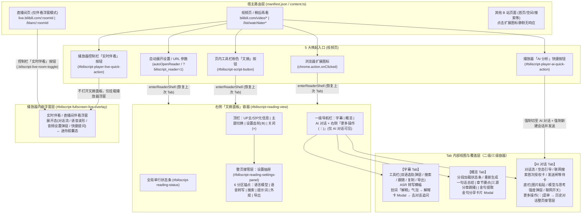

# BiliScript 信息架构与用户流程宏观走查（UX Audit Roadmap）

本文档聚焦 **【信息架构（Information Architecture）】** 与 **【用户流程（User Flows）】** 两个宏观维度，以真实用户的认知负担、寻路直觉与链路完整性为标尺，对当前版本进行全局拆解、问题诊断与后续分会话走查排期。

---

## 一、全局路由与信息架构全景图

BiliScript 是无独立 Popup 页面、直接注入 B 站宿主页的浏览器扩展。其全局信息架构横跨 **2 类宿主页面上下文**、**5 类唤起入口** 与 **4 层容器嵌套结构**。

---

## 二、核心链路拆解（5 大核心体验模块 / 子流程）

按真实用户使用场景与心智阶段，将产品拆分为 **5 个独立的“核心体验模块/子流程”**，作为后续分会话深度走查的单元：

### 模块 M1：唤起、寻路与文摘面板生命周期（Entry, Navigation & Shell Lifecycle）
* **用户场景**：用户在不同 B 站页面发现并使用扩展，打开/关闭右侧文摘面板，在三栏 Tab 与设置抽屉之间切换，或在非标布局/全屏下浏览。
* **核心链路**：
  1. **多入口唤起**：扩展图标 [`background.ts`](file:///d:/src/BiliScript/extension/entry/background.ts#L168-L176)、视频下方工具栏粉色「文摘」按钮 [`script-button.ts`](file:///d:/src/BiliScript/extension/ui/script-button.ts#L50-L79)、播放器内快捷按钮 [`player-ai.ts`](file:///d:/src/BiliScript/extension/ai/player-ai.ts#L140-L185)、自动展开与 `?biliscript_reader=1` [`content.ts`](file:///d:/src/BiliScript/extension/entry/content.ts#L1393-L1443)。
  2. **面板挂载与布局自适应**：贴合右栏（`docked`）与浮层降级（`floating`）[`shell.ts`](file:///d:/src/BiliScript/extension/reader/shell.ts#L100-L180)、拖拽调宽、明暗主题同步。
  3. **一级导航与整页接管切换**：`字幕` / `概览` / `AI 对话` 三栏切换与跨视频 Tab 记忆 [`script-tab-activation.ts`](file:///d:/src/BiliScript/extension/reader/script-tab-activation.ts#L1-L90)；顶栏设置齿轮开启「设置抽屉」整页接管与返回 [`settings-panel.ts`](file:///d:/src/BiliScript/extension/ui/settings-panel.ts#L60-L150)。
  4. **切 P / SPA 切视频与关闭面板回收**：同页切视频重置上下文 [`content.ts`](file:///d:/src/BiliScript/extension/entry/content.ts#L1180-L1260)、关闭面板时的流式请求与伴看状态回收 [`content.ts`](file:///d:/src/BiliScript/extension/entry/content.ts#L655-L685)。

### 模块 M2：首次配置与四族平台管理（Onboarding & Multi-Family Provider Setup）
* **用户场景**：新用户首次打开扩展配置 API Key，或进阶用户配置多模型平台、语音转写、实时伴看与联网搜索回退链。
* **核心链路**：
  1. **未配置冷启动引导**：在概览/对话/转写/伴看触发未配置拦截 → 点击「前往设置」跳入设置抽屉对应锚点 [`chat-notices.ts`](file:///d:/src/BiliScript/extension/reader/chat-notices.ts#L50-L120)。
  2. **四族平台差异化管理**：设置抽屉 6 分区导航 [`settings-panel-html.ts`](file:///d:/src/BiliScript/extension/ui/settings-panel-html.ts#L120-L260) 下的 `AI 模型平台`（多选启用+目录勾选）、`实时伴看平台`（单选激活）、`语音转写平台`（单选激活）、`搜索平台`（智能模式回退链拖拽排序 vs 单平台指定 + 付费开关）。
  3. **单平台编辑 Modal 闭环**：预设模板选择、协议切换（`OpenAI` / `Anthropic` / `Gemini`）、API Key 填写、动态域名权限申请（`chrome.permissions.request`）、远端拉取模型目录二级弹窗、连通性测试、删除二次确认弹窗 [`provider-editor-modal.ts`](file:///d:/src/BiliScript/extension/ui/provider-editor-modal.ts#L1-L220)。
  4. **跨族「凭据引用」配置**：`Gemini Live` 与 `DeepSeek Search` 复用已启用 AI 模型平台 Key 的跨列表依赖链路 [`provider-editor-modal.ts`](file:///d:/src/BiliScript/extension/ui/provider-editor-modal.ts#L430-L510)。

### 模块 M3：字幕精读、双语对照与即席解释（Subtitle Reading, Bilingual & Inline Explain）
* **用户场景**：用户边看视频边浏览时间轴字幕、切换双语字幕、搜索台词定位进度、对无字幕视频发起语音转写，或划词解释陌生概念并追问。
* **核心链路**：
  1. **字幕获取与无字幕 ASR 兜底**：B 站原生字幕抓取 → 无字幕空态展示 ASR「语音转写」横幅（自动转写开关、进度与取消、失败重试）[`transcribe-banner.ts`](file:///d:/src/BiliScript/extension/reader/transcribe-banner.ts#L1-L160)。
  2. **主副双语选轨弹层**：主轨/副轨双列联动选择、双语对照开关、无副轨引导态 [`subtitle-tab-ui.ts`](file:///d:/src/BiliScript/extension/reader/subtitle-tab-ui.ts#L180-L360)。
  3. **检索、跟随与导出**：关键字过滤高亮、自动跟随视频播放滚动（手动滚动暂停跟随，点击「跟随」恢复）、点击时间戳跳播、一键复制与多格式（SRT/TXT/JSON/MD）导出。
  4. **划词即席解释 → 对话追问移交**：字幕选中文本弹出「解释」胶囊 [`explain-pop-ui.ts`](file:///d:/src/BiliScript/extension/reader/explain-pop-ui.ts#L1-L120) → 弹出「解释卡」流式生成术语释义与语境说明 [`explain-card.ts`](file:///d:/src/BiliScript/extension/reader/explain-card.ts#L1-L180) → 点击「去对话追问」写入「待解释意图（`PendingExplainIntent`）」并自动切至 `AI 对话` Tab 发起首轮追问。

### 模块 M4：AI 概览生成与金句消费（AI Overview & Quote Share）
* **用户场景**：用户想在几秒内掌握长视频核心内容、按章节跳看重点片段，或提取视频金句生成海报分享。
* **核心链路**：
  1. **概览触发与分段生成反馈**：切换至 `概览` Tab 自动触发（或手动点击生成）→ 等待字幕就绪 → 长视频分段提炼进度展示、取消生成、部分分段失败黄色状态条与「重试失败部分」[`overview-ui.ts`](file:///d:/src/BiliScript/extension/reader/overview-ui.ts#L80-L260)。
  2. **结构化概览阅读与三源分章跳播**：一句话核心总结、按优先级采用（简介/评论时间轴 > B 站官方章节 > AI 生成章节）的章节列表、随播放进度高亮当前章节、点击时间戳跳播。
  3. **金句提取与分享卡片制作**：时间戳回跳、单条复制、点击「分享」打开金句分享卡片 Modal（切换配色方案、背景纹样、字体，复制图片或下载 PNG）[`quote-share-modal.ts`](file:///d:/src/BiliScript/extension/reader/quote-share-modal.ts#L1-L200)。

### 模块 M5：AI 多轮对话与双端实时伴看（AI Chat & Multimodal Live Companion）
* **用户场景**：用户针对视频内容向 AI 深度提问（含发图、让 AI 回看历史画面、联网查证），或在看视频/看直播时开启全双工语音「实时伴看」边看边聊。
* **核心链路**：
  1. **对话输入与「发送闸」拦截**：快捷提示词胶囊启动、自由输入与剪贴板贴图；字幕未就绪时触发「发送闸」挂起消息并展示等待提示（可取消），确定无字幕时拦截回填 [`chat-tab.ts`](file:///d:/src/BiliScript/extension/reader/chat-tab.ts#L600-L760)。
  2. **模型/思考强度切换与联网搜索授权**：底栏模型胶囊弹出模型与思考强度面板（离散档位滑轨）[`chat-model-panel.ts`](file:///d:/src/BiliScript/extension/reader/chat-model-panel.ts#L1-L190)；开启联网开关时首次弹出「联网搜索授权（Opt-in）」内嵌卡片 [`opt-in-notice.ts`](file:///d:/src/BiliScript/extension/search/opt-in-notice.ts#L1-L90)；工具调用状态条（联网检索、抽帧回看历史画面 `inspect_video_frames`）与来源引用渲染。
  3. **会话管理与排版/朗读控制**：顶栏右侧「更多操作 (⋮)」菜单 → 开启新会话、打开「历史对话」整页接管层（恢复/删除会话）、调节对话行高/段距与 TTS 朗读音量 [`chat-popovers.ts`](file:///d:/src/BiliScript/extension/reader/chat-popovers.ts#L1-L180)。
  4. **视频页与直播间「实时伴看」**：点击播放器控制栏「实时伴看」按钮 → 挂载播放器内浮窗 [`fullscreen-live-overlay.ts`](file:///d:/src/BiliScript/extension/live/fullscreen-live-overlay.ts#L1-L260) → 麦克风/视频伴音采集、音频设置弹层（伴看音量/分享视频声音/语音优先）、语音打断、最小化为迷你胶囊态与拖拽吸附。

---

## 三、宏观问题诊断（信息架构 × 用户流程）

### 3.1 信息架构维度（Information Architecture）

#### IA-01 【高危】设置抽屉整页接管缺乏局部返回锚点，极易误触关闭整个文摘面板
* **代码位置**：[`ui-renderer.ts`](file:///d:/src/BiliScript/extension/ui/ui-renderer.ts#L50-L95)、[`settings-panel-html.ts`](file:///d:/src/BiliScript/extension/ui/settings-panel-html.ts#L120-L155)、[`settings-panel.ts`](file:///d:/src/BiliScript/extension/ui/settings-panel.ts#L60-L120)
* **现象与认知负担**：
  * 点击顶栏齿轮 `#biliscript-reading-settings-btn` 后，设置抽屉接管了面板第 3～4 行（隐藏了 `字幕 / 概览 / AI 对话` 导航栏与内容区），但**设置抽屉内部没有任何“← 返回”或“完成/关闭设置”按钮**。
  * 此时面板右上角最显眼的退出符号是紧挨着齿轮的 `×`（`#biliscript-reading-close-btn`）。用户在全屏设置视图下按直觉点击右上角 `×` 想要“关掉设置回到刚才的 Tab”，结果直接**退出了整个文摘面板**（且触发 `closeChatSession` 断开正在进行的流式对话！）。
  * 当前退出设置的路径只有“再次点击高亮的齿轮图标”或“点击 B 站网页空白处”，严重违背浮层/次级页面返回直觉。

#### IA-02 【高危】视频页「实时伴看」入口孤立在播放器控制栏，且报错反馈跨容器分裂
* **代码位置**：[`player-ai.ts`](file:///d:/src/BiliScript/extension/ai/player-ai.ts#L155-L210)、[`content.ts`](file:///d:/src/BiliScript/extension/entry/content.ts#L1055-L1085)、[`live-overlay-binding.ts`](file:///d:/src/BiliScript/extension/live/live-overlay-binding.ts#L45-L120)
* **现象与认知负担**：
  * **入口单向孤立**：在 `AI 对话` Tab 内部没有任何开启「实时伴看」的入口，用户必须把视线移回左侧 B 站播放器底部控制栏（且仅鼠标移入播放器激活控制栏时可见）寻找 `#biliscript-player-live-quick-action`。
  * **盲区报错（严重断点）**：当文摘面板处于**关闭**状态时，用户点击播放器控制栏的「实时伴看」按钮，`handlePlayerLiveQuickActionClick` 仅调用 `ensureUiReady()`（构建隐藏 DOM，**不展开文摘面板**）并执行 `chat.startLiveCompanion()`。若用户尚未配置实时伴看平台或连接失败：
    * 播放器浮窗在 `failure` 状态下执行 `overlay?.hide()` 不显示任何内容；
    * 错误提示与「前往设置」按钮通过 `showConversationContextNotice` 被渲染进了**处于隐藏状态的文摘面板 `#biliscript-reading-chat-messages` 中**！
    * 用户在播放器上点击「实时伴看」后，肉眼看到的是**完全没有任何反应**。

#### IA-03 【中危】「AI 对话」高频核心操作（新建会话 / 历史记录）与低频排版滑块混装藏匿
* **代码位置**：[`ui-renderer.ts`](file:///d:/src/BiliScript/extension/ui/ui-renderer.ts#L75-L95)、[`chat-template.ts`](file:///d:/src/BiliScript/extension/reader/chat-template.ts#L85-L150)、[`chat-popovers.ts`](file:///d:/src/BiliScript/extension/reader/chat-popovers.ts#L30-L120)
* **现象与认知负担**：
  * `开启新会话` 与 `历史对话` 是多轮对话最高频的会话生命周期操作，却被收进了顶栏右侧的 `更多操作 (⋮)` 二级下拉菜单中，每次新建或切换会话均需 2 次点击。
  * 该二级菜单同时塞入了 `对话行高`、`对话段落间距`、`朗读音量` 三个低频偏好滑块，导致“动作触发器（Action）”与“全局偏好设置（Preference）”混杂。
  * 此外，点击菜单中的 `历史对话` 后，`#biliscript-reading-chat-history-popover` 整页覆盖对话区，同时把触发它的 `更多操作 (⋮)` 按钮隐藏（`chat-popovers.ts:72`），用户只能去左上角找 `<` 返回按钮，交互空间跳变剧烈。

#### IA-04 【中危】外观排版与音频设置散落 3 处容器，缺乏统一寻路心智
* **代码位置**：[`settings-panel-html.ts`](file:///d:/src/BiliScript/extension/ui/settings-panel-html.ts#L220-L250)、[`chat-template.ts`](file:///d:/src/BiliScript/extension/reader/chat-template.ts#L105-L145)、[`fullscreen-live-overlay.ts`](file:///d:/src/BiliScript/extension/live/fullscreen-live-overlay.ts#L160-L230)
* **现象与认知负担**：
  * **排版设置一分为二**：`文摘面板字体大小`、`文摘面板宽度` 在「设置抽屉 → 外观与布局」；而 `对话行高`、`对话段落间距` 却只存在于「AI 对话 → 更多操作 (⋮)」，设置抽屉里反而找不到。
  * **音频设置一分为二**：文本对话 TTS 的 `朗读音量` 在「AI 对话 → 更多操作 (⋮)」；而实时伴看的 `伴看音量`、`分享视频声音`、`语音优先` 仅存在于播放器伴看浮窗顶部的「音频设置」小弹窗中，设置抽屉的「实时伴看平台」分区完全没有相关说明或入口。

#### IA-05 【低危】多层弹窗/浮层叠放（Modal-over-Drawer-over-Panel）的层级与退出心智复杂
* **代码位置**：[`provider-editor-modal.ts`](file:///d:/src/BiliScript/extension/ui/provider-editor-modal.ts#L180-L320)、[`confirm-dialog.ts`](file:///d:/src/BiliScript/extension/ui/confirm-dialog.ts#L1-L90)
* **现象与认知负担**：
  * 在 ~400px 宽的侧边文摘面板内，存在高达 **4 层垂直叠放**：`文摘面板` → `设置抽屉` → `平台编辑 Modal (.provider-editor-host)` → `拉取模型二级弹窗 (.provider-editor-fetch-dialog)` 或 `删除确认弹窗 (.biliscript-confirm-backdrop)`。
  * 同时，点击面板外部网页空白处在「设置抽屉打开」时仅关闭设置抽屉，而在「拉取模型弹窗/平台编辑弹窗」中又有各自的遮罩点击与 `Esc` 拦截逻辑，窄视口内多层遮罩叠加容易产生视觉幽闭感。

---

### 3.2 用户流程维度（User Flows）

#### UF-01 【高危】直播间伴看的“无头配置”死胡同（Dead End on `live.bilibili.com`）
* **代码位置**：[`content.ts`](file:///d:/src/BiliScript/extension/entry/content.ts#L45-L62)、[`live-room-entry.ts`](file:///d:/src/BiliScript/extension/live/live-room-entry.ts#L180-L245)、[`background.ts`](file:///d:/src/BiliScript/extension/entry/background.ts#L168-L176)
* **断点机制**：
  * 根据 `ADR-0024`，直播间页（`live.bilibili.com`）采用极简的纯浮窗加载路径：`content.ts` 仅调用 `loadLiveRoom()` 后直接 `return`，**不挂载文摘面板 `#biliscript-reading-view`，也不挂载设置抽屉**；且点击浏览器右上角扩展图标在直播间页被 `isSupportedBilibiliPage` 直接忽略。
  * 当用户在直播间点击播放器控制栏的「实时伴看」按钮时，若尚未配置实时伴看平台（或 API Key 失效），[`live-room-entry.ts`](file:///d:/src/BiliScript/extension/live/live-room-entry.ts#L204-L212) 只会在播放器内弹出一个 4 秒后消失的纯文本提示（如 `"请先在设置中配置实时伴看平台"`）。
  * **死胡同**：当前直播间页面上**没有任何打开「设置」的入口**！用户必须先自己想办法打开一个普通的 B 站视频页（`bilibili.com/video/BV...`），点开文摘面板，进入设置配好实时伴看平台，再切回直播间页面才能使用。

#### UF-02 【高危】四族平台配置与跨族「凭据引用」对首次上手用户认知负荷过重
* **代码位置**：[`settings-panel-html.ts`](file:///d:/src/BiliScript/extension/ui/settings-panel-html.ts#L130-L220)、[`provider-editor-modal.ts`](file:///d:/src/BiliScript/extension/ui/provider-editor-modal.ts#L430-L520)
* **绕路与高认知负荷机制**：
  * **四种完全不同的选择模型**：
    1. `AI 模型平台`：列表项只有 `启用/禁用` 开关，没有“当前使用”单选框——真正选用哪个模型要退出设置、回到 `AI 对话` Tab 底部点模型胶囊。很多新用户在设置里配完 AI 平台后，不知道当前到底哪个模型在生效，也不知道 `概览` 和 `解释` 默认用哪个模型。
    2. `实时伴看平台` & `语音转写平台`：列表项既有 `启用` 开关，又有左侧 radio 单选框决定唯一激活平台。
    3. `搜索平台`：默认折叠在 `
` 下，展开后混合了顶部“智能”单选、列表内单平台单选、拖拽排序手柄、`免 Key / 免费额度 / 付费` 徽章以及底部的“允许消耗付费额度”独立开关（涵盖「零成本组」与「链首平台」概念）。
  * **跨族「凭据引用」折返跑**：当用户想配置 `Gemini Live`（实时伴看）或 `DeepSeek`（联网搜索）时，点开编辑弹窗会发现**没有 API Key 输入框**，只有一句说明要求“复用已启用的官方 Gemini / DeepSeek AI 模型平台（且请求地址必须精确匹配官方域名）”。如果用户还没配 AI 平台，或者 AI 平台填的是第三方中转地址，就会在此处卡住，被迫关掉弹窗去另一个列表折返配置。

#### UF-03 【中危】播放器「AI 分析」快捷按钮带有隐式破坏性副作用（强制新建会话）
* **代码位置**：[`player-ai.ts`](file:///d:/src/BiliScript/extension/ai/player-ai.ts#L140-L154)、[`content.ts`](file:///d:/src/BiliScript/extension/entry/content.ts#L1035-L1054)、[`chat-tab.ts`](file:///d:/src/BiliScript/extension/reader/chat-tab.ts#L868-L885)
* **断点机制**：
  * 用户在视频页有多个看似相近的入口：视频下方粉色「文摘」按钮、浏览器扩展图标、播放器内「AI 分析」按钮。
  * 点击前两者仅打开/聚焦文摘面板并停留在上次激活的 Tab；而点击播放器内的「AI 分析」按钮会调用 `runQuickActionPrompt`，**无条件执行 `await startNewConversation()`** 并立即发送默认提示词。
  * 如果用户正在 `AI 对话` 中进行了一半的多轮探讨（甚至文摘面板本来就是打开的），不小心点了一下播放器上的「AI 分析」按钮，当前对话视图会被立即清空重置为新会话，原会话虽存入历史但没有任何确认提示，打断感极强。

#### UF-04 【中危】关闭文摘面板即强制中断流式生成与视频页实时伴看
* **代码位置**：[`content.ts`](file:///d:/src/BiliScript/extension/entry/content.ts#L655-L685)、[`chat-tab.ts`](file:///d:/src/BiliScript/extension/reader/chat-tab.ts#L887-L905)
* **断点机制**：
  * 用户点击文摘面板右上角 `×`（或再次点击扩展图标收起面板）以恢复宽屏观看视频时，`exitReaderShell` 会调用 `closeReadingView()` → `chat.closeChatSession()`：
    1. 正在生成的 AI 回复流被立即 `abort` 丢弃；
    2. 正在排队等待字幕的「发送闸」意图被直接清空；
    3. 视频页正在运行中的「实时伴看」（`liveController?.dispose()`）被直接挂断销毁！
  * 对比之下，开启实时伴看时并不强制要求打开文摘面板，但**一旦打开过文摘面板再将其关闭，就会顺带杀死播放器里的实时伴看**，前后生命周期逻辑自相矛盾。

#### UF-05 【低危】非视频/非直播 B 站页面点击扩展图标“静默无响应”
* **代码位置**：[`background.ts`](file:///d:/src/BiliScript/extension/entry/background.ts#L168-L176)
* **断点机制**：
  * 当用户在 B 站首页（`www.bilibili.com`）、搜索结果页、UP 主空间或番剧页（`bilibili.com/bangumi/play/*`）点击浏览器工具栏上的 BiliScript 图标时，`if (!tabId || !isSupportedBilibiliPage(tab.url)) return;` 直接静默返回。
  * 用户既打不开设置面板预先配置 API Key，也得不到任何“请在 B 站普通视频页或直播间使用”的轻量反馈，容易误以为扩展崩溃或安装失败。

---

## 四、深度走查排期表（UX Audit Todo Roadmap）

后续我们将按 **模块重要性 × 问题严重度** 分 5 个专场会话逐一深挖（每场聚焦一个模块，输出具体交互改版方案与代码级修复清单）：

| 优先级 | 走查场次与目标模块 | 核心解决的宏观问题 | 会话深度走查 Todo 清单 | 核心涉及代码范围 |
| :--- | :--- | :--- | :--- | :--- |
| **P0** | **Session 1：模块 M5 & M1（跨端实时伴看闭环与入口对齐）** | **UF-01**（直播间无设置死胡同） **IA-02**（视频页伴看盲区报错与单入口） **UF-04**（关面板误杀伴看与流） | - [ ] **打通直播间配置死胡同**：评估在直播间提供轻量设置唤起路径（或扩展 Popup/独立 Options 页/按需挂载设置宿主） - [ ] **修复视频页伴看盲区报错**：面板关闭时点击播放器「实时伴看」若未配置/失败，须在播放器内给出可见反馈或自动展开面板定位至提示/设置 - [ ] **补齐面板内伴看入口与音频设置寻路**：评估在 `AI 对话` 内提供伴看状态感知与开关，解耦“关闭文摘面板”与“销毁播放器伴看会话”的强绑定 | [`live-room-entry.ts`](file:///d:/src/BiliScript/extension/live/live-room-entry.ts) [`live-overlay-binding.ts`](file:///d:/src/BiliScript/extension/live/live-overlay-binding.ts) [`fullscreen-live-overlay.ts`](file:///d:/src/BiliScript/extension/live/fullscreen-live-overlay.ts) [`content.ts`](file:///d:/src/BiliScript/extension/entry/content.ts) |
| **P0** | **Session 2：模块 M1（文摘面板壳层导航与唤起一致性）** | **IA-01**（设置抽屉无返回按钮易误关面板） **UF-03**（播放器 AI 按钮强制重置会话） **UF-05**（非支持页点击扩展图标静默无响应） | - [ ] **重构设置抽屉顶栏导航**：为设置抽屉增加明确的「← 返回」出口，消除误触右上角 `×` 关闭整个文摘面板的陷阱 - [ ] **收敛 5 大入口行为预期**：消除播放器「AI 分析」按钮在已有活跃会话时的静默清空副作用（增加保护或复用判断） - [ ] **补齐非视频页点击扩展图标反馈**：评估在非视频页点击扩展图标时的引导提示或独立设置入口 | [`ui-renderer.ts`](file:///d:/src/BiliScript/extension/ui/ui-renderer.ts) [`settings-panel.ts`](file:///d:/src/BiliScript/extension/ui/settings-panel.ts) [`player-ai.ts`](file:///d:/src/BiliScript/extension/ai/player-ai.ts) [`background.ts`](file:///d:/src/BiliScript/extension/entry/background.ts) |
| **P1** | **Session 3：模块 M2（首次配置冷启动与四族平台减负）** | **UF-02**（四族平台配置模型割裂与「凭据引用」折返跑） **IA-05**（4 层弹窗叠放负担） | - [ ] **走查新用户 0→1 首配路径**：从空状态拦截卡片点击「前往设置」到完成首个 AI 模型可用性的最短路径优化 - [ ] **统一四族平台选择与激活反馈**：明确 AI 模型平台在 `概览`/`解释`/`对话` 中的默认生效指示，降低跨列表认知差 - [ ] **消除「凭据引用」折返跑**：当用户在 `Gemini Live` / `DeepSeek Search` 遇到未配置主 AI 平台或域名不匹配时，提供一键跳转创建或内联配置引导 - [ ] **审视搜索回退链（「零成本组」/「链首平台」）与多层 Modal 交互细节** | [`settings-panel-html.ts`](file:///d:/src/BiliScript/extension/ui/settings-panel-html.ts) [`provider-editor-modal.ts`](file:///d:/src/BiliScript/extension/ui/provider-editor-modal.ts) [`chat-notices.ts`](file:///d:/src/BiliScript/extension/reader/chat-notices.ts) |
| **P1** | **Session 4：模块 M5（AI 对话高频交互、模型面板与工具反馈）** | **IA-03**（新建/历史会话藏匿于更多菜单） **IA-04**（排版与音频设置散落 3 处） | - [ ] **提升高频会话操作可见性**：重新审视 `开启新会话` 与 `历史对话` 的层级位置，将其与低频排版滑块解耦 - [ ] **优化「历史对话」整页接管体验**：解决打开历史记录后顶栏触发按钮消失、进出动画与返回心智割裂问题 - [ ] **归拢排版与音频偏好设置**：梳理设置抽屉「外观与布局」与对话内快捷调节的职责边界 - [ ] **走查「发送闸」、模型与思考强度面板、联网搜索首次授权卡（Opt-in）与历史视频帧工具状态反馈** | [`chat-template.ts`](file:///d:/src/BiliScript/extension/reader/chat-template.ts) [`chat-tab.ts`](file:///d:/src/BiliScript/extension/reader/chat-tab.ts) [`chat-popovers.ts`](file:///d:/src/BiliScript/extension/reader/chat-popovers.ts) [`chat-model-panel.ts`](file:///d:/src/BiliScript/extension/reader/chat-model-panel.ts) |
| **P2** | **Session 5：模块 M3 & M4（字幕精读、双语选轨、即席解释与概览金句）** | 跨 Tab「待解释意图」移交体验、双语选轨六态心智、概览分段失败重试体验 | - [ ] **走查主副双语选轨专用弹层**：验证单轨/多轨/双语开启/无副轨六种状态下的选项禁用与文案引导清晰度 - [ ] **走查无字幕 ASR 语音转写横幅全状态机**：未配置/待转写/自动转写/转写中取消/失败重试的视觉反馈 - [ ] **走查划词「解释」→ 解释卡 →「去对话追问」跨 Tab 移交**：验证从 `字幕` 切至 `AI 对话` 时的上下文衔接感与回退路径（想要回到刚才读到的字幕行是否顺畅） - [ ] **走查概览三源分章、分段部分失败重试与金句分享卡片 Modal** | [`subtitle-tab-ui.ts`](file:///d:/src/BiliScript/extension/reader/subtitle-tab-ui.ts) [`transcribe-banner.ts`](file:///d:/src/BiliScript/extension/reader/transcribe-banner.ts) [`explain-card.ts`](file:///d:/src/BiliScript/extension/reader/explain-card.ts) [`overview-ui.ts`](file:///d:/src/BiliScript/extension/reader/overview-ui.ts) [`quote-share-modal.ts`](file:///d:/src/BiliScript/extension/reader/quote-share-modal.ts) |
