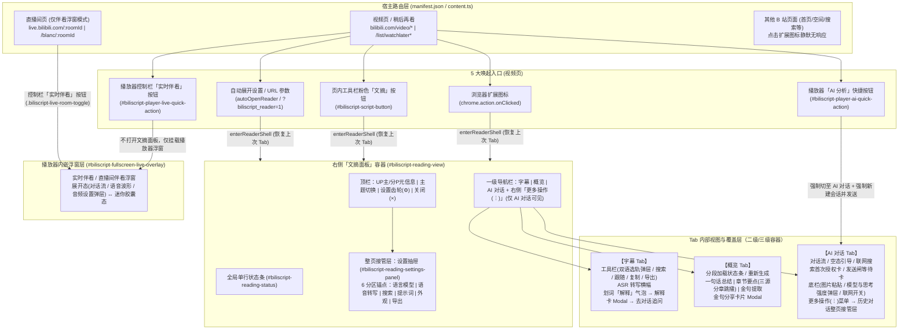
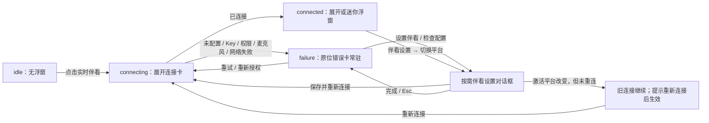

# BiliScript 信息架构与用户流程宏观走查（UX Audit Roadmap）

本文档聚焦 **【信息架构（Information Architecture）】** 与 **【用户流程（User Flows）】** 两个宏观维度，以真实用户的认知负担、寻路直觉与链路完整性为标尺，对当前版本进行全局拆解、问题诊断与后续分会话走查排期。

---

## 一、全局路由与信息架构全景图

BiliScript 是无独立 Popup 页面、直接注入 B 站宿主页的浏览器扩展。其全局信息架构横跨 **2 类宿主页面上下文**、**5 类唤起入口** 与 **4 层容器嵌套结构**。



---

## 二、核心链路拆解（5 大核心体验模块 / 子流程）

按真实用户使用场景与心智阶段，将产品拆分为 **5 个独立的“核心体验模块/子流程”**，作为后续分会话深度走查的单元：

### 模块 M1：唤起、寻路与文摘面板生命周期（Entry, Navigation & Shell Lifecycle）
* **用户场景**：用户在不同 B 站页面发现并使用扩展，打开/关闭右侧文摘面板，在三栏 Tab 与设置抽屉之间切换，或在非标布局/全屏下浏览。
* **核心链路**：
  1. **多入口唤起**：扩展图标 [`background.ts`](file:///d:/src/BiliScript/extension/entry/background.ts#L168-L176)、视频下方工具栏粉色「文摘」按钮 [`script-button.ts`](file:///d:/src/BiliScript/extension/ui/script-button.ts#L50-L79)、播放器内快捷按钮 [`player-ai.ts`](file:///d:/src/BiliScript/extension/ai/player-ai.ts#L140-L185)、自动展开与 `?biliscript_reader=1` [`content.ts`](file:///d:/src/BiliScript/extension/entry/content.ts#L1393-L1443)。
  2. **面板挂载与布局自适应**：贴合右栏（`docked`）与浮层降级（`floating`）[`shell.ts`](file:///d:/src/BiliScript/extension/reader/shell.ts#L100-L180)、拖拽调宽、明暗主题同步。
  3. **一级导航与整页接管切换**：`字幕` / `概览` / `AI 对话` 三栏切换与跨视频 Tab 记忆 [`script-tab-activation.ts`](file:///d:/src/BiliScript/extension/reader/script-tab-activation.ts#L1-L90)；顶栏设置齿轮开启「设置抽屉」整页接管与返回 [`settings-panel.ts`](file:///d:/src/BiliScript/extension/ui/settings-panel.ts#L60-L150)。
  4. **切 P / SPA 切视频与关闭面板回收**：同页切视频重置上下文 [`content.ts`](file:///d:/src/BiliScript/extension/entry/content.ts#L1180-L1260)、关闭面板时的流式请求与伴看状态回收 [`content.ts`](file:///d:/src/BiliScript/extension/entry/content.ts#L655-L685)。

### 模块 M2：首次配置与四族平台管理（Onboarding & Multi-Family Provider Setup）
* **用户场景**：新用户首次打开扩展配置 API Key，或进阶用户配置多模型平台、语音转写、实时伴看与联网搜索回退链。
* **核心链路**：
  1. **未配置冷启动引导**：在概览/对话/转写/伴看触发未配置拦截 → 点击「前往设置」跳入设置抽屉对应锚点 [`chat-notices.ts`](file:///d:/src/BiliScript/extension/reader/chat-notices.ts#L50-L120)。
  2. **四族平台差异化管理**：设置抽屉 6 分区导航 [`settings-panel-html.ts`](file:///d:/src/BiliScript/extension/ui/settings-panel-html.ts#L120-L260) 下的 `AI 模型平台`（多选启用+目录勾选）、`实时伴看平台`（单选激活）、`语音转写平台`（单选激活）、`搜索平台`（智能模式回退链拖拽排序 vs 单平台指定 + 付费开关）。
  3. **单平台编辑 Modal 闭环**：预设模板选择、协议切换（`OpenAI` / `Anthropic` / `Gemini`）、API Key 填写、动态域名权限申请（`chrome.permissions.request`）、远端拉取模型目录二级弹窗、连通性测试、删除二次确认弹窗 [`provider-editor-modal.ts`](file:///d:/src/BiliScript/extension/ui/provider-editor-modal.ts#L1-L220)。
  4. **跨族「凭据引用」配置**：`Gemini Live` 与 `DeepSeek Search` 复用已启用 AI 模型平台 Key 的跨列表依赖链路 [`provider-editor-modal.ts`](file:///d:/src/BiliScript/extension/ui/provider-editor-modal.ts#L430-L510)。

### 模块 M3：字幕精读、双语对照与即席解释（Subtitle Reading, Bilingual & Inline Explain）
* **用户场景**：用户边看视频边浏览时间轴字幕、切换双语字幕、搜索台词定位进度、对无字幕视频发起语音转写，或划词解释陌生概念并追问。
* **核心链路**：
  1. **字幕获取与无字幕 ASR 兜底**：B 站原生字幕抓取 → 无字幕空态展示 ASR「语音转写」横幅（自动转写开关、进度与取消、失败重试）[`transcribe-banner.ts`](file:///d:/src/BiliScript/extension/reader/transcribe-banner.ts#L1-L160)。
  2. **主副双语选轨弹层**：主轨/副轨双列联动选择、双语对照开关、无副轨引导态 [`subtitle-tab-ui.ts`](file:///d:/src/BiliScript/extension/reader/subtitle-tab-ui.ts#L180-L360)。
  3. **检索、跟随与导出**：关键字过滤高亮、自动跟随视频播放滚动（手动滚动暂停跟随，点击「跟随」恢复）、点击时间戳跳播、一键复制与多格式（SRT/TXT/JSON/MD）导出。
  4. **划词即席解释 → 对话追问移交**：字幕选中文本弹出「解释」胶囊 [`explain-pop-ui.ts`](file:///d:/src/BiliScript/extension/reader/explain-pop-ui.ts#L1-L120) → 弹出「解释卡」流式生成术语释义与语境说明 [`explain-card.ts`](file:///d:/src/BiliScript/extension/reader/explain-card.ts#L1-L180) → 点击「去对话追问」写入「待解释意图（`PendingExplainIntent`）」并自动切至 `AI 对话` Tab 发起首轮追问。

### 模块 M4：AI 概览生成与金句消费（AI Overview & Quote Share）
* **用户场景**：用户想在几秒内掌握长视频核心内容、按章节跳看重点片段，或提取视频金句生成海报分享。
* **核心链路**：
  1. **概览触发与分段生成反馈**：切换至 `概览` Tab 自动触发（或手动点击生成）→ 等待字幕就绪 → 长视频分段提炼进度展示、取消生成、部分分段失败黄色状态条与「重试失败部分」[`overview-ui.ts`](file:///d:/src/BiliScript/extension/reader/overview-ui.ts#L80-L260)。
  2. **结构化概览阅读与三源分章跳播**：一句话核心总结、按优先级采用（简介/评论时间轴 > B 站官方章节 > AI 生成章节）的章节列表、随播放进度高亮当前章节、点击时间戳跳播。
  3. **金句提取与分享卡片制作**：时间戳回跳、单条复制、点击「分享」打开金句分享卡片 Modal（切换配色方案、背景纹样、字体，复制图片或下载 PNG）[`quote-share-modal.ts`](file:///d:/src/BiliScript/extension/reader/quote-share-modal.ts#L1-L200)。

### 模块 M5：AI 多轮对话与双端实时伴看（AI Chat & Multimodal Live Companion）
* **用户场景**：用户针对视频内容向 AI 深度提问（含发图、让 AI 回看历史画面、联网查证），或在看视频/看直播时开启全双工语音「实时伴看」边看边聊。
* **核心链路**：
  1. **对话输入与「发送闸」拦截**：快捷提示词胶囊启动、自由输入与剪贴板贴图；字幕未就绪时触发「发送闸」挂起消息并展示等待提示，确定无字幕时拦截且保留输入与图片 [`chat-tab.ts`](file:///d:/src/BiliScript/extension/reader/chat-tab.ts#L600-L760)。
  2. **模型/思考强度切换与联网搜索授权**：底栏模型胶囊弹出模型与思考强度面板（离散档位滑轨）[`chat-model-panel.ts`](file:///d:/src/BiliScript/extension/reader/chat-model-panel.ts#L1-L190)；开启联网开关后首次发送弹出「联网搜索授权（Opt-in）」确认框 [`opt-in-notice.ts`](file:///d:/src/BiliScript/extension/search/opt-in-notice.ts#L1-L90)；联网检索有工具状态条与来源引用，抽帧回看历史画面（`capture_video_frame_at_time`，工具名定义见 [`tool-loop.ts`](file:///d:/src/BiliScript/extension/ai/tool-loop.ts#L38)）目前没有任何可见状态。
  3. **会话管理与排版/朗读控制**：标签行右侧「更多操作 (⋮)」菜单 → 开启新会话、打开「历史对话」整页接管层（恢复/删除会话）、调节对话行高/段距与 TTS 朗读音量 [`chat-popovers.ts`](file:///d:/src/BiliScript/extension/reader/chat-popovers.ts#L1-L180)。
  4. **视频页与直播间「实时伴看」**：点击播放器控制栏「实时伴看」按钮 → 挂载播放器内浮窗 [`fullscreen-live-overlay.ts`](file:///d:/src/BiliScript/extension/live/fullscreen-live-overlay.ts#L1-L260) → 麦克风/视频伴音采集、音频设置弹层（伴看音量/分享视频声音/语音优先）、语音打断、最小化为迷你胶囊态与拖拽吸附。

---

## 三、宏观问题诊断（信息架构 × 用户流程）

### 3.1 信息架构维度（Information Architecture）

#### IA-01 【高危】设置抽屉整页接管缺乏局部返回锚点，极易误触关闭整个文摘面板
* **代码位置**：[`ui-renderer.ts`](file:///d:/src/BiliScript/extension/ui/ui-renderer.ts#L50-L95)、[`settings-panel-html.ts`](file:///d:/src/BiliScript/extension/ui/settings-panel-html.ts#L120-L155)、[`settings-panel.ts`](file:///d:/src/BiliScript/extension/ui/settings-panel.ts#L60-L120)
* **现象与认知负担**：
  * 点击顶栏齿轮 `#biliscript-reading-settings-btn` 后，设置抽屉接管了面板第 3～4 行（隐藏了 `字幕 / 概览 / AI 对话` 导航栏与内容区），但**设置抽屉内部没有任何“← 返回”或“完成/关闭设置”按钮**。
  * 此时面板右上角最显眼的退出符号是紧挨着齿轮的 `×`（`#biliscript-reading-close-btn`）。用户在全屏设置视图下按直觉点击右上角 `×` 想要“关掉设置回到刚才的 Tab”，结果直接**退出了整个文摘面板**（且触发 `closeChatSession` 断开正在进行的流式对话！）。
  * 当前退出设置的路径只有“再次点击高亮的齿轮图标”或“点击 B 站网页空白处”，严重违背浮层/次级页面返回直觉。

#### IA-02 【高危】视频页「实时伴看」入口孤立在播放器控制栏，且报错反馈跨容器分裂
* **代码位置**：[`player-ai.ts`](file:///d:/src/BiliScript/extension/ai/player-ai.ts#L155-L210)、[`content.ts`](file:///d:/src/BiliScript/extension/entry/content.ts#L1055-L1085)、[`live-overlay-binding.ts`](file:///d:/src/BiliScript/extension/live/live-overlay-binding.ts#L45-L120)
* **现象与认知负担**：
  * **入口单向孤立**：在 `AI 对话` Tab 内部没有任何开启「实时伴看」的入口，用户必须把视线移回左侧 B 站播放器底部控制栏（且仅鼠标移入播放器激活控制栏时可见）寻找 `#biliscript-player-live-quick-action`。
  * **盲区报错（严重断点）**：当文摘面板处于**关闭**状态时，用户点击播放器控制栏的「实时伴看」按钮，`handlePlayerLiveQuickActionClick` 仅调用 `ensureUiReady()`（构建隐藏 DOM，**不展开文摘面板**）并执行 `chat.startLiveCompanion()`。若用户尚未配置实时伴看平台或连接失败：
    * 播放器浮窗在 `failure` 状态下执行 `overlay?.hide()` 不显示任何内容；
    * 错误提示与「前往设置」按钮通过 `showConversationContextNotice` 被渲染进了**处于隐藏状态的文摘面板 `#biliscript-reading-chat-messages` 中**！
    * 用户在播放器上点击「实时伴看」后，肉眼看到的是**完全没有任何反应**。

#### IA-03 【中危】「AI 对话」高频核心操作（新建会话 / 历史记录）与低频排版滑块混装藏匿
* **代码位置**：[`ui-renderer.ts`](file:///d:/src/BiliScript/extension/ui/ui-renderer.ts#L75-L95)、[`chat-template.ts`](file:///d:/src/BiliScript/extension/reader/chat-template.ts#L85-L150)、[`chat-popovers.ts`](file:///d:/src/BiliScript/extension/reader/chat-popovers.ts#L30-L120)
* **现象与认知负担**：
  * `开启新会话` 与 `历史对话` 是多轮对话最高频的会话生命周期操作，却被收进了标签行右侧的 `更多操作 (⋮)` 二级下拉菜单中，每次新建或切换会话均需 2 次点击。
  * 该二级菜单同时塞入了 `对话行高`、`对话段落间距`、`朗读音量` 三个低频偏好滑块，导致“动作触发器（Action）”与“全局偏好设置（Preference）”混杂。
  * 此外，点击菜单中的 `历史对话` 后，`#biliscript-reading-chat-history-popover` 只接管对话内容区，标签行与 `更多操作 (⋮)` 仍然可见。用户既能用左上角 `<` 返回，也能再次从 `⋯` 关闭历史；双入口与多层叠放造成返回心智割裂，而不是“触发按钮消失”。

#### IA-04 【中危】外观排版与音频设置散落 3 处容器，缺乏统一寻路心智
* **代码位置**：[`settings-panel-html.ts`](file:///d:/src/BiliScript/extension/ui/settings-panel-html.ts#L220-L250)、[`chat-template.ts`](file:///d:/src/BiliScript/extension/reader/chat-template.ts#L105-L145)、[`fullscreen-live-overlay.ts`](file:///d:/src/BiliScript/extension/live/fullscreen-live-overlay.ts#L160-L230)
* **现象与认知负担**：
  * **排版设置一分为二**：`文摘面板字体大小`、`文摘面板宽度` 在「设置抽屉 → 外观与布局」；而 `对话行高`、`对话段落间距` 却只存在于「AI 对话 → 更多操作 (⋮)」，设置抽屉里反而找不到。
  * **音频设置一分为二**：文本对话 TTS 的 `朗读音量` 在「AI 对话 → 更多操作 (⋮)」；而实时伴看的 `伴看音量`、`分享视频声音`、`语音优先` 仅存在于播放器伴看浮窗顶部的「音频设置」小弹窗中，设置抽屉的「实时伴看平台」分区完全没有相关说明或入口。

#### IA-05 【低危】多层弹窗/浮层叠放（Modal-over-Drawer-over-Panel）的层级与退出心智复杂
* **代码位置**：[`provider-editor-modal.ts`](file:///d:/src/BiliScript/extension/ui/provider-editor-modal.ts#L180-L320)、[`confirm-dialog.ts`](file:///d:/src/BiliScript/extension/ui/confirm-dialog.ts#L1-L90)
* **现象与认知负担**：
  * 在 ~400px 宽的侧边文摘面板内，存在高达 **4 层垂直叠放**：`文摘面板` → `设置抽屉` → `平台编辑 Modal (.provider-editor-host)` → `拉取模型二级弹窗 (.provider-editor-fetch-dialog)` 或 `删除确认弹窗 (.biliscript-confirm-backdrop)`。
  * 同时，点击面板外部网页空白处在「设置抽屉打开」时仅关闭设置抽屉，而在「拉取模型弹窗/平台编辑弹窗」中又有各自的遮罩点击与 `Esc` 拦截逻辑，窄视口内多层遮罩叠加容易产生视觉幽闭感。

---

### 3.2 用户流程维度（User Flows）

#### UF-01 【高危】直播间伴看的“无头配置”死胡同（Dead End on `live.bilibili.com`）
* **代码位置**：[`content.ts`](file:///d:/src/BiliScript/extension/entry/content.ts#L45-L62)、[`live-room-entry.ts`](file:///d:/src/BiliScript/extension/live/live-room-entry.ts#L180-L245)、[`background.ts`](file:///d:/src/BiliScript/extension/entry/background.ts#L168-L176)
* **断点机制**：
  * 根据 `ADR-0024`，直播间页（`live.bilibili.com`）采用极简的纯浮窗加载路径：`content.ts` 仅调用 `loadLiveRoom()` 后直接 `return`，**不挂载文摘面板 `#biliscript-reading-view`，也不挂载设置抽屉**；且点击浏览器右上角扩展图标在直播间页被 `isSupportedBilibiliPage` 直接忽略。
  * 当用户在直播间点击播放器控制栏的「实时伴看」按钮时，若尚未配置实时伴看平台（或 API Key 失效），[`live-room-entry.ts`](file:///d:/src/BiliScript/extension/live/live-room-entry.ts#L204-L212) 只会在播放器内弹出一个 4 秒后消失的纯文本提示（如 `"请先在设置中配置实时伴看平台"`）。
  * **死胡同**：当前直播间页面上**没有任何打开「设置」的入口**！用户必须先自己想办法打开一个普通的 B 站视频页（`bilibili.com/video/BV...`），点开文摘面板，进入设置配好实时伴看平台，再切回直播间页面才能使用。

#### UF-02 【高危】四族平台配置与跨族「凭据引用」对首次上手用户认知负荷过重
* **代码位置**：[`settings-panel-html.ts`](file:///d:/src/BiliScript/extension/ui/settings-panel-html.ts#L130-L220)、[`provider-editor-modal.ts`](file:///d:/src/BiliScript/extension/ui/provider-editor-modal.ts#L430-L520)
* **绕路与高认知负荷机制**：
  * **四种完全不同的选择模型**：
    1. `AI 模型平台`：列表项只有 `启用/禁用` 开关，没有“当前使用”单选框——真正选用哪个模型要退出设置、回到 `AI 对话` Tab 底部点模型胶囊。很多新用户在设置里配完 AI 平台后，不知道当前到底哪个模型在生效，也不知道 `概览` 和 `解释` 默认用哪个模型。
    2. `实时伴看平台` & `语音转写平台`：列表项既有 `启用` 开关，又有左侧 radio 单选框决定唯一激活平台。
    3. `搜索平台`：默认折叠在 `<details class="search-advanced-fold">` 下，展开后混合了顶部“智能”单选、列表内单平台单选、拖拽排序手柄、`免 Key / 免费额度 / 付费` 徽章以及底部的“允许消耗付费额度”独立开关（涵盖「零成本组」与「链首平台」概念）。
  * **跨族「凭据引用」折返跑**：当用户想配置 `Gemini Live`（实时伴看）或 `DeepSeek`（联网搜索）时，点开编辑弹窗会发现**没有 API Key 输入框**，只有一句说明要求“复用已启用的官方 Gemini / DeepSeek AI 模型平台（且请求地址必须精确匹配官方域名）”。如果用户还没配 AI 平台，或者 AI 平台填的是第三方中转地址，就会在此处卡住，被迫关掉弹窗去另一个列表折返配置。

#### UF-03 【中危】播放器「AI 分析」快捷按钮带有隐式破坏性副作用（强制新建会话）
* **代码位置**：[`player-ai.ts`](file:///d:/src/BiliScript/extension/ai/player-ai.ts#L707-L744)、[`background.ts`](file:///d:/src/BiliScript/extension/entry/background.ts#L221-L289)、[`chat-tab.ts`](file:///d:/src/BiliScript/extension/reader/chat-tab.ts#L896-L912)
* **断点机制**：
  * 用户在视频页有多个看似相近的入口：视频下方粉色「文摘」按钮、浏览器扩展图标、播放器内「AI 分析」按钮。
  * 点击前两者仅打开/聚焦文摘面板并停留在上次激活的 Tab；而点击播放器内的「AI 分析」按钮会调用 `runQuickActionPrompt`，**无条件执行 `await startNewConversation()`** 并尝试自动发送默认提示词（发送仍可能等待或被发送闸拦截）。
  * 如果用户正在 `AI 对话` 中进行了一半的多轮探讨（甚至文摘面板本来就是打开的），不小心点了一下播放器上的「AI 分析」按钮，当前对话视图会被立即清空重置为新会话；在途回合会被直接断流，当前视图与部分内容无法原地保留，也没有任何确认提示。

#### UF-04 【中危】关闭文摘面板即强制中断流式生成与视频页实时伴看
* **代码位置**：[`lifecycle.ts`](file:///d:/src/BiliScript/extension/reader/lifecycle.ts#L493-L543)、[`chat-tab.ts`](file:///d:/src/BiliScript/extension/reader/chat-tab.ts#L860-L889)
* **断点机制**：
  * 用户点击文摘面板右上角 `×` 以恢复宽屏观看视频时，`exitReaderShell` 会调用 `closeReadingView()` → `chat.closeChatSession()`：
    1. 正在生成的 AI 回复流被立即 `abort` 丢弃；
    2. 正在排队等待字幕的「发送闸」意图被直接清空；
    3. 视频页正在运行中的「实时伴看」（`liveController?.dispose()`）被直接挂断销毁！
  * 对比之下，开启实时伴看时并不强制要求打开文摘面板，但**一旦打开过文摘面板再将其关闭，就会顺带杀死播放器里的实时伴看**，前后生命周期逻辑自相矛盾。

#### UF-05 【低危】非视频/非直播 B 站页面点击扩展图标“静默无响应”
* **代码位置**：[`background.ts`](file:///d:/src/BiliScript/extension/entry/background.ts#L632-L643)
* **断点机制**：
  * 当用户在 B 站首页（`www.bilibili.com`）、搜索结果页、UP 主空间或番剧页（`www.bilibili.com/bangumi/play/*`）点击浏览器工具栏上的 BiliScript 图标时，`if (!tabId || !isSupportedBilibiliPage(tab.url)) return;` 直接静默返回。
  * 用户既打不开设置面板预先配置 API Key，也得不到任何“请在 B 站普通视频页或稍后再看页面使用”的轻量反馈，容易误以为扩展崩溃或安装失败。

---

## 四、深度走查排期表（UX Audit Todo Roadmap）

后续我们将按 **模块重要性 × 问题严重度** 分 5 个专场会话逐一深挖（每场聚焦一个模块，输出具体交互改版方案与代码级修复清单）：

| 优先级 | 走查场次与目标模块 | 核心解决的宏观问题 | 会话深度走查 Todo 清单 | 核心涉及代码范围 |
| :--- | :--- | :--- | :--- | :--- |
| **P0** | **Session 1：模块 M5 & M1（跨端实时伴看闭环与入口对齐）** | **UF-01**（直播间无设置死胡同）<br/>**IA-02**（视频页伴看盲区报错与单入口）<br/>**UF-04**（关面板误杀伴看与流） | - [x] **打通直播间配置死胡同**：评估在直播间提供轻量设置唤起路径（或扩展 Popup/独立 Options 页/按需挂载设置宿主）<br/>- [x] **修复视频页伴看盲区报错**：面板关闭时点击播放器「实时伴看」若未配置/失败，须在播放器内给出可见反馈或自动展开面板定位至提示/设置<br/>- [x] **补齐面板内伴看入口与音频设置寻路**：评估在 `AI 对话` 内提供伴看状态感知与开关，解耦“关闭文摘面板”与“销毁播放器伴看会话”的强绑定 | [`live-room-entry.ts`](file:///d:/src/BiliScript/extension/live/live-room-entry.ts)<br/>[`live-overlay-binding.ts`](file:///d:/src/BiliScript/extension/live/live-overlay-binding.ts)<br/>[`fullscreen-live-overlay.ts`](file:///d:/src/BiliScript/extension/live/fullscreen-live-overlay.ts)<br/>[`content.ts`](file:///d:/src/BiliScript/extension/entry/content.ts) |
| **P0** | **Session 2：模块 M1（文摘面板壳层导航与唤起一致性）** | **IA-01**（设置抽屉无返回按钮易误关面板）<br/>**UF-03**（播放器 AI 按钮强制重置会话）<br/>**UF-05**（非支持页点击扩展图标静默无响应） | - [x] **重构设置抽屉顶栏导航**：为设置抽屉增加明确的「← 返回」出口，消除误触右上角 `×` 关闭整个文摘面板的陷阱<br/>- [x] **收敛 5 大入口行为预期**：消除播放器「AI 分析」按钮在已有活跃会话时的静默清空副作用（增加保护或复用判断）<br/>- [x] **补齐非视频页点击扩展图标反馈**：评估在非视频页点击扩展图标时的引导提示或独立设置入口 | [`ui-renderer.ts`](file:///d:/src/BiliScript/extension/ui/ui-renderer.ts)<br/>[`settings-panel.ts`](file:///d:/src/BiliScript/extension/ui/settings-panel.ts)<br/>[`player-ai.ts`](file:///d:/src/BiliScript/extension/ai/player-ai.ts)<br/>[`background.ts`](file:///d:/src/BiliScript/extension/entry/background.ts) |
| **P1** | **Session 3：模块 M2（首次配置冷启动与四族平台减负）** | **UF-02**（四族平台配置模型割裂与「凭据引用」折返跑）<br/>**IA-05**（4 层弹窗叠放负担） | - [ ] **走查新用户 0→1 首配路径**：从空状态拦截卡片点击「前往设置」到完成首个 AI 模型可用性的最短路径优化<br/>- [ ] **统一四族平台选择与激活反馈**：明确 AI 模型平台在 `概览`/`解释`/`对话` 中的默认生效指示，降低跨列表认知差<br/>- [ ] **消除「凭据引用」折返跑**：当用户在 `Gemini Live` / `DeepSeek Search` 遇到未配置主 AI 平台或域名不匹配时，提供一键跳转创建或内联配置引导<br/>- [ ] **审视搜索回退链（「零成本组」/「链首平台」）与多层 Modal 交互细节** | [`settings-panel-html.ts`](file:///d:/src/BiliScript/extension/ui/settings-panel-html.ts)<br/>[`provider-editor-modal.ts`](file:///d:/src/BiliScript/extension/ui/provider-editor-modal.ts)<br/>[`chat-notices.ts`](file:///d:/src/BiliScript/extension/reader/chat-notices.ts) |
| **P1** | **Session 4：模块 M5（AI 对话高频交互、模型面板与工具反馈）** | **IA-03**（新建/历史会话藏匿于更多菜单）<br/>**IA-04**（排版与音频设置散落 3 处） | - [ ] **提升高频会话操作可见性**：将 `开启新会话` 与 `历史对话` 外置，与排版/朗读偏好解耦<br/>- [ ] **优化「历史对话」整页接管体验**：统一双入口、进出动画、焦点归还、当前项定位与删除撤销<br/>- [ ] **归拢排版与音频偏好设置**：设置抽屉承接完整持久偏好，场景内保留同源快捷调节<br/>- [ ] **走查「发送闸」与多模态输入**：保护等待期草稿、在途图片与授权弹层结算<br/>- [ ] **走查模型与工具反馈**：联动模型/思考强度，补齐历史视频帧、来源引用与消息操作终态 | [`chat-template.ts`](file:///d:/src/BiliScript/extension/reader/chat-template.ts)<br/>[`chat-tab.ts`](file:///d:/src/BiliScript/extension/reader/chat-tab.ts)<br/>[`chat-popovers.ts`](file:///d:/src/BiliScript/extension/reader/chat-popovers.ts)<br/>[`chat-model-panel.ts`](file:///d:/src/BiliScript/extension/reader/chat-model-panel.ts)<br/>[`chat-runtime.ts`](file:///d:/src/BiliScript/extension/chat/chat-runtime.ts)<br/>[`chat-stream-render.ts`](file:///d:/src/BiliScript/extension/chat/chat-stream-render.ts)<br/>[`settings-panel-html.ts`](file:///d:/src/BiliScript/extension/ui/settings-panel-html.ts) |
| **P2** | **Session 5：模块 M3 & M4（字幕精读、双语选轨、即席解释与概览金句）** | 跨 Tab「待解释意图」移交体验、双语选轨六态心智、概览分段失败重试体验 | - [ ] **走查主副双语选轨专用弹层**：验证单轨/多轨/双语开启/无副轨六种状态下的选项禁用与文案引导清晰度<br/>- [ ] **走查无字幕 ASR 语音转写横幅全状态机**：未配置/待转写/自动转写/转写中取消/失败重试的视觉反馈<br/>- [ ] **走查划词「解释」→ 解释卡 →「去对话追问」跨 Tab 移交**：验证从 `字幕` 切至 `AI 对话` 时的上下文衔接感与回退路径（想要回到刚才读到的字幕行是否顺畅）<br/>- [ ] **走查概览三源分章、分段部分失败重试与金句分享卡片 Modal** | [`subtitle-tab-ui.ts`](file:///d:/src/BiliScript/extension/reader/subtitle-tab-ui.ts)<br/>[`transcribe-banner.ts`](file:///d:/src/BiliScript/extension/reader/transcribe-banner.ts)<br/>[`explain-card.ts`](file:///d:/src/BiliScript/extension/reader/explain-card.ts)<br/>[`overview-ui.ts`](file:///d:/src/BiliScript/extension/reader/overview-ui.ts)<br/>[`quote-share-modal.ts`](file:///d:/src/BiliScript/extension/reader/quote-share-modal.ts) |

**M1 完成状态（Session 1 / Session 2）**：三路审查完成，无 P0；9 个原 P1 与用户指定的 idle 入口呈现调整均已完成。

- 合并回归：280 个测试文件，3975 通过、11 跳过、0 失败；typecheck/build 通过。最新输入框语音入口相关 reader/chat/live 2028 项测试通过，typecheck/build 通过。
- 真实 Edge 验收：[provider-onboarding-acceptance 40/40](../.scratch/browser-harness/scenarios/provider-onboarding-acceptance/evidence.json)、[live-companion-closure 19/19](../.scratch/browser-harness/scenarios/live-companion-closure/evidence.json)，共 59/59。
- 剩余边界：物理拔麦未测；真实 Edge fake track 合成 `ended` 已验。P2/P3 15 条已记录在 [UX Audit Backlog](UX_AUDIT_BACKLOG.md)，本轮不实施。

Session 1 的详细方案见第五节；执行工单为 `.scratch/tickets/live-companion-closure/issues/01-13`。Session 2 的详细方案见第六节。Session 3 的详细方案见第七节（待审批，未实施）。Session 4 的详细方案见第八节（待审批，未实施）。


---

## 五、Session 1 深度走查方案：跨端实时伴看闭环与生命周期解耦（已裁定）

> 范围：UF-01、IA-02、UF-04 与伴看浮窗微观体验。本节记录交互与实现方案；对应改动已完成，验收状态见第四节。

### 5.1 代码复核结论与设计总原则

当前问题不只是“提示位置不对”，而是三种不同生命周期被当成了一个：

1. **文摘面板可见性**：`closed / entering / open / exiting`，只决定右侧阅读形态是否展示。
2. **AI 文本对话任务**：空闲、发送闸等待、流式生成；由当前视频身份与回合状态约束。
3. **实时伴看会话与浮窗呈现**：连接状态是 `idle / connecting / connected / failure` 加重连标志；呈现状态是展开、迷你、隐藏。连接状态不应由文摘面板是否打开决定。

代码走查确认：

- 视觉呈现其实已经分离：伴看浮窗直接挂载在播放器宿主内，默认迷你态，启动伴看不会打开右侧文摘面板。真正没解耦的是**所有权与启动链**——控制器归 `chat-tab.ts` 所有，启动路径仍先初始化隐藏阅读壳和整个 AI 对话，关闭面板又会反向销毁控制器。
- `live-overlay-binding.ts:152-163` 在任何非连接态都执行 `overlay?.hide()`，包括 `failure`；同时 `onStateChange(state, error)` 的 `error` 没有传进浮窗。这是“失败后肉眼无反应”的直接原因。
- 视频页 `player-ai.ts:680-717` 为启动伴看先构建隐藏阅读壳、初始化整个 AI 对话 Tab；控制器提示则写进 `#biliscript-reading-chat-messages`。面板关闭时，启动错误、权限错误、工具状态都可能不可见。
- 直播间 `live-room-entry.ts:42-51` 只有 4 秒纯文本提示，没有动作；`showNotice` 固定挂播放器宿主，进入浏览器全屏后还可能随原宿主一起不可见。
- 直播间创建控制器后没有执行 `refreshTarget()`，首次权限申请可能仍按默认 MOSS Live 目标发起；而同页切换平台后也没有直播间的设置变更监听。这会破坏“切换伴看平台”的闭环。
- `reader/lifecycle.ts:492-542` 关闭面板会调用 `closeChatSession()`；后者在 `chat-tab.ts:823-853` 同时销毁 Live 控制器、断文本流并取消发送闸。
- 换片语义不能被误写成“当前已经挂断”：`tests/live/live-cross-tab-and-video-switch.test.ts:226-273` 明确要求换片/分 P 保留 Live 连接，并通过 `context_update` 切换上下文。
- 当前浮窗没有快捷提问胶囊；Live 端口协议也没有文本提问 action。当前只有边界钳制，没有拖拽吸附；浮窗也没有自行监听 `fullscreenchange` 来重挂载。

总原则：**错误回到触发它的播放器；设置可以按需出现；收起面板不等于挂断；换内容更新上下文，显式挂断才销毁连接。**

### 5.2 UF-01：直播间按需「伴看设置」，不加载阅读壳

#### 推荐路径

在直播间增加一个**仅由用户动作懒加载的伴看设置对话框**，不引入文摘面板、字幕、概览、文本对话或右栏锚点。它只包含：

- 实时伴看平台单选列表、当前激活状态；
- 添加、编辑、删除平台与连通性测试；
- Gemini Live 所需的官方 Gemini AI 平台凭据引用入口；
- 保存状态与“重新连接”动作。

这符合 ADR-0024 的轻量注入目标，但会改变其“配置入口仍在视频页”的后果；获批实施时应同步修订 ADR-0024 与 `GLOSSARY.md`，明确“无常驻面板，允许按需伴看设置对话框”。

#### 状态流转



设置对话框是独立的界面状态，不把控制器改成一个新的 `configuring` 连接态。已有连接在浏览设置时继续运行；切换激活平台也不静默挂断旧连接。

#### 触发与文案

| 场景 | 主文案 | 主动作 | 次动作 |
| --- | --- | --- | --- |
| 未配置平台 | 还没有配置伴看平台。 | 设置伴看 | 无 |
| 自有 Key 缺失 | 当前伴看平台还没有 API Key。 | 填写 Key | 切换平台 |
| Gemini 凭据引用缺失 | 需要先配置官方 Gemini AI 平台 Key。 | 配置 Gemini Key | 切换平台 |
| Key 被平台拒绝 | 伴看平台拒绝了密钥，请检查 API Key。 | 检查配置 | 重试 |
| 平台域名权限被拒绝 | 需要访问伴看平台域名的权限。 | 重新授权 | 设置伴看 |
| 主动切换平台 | 伴看平台已切换，重新连接后生效。 | 重新连接 | 暂不 |

“配置 Gemini Key”必须能直接打开预置为官方 Gemini 的 AI 平台编辑器；保存后回到伴看设置并刷新凭据状态。只提供 Live 平台编辑器会把这个分支再次变成死胡同。

#### DOM 挂载与复用边界

- 新增 `#biliscript-live-room-settings`，使用原生 `<dialog>`，挂到 `document.fullscreenElement || 当前直播播放器宿主`；不能固定挂 `document.body`。
- 平台编辑器与删除确认框增加可选挂载宿主；直播间里挂到该对话框内部，视频页仍默认挂 `#biliscript-reading-view`。一次 Esc 只关闭最上层。
- 从 `settings-panel.ts` 抽出可复用的 Live 平台列表/事务组件，直播间与视频页共用；不在直播间渲染整套 `buildSettingsHtml()`。
- 对话框打开时把焦点移到标题或首个平台控件；关闭后焦点回到触发按钮。保存失败的草稿保留，不因外点或 Esc 静默丢弃。
- 换房间时结束旧伴看、清空转写并关闭设置对话框；不得把上一房间的“保存并重新连接”意图带入新房间。

### 5.3 IA-02：视频页原位失败反馈 + AI 对话稳定状态条

#### A. 面板关闭时，反馈仍必须在播放器内完成闭环

点击播放器「实时伴看」后立即展开**播放器内的伴看连接卡**，而不是先等初始化或默认只出现迷你胶囊。这里的“展开”不打开文摘面板；现有伴看浮窗本就独立挂载在播放器上，阅读面板保持关闭。需要设置时，才由错误卡的主按钮按需打开阅读设置。

当前只是视觉呈现解耦；控制器仍归 `chat-tab.ts` 所有，面板关闭仍会通过 `closeChatSession()` 销毁它。因此启动链路不应再为了伴看初始化隐藏的 AI 对话，面板关闭也不应再挂断浮窗：

1. `connecting`：显示“正在连接伴看…”与“首次使用需要允许麦克风。”，提供“取消”。
2. `connected`：显示“正在伴看”；首次启动保持展开，之后尊重用户上次选择的迷你态。
3. `failure`：显示常驻错误卡，不再自动 `hide()`；主按钮按错误类型导向重试、授权或设置。
4. `idle`：只有用户取消、显式结束或关闭错误卡后才隐藏浮窗。

视频页“设置伴看 / 检查配置 / 切换平台”的动作为：打开阅读壳 → 展开设置抽屉 → 定位到实时伴看平台锚点。增加 `open-settings` 的 `{ anchor: "live" }` 载荷和实际滚动定位，不能只打开设置首页让用户自行寻找。若错误指向 Gemini 凭据引用，则定位到对应 Gemini 配置编辑器。

所有 Live 启动错误和工具状态统一走播放器反馈层；面板打开时可以由 AI 对话状态条同步连接状态，但不再把唯一反馈写进消息区。`player-ai.ts` 最外层异常也不能只写隐藏的全局阅读状态行。

#### B. AI 对话 Tab 伴看入口与稳定状态反馈

在 `chat-template.ts` 的历史整页之后、待解释卡之前新增 `#biliscript-reading-chat-live`。它是独立区域，**不得放入 `#biliscript-reading-chat-messages`**，否则历史回放、空态清场和上下文重建会把状态条抹掉。

| 连接状态 | 状态条内容 | 操作 |
| --- | --- | --- |
| idle | —（隐藏） | 输入框空草稿主按钮显示麦克风 |
| connecting | 正在连接伴看… | 取消 |
| connected | 正在伴看 | 显示浮窗；结束 |
| reconnecting | 连接中断，正在重连 | 显示浮窗；结束 |
| failure | 伴看未连接 | 重试；设置 |

idle 时顶部伴看状态条隐藏。输入框没有文字且未贴图时，主按钮动态显示麦克风；出现文字或贴图后恢复发送。仅在 idle 点击该麦克风进入启动链。connecting / reconnecting 时输入框主按钮保持 busy 与 disabled，启动链使用单飞守卫防连点；connected / reconnecting / failure 的顶部反馈保持。

“显示浮窗”只恢复浮窗，不重启连接、不停止文本流。显式“结束”只结束 Live，不删除文本会话。

为避免状态条和控制器继续互相倒置，建议把视频页 Live 控制器、浮窗与 Live 工具桥从 `chat-tab.ts` 的 `bindEvents()` 中抽成独立的 `reader/live-companion-session.ts`：播放器按钮和 AI 对话状态条都消费同一个会话单例。启动伴看不再需要初始化对话壳、历史会话、消息区或发送闸，但不能因此丢掉文本模型工具链：`summarize_video` 仍需经概览协调器调用文本模型，新的会话装配点必须提供一个窄的 Live 文本工具宿主（文本 provider + 概览来源），并按需懒加载。控制器不再因 `chat-tab.ts` 的 `requireShell()` 而被壳 DOM 绑架。

### 5.4 UF-04：面板收起、任务销毁与内容切换分别定义

#### 生命周期矩阵

| 用户/系统事件 | 文摘面板 | AI 文本回合 / 发送闸 | 实时伴看与浮窗 |
| --- | --- | --- | --- |
| 点击面板 ×、扩展图标再次收起 | 关闭 | **终止**当前文本生成，取消发送闸等待并停止朗读；不保留后台文本生成 | **保留**连接、音画采集、转写和展开/迷你状态 |
| 切走 AI 对话 Tab | 面板仍开 | 保持回合；停止文本朗读 | 保持 |
| 重新打开面板 / AI 对话 | 打开 | 不复活已终止的流；按已落盘内容恢复文本会话 | 状态条同步现有连接 |
| 点击文本“停止” | 不变 | 只停止当前文本回合并按现有规则落盘 | 不影响 |
| 新会话、删除/清空、切换历史会话 | 不变 | 按既有拆除事务处理 | 不影响 |
| 切 P / 切视频 | 按现有壳规则 | 旧视频的等待发送不得带到新视频；在途回复归旧会话，不在新上下文继续生成 | **保留底层连接**，先清空旧转写、取消旧视频委派任务，再发送新 `context_update` |
| 直播间换房间 | 不适用 | 不适用 | 停止旧会话并清空浮窗，不自动开启新房间伴看 |
| 浮窗 × / AI 状态条“结束” / 控制栏激活态点击 | 不变 | 不影响 | 显式挂断并隐藏 |
| 跨标签页被接管 | 不变 | 不影响 | 停止旧标签页采集与连接；提示“伴看已切换到另一个标签页” |
| 页面卸载 / 内容脚本销毁 | 销毁 | 销毁 | 销毁 |
| 仅切后台标签页或浮窗最小化 | 不销毁 | 不销毁 | 不销毁 |

切 P / 切视频的“保留”只指传输与麦克风会话，不保留旧内容语义：浮窗清空上一轮消息，短暂显示“已切换到当前分P，继续伴看。”或“已切换到当前视频，继续伴看。”。若新上下文尚未就绪，先发送空上下文，避免 AI 继续引用旧视频。

#### 代码边界重构

- `exitReaderShell()` 继续只负责阅读壳退出事务；`closeReadingView()` 仍按既有文本会话拆除规则收尾，但不再调用 `liveController.dispose()`。
- `closeChatSession()` 继续承担文本会话销毁：终止流、取消发送闸、停止朗读并落盘；它不再拥有或销毁 Live 控制器。
- Live 控制器、浮窗和工具桥改由独立伴看会话持有，阅读壳关闭只影响文本界面，不影响 Live 连接。
- 关闭面板不保留后台文本生成：不需要隐藏 DOM 继续接收流，也不需要重开时投影在途回合；重开只按已落盘历史恢复。
- 上下文身份变化是发送闸的失效条件：等待中的提示词取消，不在新视频自动发送；在途文本回合按旧会话终态规则结算后再装载新上下文。

### 5.5 伴看文本模型调用的可视化与留档

伴看调用文本模型时，结果不再只变成一段瞬时语音或隐藏状态。它成为可查看的「伴看记录」，但始终是**工具产物**，不伪装成用户自己发出的普通消息。

#### 展示边界

- 面板已打开时，在 AI 对话的稳定伴看区域增量显示记录卡：
  - 运行中：「伴看调用文本模型 · 正在生成全片概览」
  - 完成：「伴看调用文本模型 · 全片概览」，显示任务目标、结果摘要、耗时和展开后的完整 Markdown
  - 失败：保留原因，并提供重试或继续伴看的出口
- 触发问题展示为伴看模型给出的任务目标或查询，例如「总结当前视频」「检索这段关于 XX 的内容」；不展示系统提示词、整段字幕或凭据。
- 记录与伴看的口语回答分开展示：前者是文本工具产物，后者是 Live 对结果的转述，避免用户误以为回答了两遍。
- 记录不写入普通消息数组，不进入文本模型上下文，也不触发发送闸。

#### 不主动呼出面板

- 面板关闭时，记录只进入伴看会话状态，不创建可见 DOM，不执行 `ensureUiReady()`，不打开面板。
- 全屏观看、迷你胶囊态或切后台标签页期间，记录保持静默；用户主动打开面板或历史后才看到。
- 文本模型调用失败也不会强制展开面板；错误仍由播放器浮窗和伴看状态条承接。

#### 独立历史

- 新增「伴看记录」历史条目，与普通 AI 对话线程分开；条目展示视频标题、时间、文本模型调用次数。
- 记录只保存文本模型调用：任务目标、结果摘要、完整结果、状态、错误、视频身份和时间。不保存语音问答转写、系统提示词、字幕全文或凭据。
- 打开历史只读回记录，不恢复伴看连接、不启动浮窗，也不自动打开面板。
- 记录写入有容量上限和文本截断；删除记录与清空历史时行为明确，不静默残留。
- Gemini 的后台分析委托与 MOSS 的全片总结工具都归一为同一记录形状，避免两套展示。

### 5.6 伴看浮窗微观体验走查

#### 展开态 ↔ 迷你胶囊态

- 首次连接需要展示连接与权限反馈，默认展开；用户主动最小化后，后续自动重连尊重迷你态，只有新的失败需要处理时才展开错误卡。
- 迷你胶囊从“圆点 + 麦克风图标”改为带文本的原生按钮：`正在伴看` / `连接中` / `重连中` / `需要处理`；静音时换用麦克风关闭图标并给出“已静音”无障碍文本。
- 点击胶囊只展开，不挂断；展开后焦点落在浮窗标题或最小化键。最小化后焦点移到胶囊。两态都暴露 `aria-expanded` / `aria-controls`。
- `toggle()` 不得制造“连接仍活跃但浮窗完全隐藏”的第三态；活跃态的收起一律进入迷你胶囊，完全隐藏只随 idle/显式结束发生。

#### 拖拽与吸附

- 当前实现只有边界钳制，没有吸附。拖拽松手后按最近左右边缘吸附，保留 16px 间距和当前纵向位置；拖动过程中不抢吸附，减少动态偏好下不做吸附动画。
- 点击判定阈值从 4px 提到约 8px，并补 `setPointerCapture`、`pointercancel` 与 `touch-action: none`，避免轻微手抖被当成拖拽、滑出窗口后卡住。
- 位置模型从单一 `{right, top}` 改为 `{edge: left|right, offsetX, top}`，并随容器尺寸变化重新钳制；否则左侧吸附在窗口缩放后会漂移。
- 监听 `fullscreenchange`、宿主替换与 `ResizeObserver`，把展开浮窗和胶囊一起迁移到新宿主。迁移只改 DOM 与几何，不重建 Live 会话。

#### 音频设置小弹窗

- 音频键补 `aria-expanded` / `aria-controls`；支持外点与 Esc 关闭，Esc 只关弹层不结束伴看，关闭后焦点回音频键。
- 弹层按可用空间向左/向上翻转，不能被浮窗圆角、播放器边缘或全屏宿主裁掉。
- “分享视频声音”保留现有开关名，首次/悬停说明“让 AI 听到当前视频或直播声音”；“语音优先”说明“你说话或 AI 回答时降低视频音量”。说明放在帮助提示中，不增加常驻次级说明行。
- 音量拖动时只实时预览，`change`/指针结束时持久化一次；移除当前 `input` 与 `change` 双写存储。
- 开启原声共享但没有采到音轨时，开关保留用户选择，弹层内显示“未获取到视频音轨，仍可语音伴看”；不能假装开关开启就等于采集成功。
- 浮窗左侧提供“伴看平台与密钥”设置按钮，直播间打开按需设置对话框，视频页打开阅读设置并定位 Live 锚点。这样主动切换平台不再只能等待一次失败。

#### 麦克风异常

启动失败不再使用四秒 Toast，而是在浮窗内保留原因与下一步：

- 弹窗被关闭：“未允许麦克风，伴看尚未开启。” → “重新授权”。
- 权限被拒绝：“麦克风权限已被拒绝。请在地址栏左侧的网站设置中允许麦克风。” → “我已允许，重试”。
- 无设备：“未检测到麦克风。连接或启用设备后重试。” → “重试”。
- 设备占用/读取失败：“麦克风暂时无法读取。关闭占用它的应用后重试。” → “重试”。
- 运行中设备断开或权限撤回：恢复被降低的视频音量、停止无效采集、进入可见 failure；不要只在控制台记录。

主文案不展示“麦克风或摄像头”“关闭码/错误详情”等泛化或技术内容；原始诊断可放折叠详情与日志。

#### 快捷提问胶囊：现状纠偏与范围建议

当前 `fullscreen-live-overlay.ts` 没有快捷提问胶囊，`MossLiveClientAction` 也只有音视频、上下文、工具和停止等动作，没有文本提问通道。因此它不是本次可以直接修复的既有交互。

若后续要新增，须先补齐 MOSS Live 与 Gemini Live 的文本发送协议，再设计为：仅在 `connected + 展开态 + 当前无进行中的轮次` 显示至多两条；点击后上屏用户气泡并进入生成态；连接中、失败、迷你态不显示；直播间文案不得承诺回看。建议另列 P1，不把协议扩建混入本次 P0 修复。

### 5.7 可执行代码改动清单（获批后实施）

#### 第一批：原位状态与错误闭环

- `extension/live/live-chat-controller.ts`：把启动/连接失败整理为带类别、平台 id、用户文案和详情的失败对象；`onStateChange` 传递完整失败信息；主动重连使用明确的 stop → start 序列。
- `extension/live/live-session-tracker.ts`、`extension/shared/messaging-protocol.ts`：`live-session-prepare` 失败回包增加稳定错误类别与平台 id，不回传 Key；连接期 401/403 映射为凭据错误，域名权限与麦克风错误分别分类。
- `extension/live/live-overlay-binding.ts`：failure 不再 hide；把错误传给浮窗；提供统一的播放器 notice/feedback 出口；区分“真正启动”和“仅恢复浮窗”。
- `extension/live/fullscreen-live-overlay.ts`：增加连接卡、常驻错误卡、按错误类型分派动作和迷你态文本。
- `extension/ai/player-ai.ts`：所有启动异常进播放器反馈层，不再写隐藏阅读状态行。

#### 第二批：入口对齐与控制器解耦

- 新增 `extension/reader/live-companion-session.ts` 及窄懒加载接口：持有视频页 Live 控制器、浮窗绑定、工具桥和文本工具宿主，不依赖阅读壳是否打开。
- 文本工具宿主只装载当前文本 provider 与概览来源，不初始化对话历史、消息区或发送闸；`summarize_video` 与后台分析委托仍可调用文本模型。
- `extension/reader/chat-tab.ts`：移除 Live 控制器创建/销毁归属，改为消费共享会话；分离 `startLiveCompanion()`、`showLiveCompanion()` 与 `stopLiveCompanion()`。
- `extension/reader/chat-template.ts`：增加稳定伴看状态条；`chat-tab.ts` 只投影状态，不把状态写进消息流。
- `extension/entry/styles/player-ai.css`：补状态条、错误卡、迷你文本和弹层边界样式。

#### 第三批：关闭面板终止文本任务

- `extension/reader/shell.ts`：保持阅读壳事务职责，不新增任何 Live 停止调用。
- `extension/reader/lifecycle.ts`：关闭视图继续走文本会话收尾，终止生成、发送闸和朗读；不再销毁 Live 控制器。
- `extension/reader/chat-tab.ts`：关闭面板不保留后台生成；重开按已落盘内容恢复，不复活已终止的流；换片使旧发送闸失效。
- `extension/reader/lazy-chat-tab.ts`：同步收窄并文档化新的对外接口。

#### 第四批：直播间按需设置闭环

- `extension/live/live-room-entry.ts`：未配置/鉴权错误提供动作；启动初始化时读取目标平台，并监听设置变化；换房间关闭设置并清理旧会话。
- 新增 `extension/live/live-room-settings.ts`：按需 `<dialog>`、焦点管理、保存后重连、全屏宿主接入。
- 从 `extension/ui/settings-panel.ts` 抽出 Live 平台设置组件；`extension/ui/settings-panel-html.ts` 增加 Live 定位锚点。
- `extension/ui/provider-editor-modal.ts`、`extension/ui/confirm-dialog.ts`：支持注入挂载宿主，默认视频页行为不变；支持 Gemini 凭据引用的直接配置入口。
- `extension/ui/ui-renderer.ts`、`extension/reader/view-render.ts`：`open-settings` 支持 `{anchor:"live"}`，待设置首次渲染/水合完成后可靠定位。

#### 第五批：伴看文本模型记录与历史

- `extension/live/video-backend-task.ts`、`extension/live/live-chat-controller.ts`：保留后台任务返回的目标、摘要、完整结果和来源，不再只转成口语简报；同一次调用去重。
- `extension/live/live-tools-bridge.ts`：把 MOSS 全片总结结果归一为同一种记录形状，与后台分析委托共用状态机。
- 新增独立的伴看记录存储：仅保存文本模型调用，限制条数与文本长度，不保存语音转写、系统提示词、字幕全文或凭据。
- `extension/reader/chat-tab.ts`、`extension/reader/chat-template.ts`：面板打开时在稳定伴看区域增量渲染记录卡；关闭时不创建 DOM、不打开面板。
- 历史列表增加可区分的「伴看记录」条目；打开只回看，不恢复连接或浮窗。
- `extension/entry/styles/reader.css`：补记录卡运行、完成、失败和展开态样式。

#### 第六批：浮窗微交互与真机边界

- `extension/live/viewport-drag.ts`：点击阈值、pointer capture/cancel、左右吸附与边缘位置模型。
- `extension/live/fullscreen-live-overlay.ts`：全屏/宿主迁移、尺寸变化钳制、焦点恢复、音频弹层 Esc/外点/翻转、音量单次持久化。
- `extension/live/page-media-capture.ts`：输出麦克风专用错误类别，去掉摄像头泛化与重复括号文案；运行中设备异常上浮到同一失败卡。

### 5.8 验收清单

- 更新 `tests/live/live-overlay-binding.test.ts`：failure 可见且错误/动作不丢失；重连尊重迷你态；恢复浮窗不重启连接。
- 更新 `tests/live/fullscreen-live-overlay.test.ts`：首次展开、状态文案、焦点、吸附、pointercancel、全屏迁移、弹层 Esc/外点、音量只提交一次。
- 更新 `tests/live/live-room.test.ts`：未配置可打开设置、保存后可重连、Gemini 凭据引用可闭环、换房间不串会话。
- 更新 `tests/reader/chat-tab.test.ts` 与 `chat-tab-urlsync.test.ts`：关面板终止文本流、取消发送闸并停止朗读，但保留 Live；重开不复活已终止的流；换片不把等待消息发到新视频。
- 新增伴看记录测试：两类文本工具归一、失败保留、同一调用去重、面板关闭不写 DOM、历史持久化与容量截断。
- 保留并扩展 `tests/live/live-cross-tab-and-video-switch.test.ts`：切 P/切视频仍复用 Live 连接，但旧转写和旧委派任务被清理。
- 真机跑 `pnpm harness:browser`，至少覆盖：面板关闭态启动与失败、设置后重试、AI 状态条显示/结束、全屏中打开设置、麦克风拒绝后重试、切 P 后续聊、跨标签页接管、面板打开可见文本记录、全屏关闭后从独立历史回看。

### 5.9 已裁定的产品决策

1. **关闭面板**：终止当前文本生成、取消发送闸等待并停止朗读，不保留后台文本任务；实时伴看连接和浮窗继续存在。
2. **直播间配置形态**：采用按需伴看设置对话框；不跳独立 Options 页，也不加载整套文摘面板。
3. **切 P / 切视频**：保留 Live 传输与麦克风，只销毁旧内容轮次和委派任务，再发送新上下文。
4. **首次启动呈现**：首次展开播放器内连接卡，之后记住用户的迷你态选择；需要处理的 failure 始终展开，不做四秒自动消失。
5. **伴看文本模型记录**：面板打开时可见，不主动呼出面板；历史使用独立「伴看记录」条目，只保存文本模型调用，不保存语音转写。

---

## 六、Session 2 深度走查方案：壳层导航与唤起一致性（已裁定）

> 范围：IA-01、UF-03、UF-05，以及贴栏/浮层、宽度与状态条职责。本节记录代码复核结论与交互方案；对应改动已完成，验收状态见第四节。

### 6.1 代码复核后的事实校正

- 设置状态只有 `readingSettingsExpanded` 布尔位；`renderReaderPanels()` 只切换抽屉 `hidden` 与齿轮 `.is-active`，没有设置态顶栏投影、Esc 处理或焦点管理（`extension/reader/view-render.ts:109-123`）。
- 当前外点判定是“不在设置抽屉或齿轮内”，因此点击面板顶栏、全局状态条等面板内区域也会退出设置；并非只有点击 B 站空白处才退出（`extension/ui/ui-renderer.ts:354-370`）。
- 扩展图标是幂等打开/聚焦，不会在面板已打开时再次点击收起；页内「文摘」按钮在面板打开后会被摘除，也不是开合开关（`extension/entry/background.ts:632-643`、`extension/ui/script-button.ts:147-157`）。
- 播放器「AI 分析」即使面板已经打开，也仍会经 `runQuickActionPrompt()` 无条件执行 `startNewConversation()`；若设置抽屉正开着，激活对话 Tab 后设置层仍然覆盖内容，拆除会话与发送却可继续发生（`extension/reader/chat-tab.ts:896-912`、`extension/reader/shell.ts:274-285`）。
- 当前没有面板拖拽调宽手柄或 pointer 调宽实现。实际宽度入口只有「设置 → 外观与布局 → 文摘面板宽度」400–650px 滑杆；不能把“修复拖拽边界”写成既有功能回归（`extension/ui/settings-panel-html.ts:295-311`）。
- 非视频/非直播的 `www.bilibili.com` 页面没有常驻 content script；但 manifest 已有该源 host 权限与 `scripting` 权限，因此无需新增权限即可在扩展图标点击后注入一次性可见反馈（`extension/manifest.json:8-20,50-67`）。

### 6.2 IA-01：设置成为可退出的内容模式，保留稳定壳层顶栏

#### 灰化顶栏与设置内返回

设置只接管内容区，不替换整个面板顶栏。设置态保留顶栏原有按钮与顺序，并将整行轻微灰化，与下方设置内容形成层级；「← 返回」位于设置内容自己的左上角，不与右上角三个全局按钮同一行：

```text
常规态：UP主 / 分P                         主题  设置  × 关闭文摘面板
设置态：UP主 / 分P                         主题  设置  × 关闭文摘面板   （整行轻微灰化）
设置内容：← 返回
          设置分区与表单项
```

- 设置内的「← 返回」只退出设置，回到进入前的 Tab。它是设置内容的局部导航，不再冒充整个文摘面板的返回键。
- 设置态保留主题、齿轮与全局面板 `×`。齿轮增加 `aria-expanded` 与 `aria-controls` 并保持激活态；再次点击齿轮只退出设置。全局 `×` 仍关闭整个文摘面板，不增加确认框。
- 点击灰化顶栏的非按钮区域也退出设置，让整行成为模式退出的可见 affordance。主题和 `×` 等实际按钮必须保留各自行为并阻止事件穿透到背景，不能因顶栏点击规则被改成只关闭设置。
- 灰化只负责视觉分层，不能成为唯一状态提示；齿轮激活态、设置内容标题和内部返回键共同表达当前模式。
- 打开后焦点到设置内「返回」；从错误卡深链进入时，例外地聚焦目标分区标题。通过返回键、齿轮、顶栏背景或 Esc 关闭后，焦点回本次打开的来源控件，失效则回落到原活动 Tab；宿主页外点关闭时不抢回焦点，避免覆盖用户刚点击的宿主页目标。焦点写入只发生在 open/close 动作，不放进会被其他渲染重复触发的 `renderReaderPanels()`。

#### 返回锚点与状态保持

- 进入设置不修改 `readingActiveScriptTab`；退出设置只关闭覆盖层，不重新调用 Tab 激活，不写一次新的 Tab 偏好，也不重新触发概览生成或对话恢复。
- 三个 Tab 的 DOM 与滚动位置保持原样；返回后恢复进入前的 Tab、字幕/概览/对话滚动位置和输入草稿。设置抽屉自身的滚动位置在同一面板生命周期内也保留，深链定位仍可显式覆盖。
- 设置分区锚点仍由现有吸顶导航负责；深链 `live` / `gemini-key` 先完成设置渲染再定位，不让“返回”与分区导航互相覆盖。
- 任一内容 Tab 的程序化激活都意味着离开设置层。该不变式收在 Tab 激活属主，避免播放器 AI 入口在设置层后面不可见地发送。

#### Esc、外点与叠层的统一规则

| 输入 | 无更上层弹窗 | 有平台编辑器 / 拉取模型 / 确认框 |
| --- | --- | --- |
| 设置内「← 返回」、灰化顶栏非按钮区域或再次点击齿轮 | 只退出设置 | 不应绕过最上层；先按最上层自身规则结算 |
| `Esc` | 只退出设置，保留文摘面板 | 一次只处理最上层；设置层不得同时收到本次 Esc |
| 点击 `#biliscript-reading-view` 之外的宿主页 | 只退出设置，不关闭文摘面板 | 由最上层 capture 拦截并结算，设置层不外点关闭 |
| 点击全局状态条或设置内容空白 | 不自动退出 | 不穿透弹窗 |
| 顶栏主题键或全局 `×` | 分别执行切换主题或关闭整个文摘面板 | 不穿透弹窗 |

层级优先级固定为“确认框 → 拉取模型 → 平台编辑器 → 自定义下拉/其他弹层 → 设置抽屉”。设置层的 Esc 监听只在 `readingSettingsExpanded` 时工作，先检查 `event.defaultPrevented`，并对已打开编辑器/确认框让位；实际退出时停止继续冒泡。现有自定义下拉处理 Esc 后只 `preventDefault()`、不停止冒泡，必须补上事件边界，否则会同时收起下拉和设置。保留 Modal 的 dirty 草稿确认，不因一次外点或 Esc 同时拆掉设置和编辑器。外点关闭不调用 `preventDefault()`，宿主页原有的播放、链接等点击行为不被扩展拦截。

### 6.3 UF-03：五类入口各有明确意图，只有快捷动作会发送

| 入口 | 当前行为 | 目标行为与防误触 |
| --- | --- | --- |
| 浏览器扩展图标 | 支持页注入/重试后发 `reader-enter`；恢复上次 Tab；重复点击不收起 | 保持幂等打开/聚焦，不新建会话、不发送；非支持 B 站页走 6.4 的可见反馈 |
| 页内粉色「文摘」 | 面板关闭时可见；与图标共用打开事务；恢复上次 Tab | 保持“阅读字幕与文摘”的纯打开语义，不改 URL 以外的会话状态 |
| 播放器「AI 分析」 | 强制进 AI 对话、强制新会话并发送；设置层可能仍覆盖对话 | 表达“用预设问题向当前视频提问”；先退出设置并进入对话，再按下表三态处理 |
| `autoOpenReader` | 设置加载后自动打开；仅普通视频页，排除稍后再看与收藏/合集来源；不写阅读 URL 参数 | 保持非破坏、非发送；恢复上次 Tab，不与用户手动关闭争抢同一导航事务 |
| `?biliscript_reader=1` | 支持页首载或 SPA 导航进入；恢复上次 Tab；关闭时移除参数 | 保持纯打开语义；不支持页面的该参数不伪造可用能力，也不自动跳转 |

#### 「AI 分析」三态策略

| 对话状态 | 点击后的行为 | 明确禁止 |
| --- | --- | --- |
| 空会话 / 首开：当前无有效会话消息且无在途回合 | 直接在当前空会话发送预设提示词，由既有发送闸读取/等待当前视频上下文；无需先做一次空的新会话拆除 | 重复初始化、重复发送 |
| 已有当前视频的进行中对话，且不在在途回合 | **复用当前会话并直接发送**，用户消息与回答原位追加；不弹确认，因为该动作不再拆除会话 | `startNewConversation()`、清输入草稿/附件、切断既有上下文 |
| 正在流式生成或回合仍在受理/发送闸窗口 | 只退出设置、定位 AI 对话并显示“当前回答仍在生成，完成后可再次点击 AI 分析。”；保留当前草稿 | 新建会话、停流、并发发送、覆盖输入框、默认排队到流结束后自动发送 |

- 所有状态都在 `await activateScriptTab()` 完成初始化/恢复之后、真正发送之前判定；不能先 `startNewConversation()` 再检查状态。
- 忙态判据使用覆盖受理窗口与流段的 `isTurnActive()`，不能只用较窄的 `isStreaming()`；否则发送闸或受理窗口仍可能被快捷动作穿过。
- 若输入框已有草稿或图片附件，即使当前回合空闲也只定位并提示，不调用会覆盖输入内容的快捷发送；这是三态之外的输入保护守卫，不新增第四种任务状态。
- 不在忙态自动排队：延迟扣费、迟到发送和用户忘记排队意图的代价高于再次点击。历史切换已有 `settleTurn()` 的主动停流语义，不应被复用为播放器按钮的隐式行为。关闭/换片后也不得复活被忽略的快捷意图。
- 快捷动作在 chat 域增加单飞守卫，覆盖“进入事务 → Tab 激活 → 发送受理”的完整区间；现有播放器按钮的 `submitting` 只维持到 background 即答，不足以挡住其后的连点。
- 成功反馈不能继续无条件写“已发送”。播放器侧只承诺“已定位 AI 对话”，实际发送结果由对话区呈现；忙态、无平台、无字幕或发送闸拦截都不得显示成功文案。

### 6.4 UF-05：非支持页采用“tab 徽标保底 + `www` 页内说明”，不新开设置体系

扩展图标点击后，所有无法打开文摘面板的当前标签页都设置 tab 级 action 徽标 `!`，标题改为「当前页不能打开文摘；请在 B 站视频或稍后再看页使用」，使首页、搜索、空间、番剧、直播及外部页面都至少有立即可见且不依赖页面 DOM 的反馈。标签页开始导航、或之后在支持页点击图标时，清徽标并恢复默认标题，无需定时器或 alarms。

对现有 host 权限覆盖的 `www.bilibili.com` 非支持页，再经 `chrome.scripting.executeScript()` 注入一个顶部居中的轻量 `role="status"` 提示，让首页与番剧页无需悬停也能直接读到原因：

> BiliScript 暂不支持此页面，请打开普通视频或稍后再看页面后再使用。

- 提示停留约 6 秒，可重复点击重新显示；不自动导航、不引入 Popup、Options 页或 `notifications` 权限。
- `search.bilibili.com`、`space.bilibili.com` 等不在现有 host 权限内，只使用徽标与标题，不为 toast 扩大站点权限。直播间的实际入口仍按 Session 1 的独立方案处理，本处文案不声称直播页能打开文摘面板。
- `www` 注入失败时保留徽标与标题并记日志，不升级为系统通知；徽标是统一保底，不依赖 toast 成功。
- 本 Session 只补“当前页为何没有打开”的反馈，不把扩展图标改造成跨站点能力管理入口。

### 6.5 壳层自适应、宽度与状态条职责

#### 贴栏 / 浮层与宽度边界

- 代码没有名为 `docked` 的 DOM 状态：贴栏态是 `data-biliscript-script-float` 缺席，浮层态是该属性为 `1`。定位链保持“有效右栏锚点 → 播放器右缘可挤出至少 300px → 居中浮层”，宽屏阈值目前为 1000px（`extension/reader/script-host.ts:327-449`）。
- 当前只有右栏锚点命中的贴栏分支消费 400–650px 自定义宽度；播放器右侧降级直接占满剩余宽度，浮层固定为 `min(760px, 100vw - 32px)`、高度 `min(76vh, 860px)`。因此后两种形态移动滑杆只有重排、没有宽度变化，属于确定缺陷（`extension/reader/script-host.ts:339-396`、`extension/entry/styles/reader-gate.css:100-116`）。
- 目标口径是“用户主动改过宽度后，三种形态都尊重该偏好，但不改变未自定义时的默认几何”：贴栏使用 400–650px；播放器降级取 `min(自定义宽度, 可用宽度)`，可用宽度不足 300px 仍降浮层；浮层取 `min(自定义宽度, 100vw - 32px)`。未自定义时继续保持贴栏 540px、播放器占剩余空间、浮层 760px 上限。
- 复用现有但未被定位器消费的 `customPanelWidthEnabled` 作为“用户已自定义”的内部标记：用户提交滑杆时置 true，恢复默认时置 false；不增加可见开关，也不要求存量数据迁移。这样可区分默认值与显式选择，避免浮层默认宽度被顺手改掉。
- 本 Session 的 P0 不新增拖拽手柄。若后续立项，需单独定义贴栏左缘命中区、键盘等价操作、pointer capture/cancel、视口 clamp、松手持久化及浮层是否可调；不能只在 CSS 上加 `resize`。
- 真机重点观察：1000px 阈值两侧、650px 最宽贴栏、窄窗浮层、设置态与常规态切换、全屏隐藏后恢复，以及 B 站右栏被替换后的 2 秒重锚；jsdom 几何通过不能替代这些场景。

#### 全局状态条与 Tab 内嵌提示

| 信息类型 | 唯一主宿主 | 规则 |
| --- | --- | --- |
| 壳层进入/退出、注入与跨入口定位结果 | `#biliscript-reading-status` | 设置打开时仍可承接真正壳层级错误；不重复 Tab 内已有进度 |
| 字幕抓取、无字幕、ASR 进度/取消/失败 | 字幕空态与转写横幅 | 不上浮为全局重复行；复制字幕的短暂成功反馈沿用现有全局状态行约定 |
| 概览生成、分段部分失败与重试 | 概览 Tab 内状态区 | 在设置或其他 Tab 打开时不把任务进度写进全局行 |
| 对话发送闸、流式、工具调用与快捷动作忙态 | AI 对话 Tab 内对应区域 | 错误与下一步靠近对话；不得只写隐藏面板或全局行 |
| 设置保存、校验、平台测试与权限结果 | 设置内 `.biliscript-set-status` 或编辑器状态区 | 不与全局状态条双写 |

本 Session 不重写所有历史 writer，也不继续扩大正则文案分类。新增快捷动作忙态直接落对话区；非支持页反馈落 action 徽标与 `www` 宿主页 toast，不再借用一个不存在的 `#biliscript-reading-status`。状态行补 `role="status"` / `aria-live="polite"` 与长文案可读性即可，暂不改变既有复制反馈归属。

### 6.6 可执行代码改动清单（获批后实施）

#### 第一批：设置模式与逐层退出

- `extension/shared/dom-ids.ts`、`extension/ui/ui-renderer.ts`：登记设置内返回键；集中实现 open/close、齿轮切换与 aria、灰化顶栏背景点击、焦点恢复、Esc 与真正的面板外点判定；注册 `close-settings` 壳命令。顶栏背景点击必须排除实际按钮，设置退出不得触发全局 `exitReaderShell()`。
- `extension/reader/view-render.ts`：以 `readingSettingsExpanded` 为唯一状态源，一次投影抽屉、顶栏灰化与齿轮激活态、Tab 区及 aria/hidden；保留顶栏按钮，不在多个点击回调里分散写 DOM，也不在此写焦点。
- `extension/reader/script-tab-activation.ts`：内容 Tab 激活前先请求关闭设置层，再执行既有状态位、持久化、投影与二级激活队列；返回设置前的 Tab 不经过此入口。
- `extension/ui/settings-panel-html.ts`：在设置内容内部左上角增加独立「← 返回」行，保留吸顶分区导航，并为深链目标标题提供可编程焦点锚点；返回键不进入全局顶栏。
- `extension/ui/settings-panel.ts`：深链滚动完成后聚焦目标标题；保存/校验状态仍留设置本地，不接管壳层返回。
- `extension/ui/custom-select.ts`：下拉已消费 Esc 时停止冒泡，与设置层只退一层的规则对齐。
- `extension/entry/styles/reader.css`、`reader-settings-shell.css`：补设置态顶栏灰化、背景点击 affordance、设置内返回行、焦点与窄容器适配；保留现有网格交接和减少动态规则。
- `extension/reader/lifecycle.ts`：关闭整个面板时仍复位设置态；普通返回设置不得调用这里的面板销毁链。

#### 第二批：快捷动作去破坏与防连点

- `extension/reader/chat-tab.ts`：把 `runQuickActionPrompt()` 改为在激活/恢复后判定空会话、既有空闲会话、在途回合；空闲时直接发送，不再无条件 `startNewConversation()`；忙态或已有草稿/附件时只定位并提示；加入覆盖完整操作的单飞守卫。
- `extension/reader/shell.ts`：保持进入事务串行，不再为快捷动作另造 Tab 写手；chat 档经既有激活属主满足“先离开设置”的不变式。
- `extension/ai/player-ai.ts`：保留现有按钮点击锁，但把成功文案收窄为定位结果；不得把 background 的“命令已受理”当成“消息已发送”。
- `extension/entry/background.ts`：快捷提示词解析与 `player-ai-quick-action` 路由保持不变，不在 SW 猜测 content 侧的会话/流式状态。

#### 第三批：非支持页图标反馈

- 新增窄模块 `extension/entry/action-feedback.ts`：封装 tab 级徽标/标题、导航或成功打开后的复位，以及 `www` 页一次性 toast；toast 使用 `textContent`，不新增依赖或权限。
- `extension/entry/background.ts`：将不支持分支的静默 `return` 改为徽标保底，并仅对 `www.bilibili.com` 尝试页内说明；支持页先清反馈再走原 `triggerReaderModeInTab()`，非 `www` 页面不注入。
- `extension/chrome-types.d.ts`：如现有 action 类型未覆盖 `setBadgeText` / `setBadgeBackgroundColor` / `setTitle`，补齐最小声明。
- `extension/manifest.json`：无需改动；现有 `tabs`、`scripting` 与 `https://www.bilibili.com/*` 已覆盖方案。

#### 第四批：状态与几何边界

- `extension/ui/ui-renderer.ts`：全局状态行补状态语义与长文案无障碍名称；不把所有 Tab writer 迁入全局。
- `extension/ui/settings-panel.ts`：用户提交宽度滑杆时同步写 `customPanelWidthEnabled: true`，恢复默认沿用现有 false 载荷；不新增可见开关。
- `extension/reader/script-host.ts`：仅在已自定义时把目标宽度应用到播放器降级，并保留 300px 可用宽下限；未自定义几何不变。
- `extension/entry/styles/reader-gate.css`：仅在已自定义时让浮层消费目标宽度并受 `100vw - 32px` 上限约束；未自定义仍使用 760px 上限。P0 不新增拖拽。

### 6.7 验收清单

- 更新 `tests/reader/settings.test.ts` / 壳层投影测试：设置态顶栏保留主题、齿轮和全局面板关闭键并呈现灰化层，设置内部左上角显示返回键；返回、再次点击齿轮、灰化顶栏背景、Esc、面板外点击均恢复原 Tab 与焦点；主题与全局 `×` 保持各自行为且不触发背景退出，状态条空白不误退，宿主页外点不抢焦点。
- 更新 `tests/ui/custom-select-search.test.ts` 与普通下拉用例，以及编辑器/确认框叠层测试：Esc 只关下拉；编辑器、拉取模型、dirty 确认框存在时，一次 Esc/外点只结算最上层，设置与面板不同时关闭。
- 更新 `tests/reader/chat-tab.test.ts`、`tests/entry/quick-action-tab-race.bug.test.ts`：空会话直接发送一次；既有空闲会话保留 id/历史并续发；流式与发送闸等待中不新建、不停流、不发送、不排队；已有草稿/图片不覆盖；设置打开时先退出设置；连点不重复发送，关闭/换片后旧意图不复活。
- 更新 `tests/entry/toolbar-action-script.test.ts` / background 编排测试：支持页行为不变且清反馈；不支持页均有徽标/标题；`www` 首页与番剧尝试 toast，搜索/空间等源不注入；API 失败不静默，导航后无残留。
- 更新 `tests/reader/script-host.test.ts`、`tests/ui/custom-panel-width.test.ts`：锁定 999/1000px、300px 播放器降级下限、400/650px 边界、贴栏↔浮层双向切换；分别验证未自定义默认几何与自定义后三形态生效，不把不存在的拖拽写成通过项。
- 真机运行 `pnpm harness:browser`，至少覆盖：设置深链后 Esc/外点返回、灰化顶栏与按钮事件边界、流式中点 AI 分析、设置中点 AI 分析、连点、1000px 阈值与最宽面板、全屏往返，以及各 Tab 提示不串位。浏览器工具栏图标的首页/搜索/空间/番剧点击需有头人工验收，不能用页面 CDP 场景假装覆盖。

### 6.8 已裁定的产品决策

1. 设置只接管内容区；全局顶栏保留主题、齿轮和关闭面板按钮并轻微灰化，「← 返回」位于设置内容左上角，不与全局按钮同一行。
2. 设置内返回、再次点击齿轮、点击灰化顶栏非按钮区域、`Esc` 与面板外点击均只退出设置；主题与全局 `×` 保留各自行为，叠层一次只结算最上层。
3. 空会话与已有空闲会话都直接发送，不再先拆除；在途回合或已有草稿/附件时只定位不排队，不再隐式新建、停流或覆盖输入。
4. 不支持页统一采用 action 徽标/标题，`www` 页补充一次性页内提示；不扩大 host 权限，也不借机新增 Popup 或独立设置页。
5. P0 不新增拖拽调宽；用现有 enabled 标记让显式自定义宽度在三形态生效，同时保持未自定义时的默认几何不变。
6. 全局状态条只保留壳层与既有跨域反馈；新增任务反馈回到触发它的 Tab/宿主，不做全量状态系统重写。

执行工单为 `.scratch/tickets/reader-shell-consistency/issues/01-06`。

---

## 七、Session 3 深度走查方案：首配冷启动、四族平台与凭据引用（待审批）

> 范围：UF-02、IA-05，以及概览 / AI 对话 / 解释 / 语音转写的 0→1 首配续跑。本节只记录代码复核结论与待实施交互方案，不代表业务代码已经修改。

### 7.1 代码复核后的事实校正

- **设置没有弄丢原 Tab，真正缺的是“配置完成后的任务续跑”。** `openReaderSettingsPanel()` 只展开设置覆盖层，不改 `readingActiveScriptTab`；但概览和解释没有 storage 恢复链，ASR 的 `empty` 终态也不会因配好平台自动失效。用户即使知道如何返回，也仍要自行重试，ASR 甚至可能重试无效（`extension/ui/ui-renderer.ts:270-273`、`extension/reader/overview-coordinator.ts:351-360`、`extension/chat/send-gate.ts:230-242`）。
- **概览与解释的“未配置”提示没有「前往设置」。** 两者只提供必然再次失败的「重试」；概览无字幕空态也只把 ASR remedy 渲染为纯文本（`extension/reader/overview-ui.ts:149-160,209-216`、`extension/reader/explain-card.ts:111-115`）。
- **AI 对话只有空态入口基本闭环。** 配好平台后 storage watcher 能把空态刷成欢迎态；但已选平台缺 Key 时，port 错误会成为普通错误泡，没有设置动作。发送闸的 ASR notice 虽有「前往设置」，配置后重发仍可能被同一个 `empty + no-asr-config` 再次拦截（`extension/reader/chat-notices.ts:54-92`、`extension/chat/chat-runtime.ts:457-464,629-632`）。
- **AI 的“默认”与对话的“当前模型”不是同一层。** 概览 / 解释缺省走 `defaultModel → 首个启用平台`；对话给定 providerId 后精确匹配。设置里的 AI 行既不显示默认徽标，也不显示模型名，唯一写入 `defaultModel` 的入口在对话底栏（`extension/core/provider-handlers.ts:223-273`、`extension/ai/active-provider.ts:28-58`、`extension/ui/provider-family.ts:118-125`）。
- **搜索不是 `<details>`，而是自制 disclosure。** 折叠体内有智能虚拟行、平台 radio、排序与恢复默认；付费开关和次数上限在体外。悬空 activeId 实际按智能链解析，摘要却显示「单个平台」，是确定的状态投影错误（`extension/ui/settings-panel-html.ts:176-227`、`extension/ui/settings-panel.ts:715-727`、`extension/core/search-mode.ts:13-27`）。
- **凭据引用的四态判定与 Key 单向读取已经收口，不应重写。** 缺口在动作层：Gemini Live 在直播间已有「配置 Gemini Key」范式，但视频页消费 Modal 与 DeepSeek Search 没有同等闭环；AI 保存后的列表重渲只刷新 Live，没有同步刷新 DeepSeek 搜索行（`extension/core/ai-credential-reference.ts:51-80,126-170`、`extension/ui/settings-panel.ts:469-488,975-984`）。
- **DeepSeek 的红点表达了错误的对象。** 消费行没有自有 Key 是设计如此，当前却由 `hasSavedKey=false` 显示「未保存 API Key」；应展示引用是否可用，而不是假装它应该有自己的 Key（`extension/ui/provider-row.ts:308-318`）。
- **多层弹窗的 Esc / 外点让位基本正确，不应推倒重来。** 确认框、下拉、拉取模型、编辑器已有 capture 让位与 dirty 确认；真正缺的是焦点圈禁/归还、确认框矮容器滚动，以及拉取模型仍占一层遮罩（`extension/ui/provider-editor-modal.ts:198-236,609-630`、`extension/ui/confirm-dialog.ts:54-90`）。
- **拉取模型有确定的数据丢失缺陷。** 搜索过滤会重建整个列表，已勾选项没有会话级 Set；先选 A、再过滤选 B，确认时只剩当前 DOM 中的 B（`extension/ui/provider-editor-fetch-dialog.ts:60-64,79-123,207-216`）。
- **权限手势链已有测试约束，必须保留。** 点击到 `requestProviderOriginsViaBackground` 之间零先行 await，SW 在首个异步间隙前调用 `chrome.permissions.request`；拒绝时编辑器保留草稿。优化文案和重试不能在这条链前插入异步步骤（`extension/ui/provider-editor-modal.ts:362-367`、`extension/ui/provider-editor-fetch-dialog.ts:166-203`、`extension/entry/background.ts:192-206`）。
- **搜索 Opt-in 不是“配置搜索平台”。** 它只决定查询词能否外发；拒绝后主任务会无搜索继续，但开关仍开着，下次发送还可能再次询问。通用确认框只有「同意并继续 / 取消」，也没有可见标题说明正在授权什么（`extension/search/opt-in-notice.ts:15-43`、`extension/chat/chat-runtime.ts:656-668`）。

### 7.2 新用户 0→1：一次性「设置并继续」任务意图

#### 目标漏斗

| 来源 | 当前主要断点 | 目标最短路径 | 配置完成后的动作 |
| --- | --- | --- | --- |
| 概览 | 错误条只有重试；回 Tab 不自动生成 | 「前往设置」→ 直接打开首个 AI 编辑器 → 平台 / Key / 模型 →「保存并继续」 | 退出设置，在同一视频自动续跑一次概览 |
| AI 对话·空态 | 配好后仍要自行退出设置 | 空态「配置 AI 平台」→ 同一编辑器 →「保存并继续」 | 回到对话并聚焦输入框；不自动生成、不自动发消息 |
| AI 对话·发送前未配置 | 配置链与草稿恢复没有统一意图；缺 Key 错误泡无动作 | 保留未受理草稿 → 设置并继续 | 草稿回到输入框，提示「平台已就绪，请确认发送」；由用户再次点击发送 |
| 解释 | 卡片只有重试；选区上下文可能丢失 | 「前往设置」→ 同一 AI 编辑器 →「保存并继续」 | 回到原解释卡，保留 selection / line / from，自动续跑一次 |
| 语音转写 | 多处 remedy 是纯文本；`empty` 终态让重发失效 | 「配置语音转写」→ 直接打开 ASR 编辑器 → Key / 模型 →「保存并继续」 | 重新进入既有字幕装载链并启动转写；已有发送闸等待则继续等字幕后发送 |

规则如下：

1. 未配置提示的主动作必须携带 `{section, providerId?, presetId?, resume}`，不能只打开设置首页。无记录时直接打开对应族的新增编辑器；有记录但缺 Key 时直接编辑该记录并聚焦 Key；不再要求用户先点一次「+ 添加平台」。
2. AI 预设不替用户做商业选择：新增编辑器聚焦平台预设控件；ASR 可沿用现有默认预设。首个 AI 平台的引导态必须至少有 **一个可用模型** 才允许「保存并继续」，缺模型时聚焦模型输入并显示字段错误；普通编辑是否继续允许空目录不在本批顺手改变。
3. 「保存并继续」只在引导态出现，普通编辑仍为「保存」。连通性测试是可选诊断，不设为首配必经步骤；保存成功本身就完成权限与持久化事务。
4. 续跑意图只存在当前页面内存，包含来源、视频 `bvid+cid`、原任务代次和一次性状态；换视频 / 分P、用户取消、显式编辑原文、关闭面板或已经续跑后即作废。不得落 storage，也不得让之后每次平台保存都触发旧任务。
5. 返回是关闭设置覆盖层，不重新激活 Tab、不新建会话、不写新的 Tab 偏好。概览与解释只在原错误仍对应“无平台 / 缺 Key”时续跑；网络、额度、限流错误不自动重试。
6. AI 对话不自动重发已经产生用户气泡、部分回复或历史记录的错误回合；只恢复尚未受理的草稿。这样配置动作不会变成一次用户没有再次确认的付费请求。
7. ASR 续跑复用既有「字幕抓取 / 无字幕出口 / 转写 / 字幕接受」事务与在飞守卫，不另起一条转写管线。发送闸重发时，配置类 `empty` 原因允许重新进入抓取；非配置类空字幕仍按原规则拦截。

#### 统一提示与恢复文案

- 无 AI 平台：`还没有配置 AI 平台。`，主动作「配置 AI 平台」；已有平台缺 Key：`当前平台还没有 API Key。`，主动作「填写 Key」。
- 无 ASR 平台沿用 `getAsrFailureNotice` 的病因与补救单源，只把 `remedy=open-settings` 真正投影为按钮，不再复制一套错误分类。
- 配置成功反馈留在原任务上下文：概览直接进生成条；解释直接进 loading；对话显示「平台已就绪，请确认发送」；转写显示既有进度横幅。设置底部状态行不再承担远端任务结果。

### 7.3 UF-02：统一“谁正在生效”，保留四种真实语义

#### 四族共同规则

每个分区先回答「现在用什么」，再提供「管理记录」。共同行结构为：状态点 + 平台名 + 生效标记 + 模型 / 凭据状态 + 管理动作；启用开关只表达能否参与解析，不再冒充“当前使用”。

| 族 | 生效语义 | 设置内应看到的内容 |
| --- | --- | --- |
| AI 模型 | 默认平台供概览 / 解释等缺省链使用；对话可精确另选 | 默认行显示「默认」徽标与模型名；分区摘要显示「概览 / 解释：平台 · 模型」。对话另选时追加「对话：平台 · 模型（在对话底栏切换）」 |
| 实时伴看 | 唯一激活平台 | radio 改为明确的「使用」，选中行同时显示「使用中」；Gemini 行显示模型与引用状态 |
| 语音转写 | 唯一激活平台，另有自动转写开关 | 与 Live 相同的「使用 / 使用中」；自动转写开关不被误认为平台激活 |
| 搜索 | 智能有序回退，或单平台无回退 | 摘要直接显示「智能搜索」或「仅平台名 · 失败不回退」；单平台行不借「链首」术语 |

AI 默认摘要必须复用解析单源：从 handler / active-provider 中提取不暴露 Key 的纯选择助手，同时供实际请求与 UI 投影使用；不得在 `settings-panel.ts` 重写一份 `defaultModel → 首个启用` 和模型回落。默认平台被禁用、删除或 Key 缺失时，摘要显示真实回落或不可用状态，不继续展示旧模型。

「翻译模型」改为「字幕翻译模型」，默认项改为「跟随 AI 默认平台」；它是 AI 消费偏好，不应让用户以为会在 Gemini Live 模型列表里选择。

#### 搜索区降密与模式投影

折叠触发器改为原生 `<button>`，名称用「搜索方式」，摘要在折叠态也足以回答当前行为：

- 智能：`智能搜索 · 按顺序尝试`；有悬空旧选择时仍显示智能，不再误报「单个平台」。
- 单选：`仅 DeepSeek · 失败不回退`；付费平台追加「可能计费」，不另造「智能（含付费）」虚拟模式。
- 展开后第一组是模式：「智能搜索」虚拟行说明改为「按顺序尝试可用平台；失败时尝试下一家」。单平台 radio 的可见说明为「只使用该平台，失败不回退」，关键后果不能只放 hover `title`。
- 只有智能模式显示拖拽把手、「恢复默认顺序」和「允许智能搜索使用付费平台」。切到单平台后这些控件隐藏，因为它们对当前请求完全无效；切回智能恢复原排序与付费偏好，不清设置。
- 「单轮搜索次数上限」继续常驻折叠体外：它同时约束智能和单平台，不是回退链专属参数。
- 不向界面引入「零成本组」「链首平台」这些实现术语。免 Key、免费额度、付费继续由行徽章表达；智能行说明可写「免 Key 平台直接参与，免费额度平台需先保存 Key」，避免把“免费额度”误解成无需配置。
- 智能列表首项不需要额外「链首」徽标；列表顺序、拖拽把手与「按顺序尝试」已足够表达。单平台模式不显示排序，避免暗示还有下一家。

### 7.4 UF-02：跨族凭据引用改为同层联动事务

#### 四态动作表

| 引用状态 | 消费侧说明 | 主动作 | 动作结果 |
| --- | --- | --- | --- |
| `no-record` | `DeepSeek 搜索使用官方 DeepSeek AI 平台的 Key。` / Gemini 对应文案 | 「配置 DeepSeek Key」/「配置 Gemini Key」 | 同层打开预置官方 AI 平台编辑器，聚焦 Key |
| `no-key` | `已找到官方 AI 平台，但还没有保存 Key。` | 「填写 Key」 | 同层编辑解析到的精确记录，聚焦 Key |
| `unofficial` | `现有 AI 平台使用中转地址；此功能只支持官方接口。` | 「添加官方平台」 | 新建独立官方 AI 记录；不静默改写现有中转平台的地址 |
| `ok` | `使用 AI 平台「名称」的 Key` | 无需常驻动作 | 显示真实来源名称，不显示或复制 Key |

`unofficial` 不提供一键覆盖现有 baseUrl：该记录可能正服务概览和对话，改地址是有副作用的 AI 配置变更。新建官方记录后，由既有「第一条启用且官方」规则解析；若已有多条，界面显示实际命中的来源，避免用户以为新记录一定生效。

#### 同层切换，不增加第五层弹窗

- Gemini Live / DeepSeek 编辑器及列表状态行都提供上表动作。点击后，**同一个编辑器宿主**从消费记录切换到 AI 记录，标题显示「配置 DeepSeek Key」或「配置 Gemini Key」，并提供「返回搜索平台 / 返回伴看平台」。
- 切换前保存消费编辑器的内存 draft 与返回上下文，但不写消费族存储。AI 保存成功或取消后都返回原消费编辑器并恢复 draft；AI 保存成功时重新查询引用状态，显示「Key 已就绪，保存后生效」。消费记录仍由自己的「保存 / 保存并继续」显式落盘。
- 该返回上下文不是新的可见 Modal 栈，也不是 dirty 放弃；换视频或关闭整个面板时销毁。AI 编辑器自身的未保存修改仍有 dirty 保护。
- Key 始终只写 `aiProviderKeys`；`searchProviderKeys` / `liveProviderKeys` 不新增写入路径，运行期仍只经 `resolveAiCredentialKey` / `queryAiCredentialKey` 读取。
- AI 新增、编辑、删除后，同次事务同时刷新 Live 与 Search 两类行，不能让 DeepSeek 状态停留在打开 AI 编辑器之前。
- 行状态改由结构化 `credentialTarget / credentialStatus` 驱动：`ok` 显示正常，`no-record/no-key/unofficial` 显示需要处理；不再用消费记录自己的 `hasSavedKey` 推出红点。状态文案只作展示，不作逻辑判据。

### 7.5 IA-05：编辑器降层、权限、测试与校验

#### 层级与焦点

目标层级收敛为 `文摘面板 → 设置抽屉 → 平台编辑器 →（仅必要时）确认框`：

1. 「获取可用模型」改为平台编辑器内的子视图，共用同一个对话框与宿主，不再生成第二张 mask。头部为「← 返回平台编辑 / 选择模型」，底部为「取消 / 添加所选（N）」；Esc 在子视图只返回编辑器，确认框存在时仍只结算确认框。
2. 拉取选择使用会话级 `selected: Set<string>`：过滤只改变可见项，不删除选择；确认添加 Set 全集。全选只作用于当前可见且未添加项，按钮计数显示全量已选数，并提示「另有 N 项已选」以避免隐藏选择造成误解。
3. 本批保留现有自定义 overlay 与 capture 让位，不趁机混写另一套原生 dialog 事件模型。必须补外区 `inert`、编辑器内焦点圈禁与关闭后的焦点归还；子视图切换聚焦标题或搜索框，确认框取消后回编辑器触发按钮。
4. 确认框增加可见标题、`aria-labelledby` / `aria-describedby`、最大高度与内部滚动；破坏性确认初始焦点放「取消」。长文案、400px 窄面板与矮视口都不能让按钮溢出。
5. 外层设置关闭请求不得绕过 dirty 编辑器；只有整个阅读视图销毁或换片才允许强制清理。继续遵守 Session 2 的“一次 Esc / 外点只结算最上层”。

#### 动态域名权限

- 点击测试、拉取或保存时，先同步显示「浏览器将请求访问 `host`」再在同一手势链发起申请；不得为展示提示而先 await。
- 拒绝后保留所有 draft，状态区显示「未获得 `host` 访问权限，尚未保存 / 尚未测试」，提供「重新授权」。保存拒绝意味着记录未落盘，不能显示部分成功。
- 多 origin 仍合并为一次浏览器请求；Live 的 HTTP + WebSocket 权限与模型列表双端点规则继续由原解析器负责。
- 测试和保存共用同一权限错误形状，但状态文案区分动作结果；已成功授权后再次点击不重复提示。

#### 连通性测试与状态反馈

- AI 维持逐模型测试，ASR / Live 用「测试连接」，搜索用「测试搜索」；搜索按钮旁可见说明「会发起 1 次真实搜索，可能消耗额度」，不能只放 hover title。
- 测试始终读取当前 draft，未保存时用「正在测试未保存的配置」短状态；成功只证明这次探针成功，不自动保存、不改变默认平台。
- 状态区使用一个稳定的 `role="status"` / `aria-live="polite"` 容器；错误文本与修复动作靠近触发控件。连续点击只保留最新代次回执，旧测试不得覆盖新输入的结果。
- 搜索测试区分「连接成功 · N 条结果」「未返回结果」「Key 无效或无权限」「额度已用尽」，沿用现有分类，不把空结果写成成功。

#### 表单校验

- 编辑器控件收进一个语义化 `<form>`，保存使用 submit；保留 `:user-invalid`，不要在初次打开或每次按键时提前报错。
- 业务校验返回 `{field, message}`，写入对应字段的错误节点并以 `aria-describedby` 关联；保存失败聚焦首个无效字段。输入修正时只清已解决错误，不用整行状态代替字段定位。
- 首配引导的“至少一个模型”、URL 合法、Key 必填与 ASR / Live 模型必填都在提交时统一检查；保存按钮在校验前保持可点，在合法提交后防连点。
- 搜索折叠触发器、编辑器按钮、删除与测试都使用原生按钮及包含可见文本的无障碍名称；状态点不能只用颜色表达。

### 7.6 搜索首次授权：与平台配置解耦，拒绝后不反复追问

- 确认框显示标题「允许联网搜索？」，正文说明查询词会发往当前可能参与的平台；同意键「允许并继续」，次键「本次不搜索」。若当前链可能命中付费平台，正文额外明确「使用付费平台会产生费用」。
- 同意仍只持久化 `searchOptInNoticeAcknowledged:true`；写失败不阻断本轮，但不得伪造已持久化反馈。
- 拒绝后本轮继续无搜索的概览解释或对话，不把用户消息留在半受理状态；同时将 `webSearchEnabled:false` 落盘，并由现有 storage watcher 同步对话开关，避免每发一条消息都再次弹窗。之后用户重新打开开关才再次询问。
- 授权与“是否有可用搜索平台”分别反馈：免 Key 平台使新用户无需先配置即可搜索；凭据缺失、额度或网络问题仍走搜索链的既有 notice，不拿授权弹窗代替平台修复。

### 7.7 可执行代码改动清单（获批后实施）

#### 第一批：任务深链与首配续跑

- `extension/shared/messaging-protocol.ts`、`extension/ui/ui-renderer.ts`、`extension/reader/settings-mode.ts`：扩展 `open-settings` 载荷为分区、精确 provider / preset 与一次性 resume 意图；打开设置后先完成水合再定位，不把 resume 持久化。
- 新增窄的 `extension/ui/provider-setup-intent.ts`：持有当前页面的一次性来源、视频身份、任务代次和消费状态；提供创建、校验、消费、作废，不读写业务状态袋。
- `extension/ui/settings-panel.ts`：无记录直接开编辑器，缺 Key 精确编辑并聚焦；引导态保存按钮改为「保存并继续」，先检查 AI 模型就绪，再消费一次意图并退出设置。
- `extension/reader/overview-ui.ts`、`overview-coordinator.ts`：配置类错误与 ASR 空态增加设置动作；仅对匹配的原错误代次续跑，允许 error 被显式续跑，不改变 ready / partial / cancelled 的缓存规则。
- `extension/reader/explain-card.ts`：错误卡增加设置动作，保留选区上下文与原 runId 归属；返回后续跑一次，换选区或关闭卡片即作废。
- `extension/reader/chat-notices.ts`、`extension/chat/chat-runtime.ts`、`extension/reader/chat-tab.ts`：统一配置类 notice / 空态 / 错误泡的设置动作；恢复未受理草稿，不自动重发已受理回合，不错误清空输入与附件。
- `extension/reader/init-essentials.ts`、`extension/chat/send-gate.ts`、`extension/asr/fallback.ts`：配置类 `empty` 可重新进入既有字幕链；复用在飞守卫，转写完成后由原发送闸继续，不新增第二条 ASR 管线。

#### 第二批：生效投影与搜索降密

- `extension/core/provider-handlers.ts`、`extension/ai/active-provider.ts`：提取可供请求和 UI 共用的无 Key 默认选择投影，保持概览 / 解释 / 对话的精确匹配与回落语义不变。
- `extension/ui/provider-family.ts`、`provider-row.ts`、`settings-panel.ts`：AI 行显示默认徽标与模型，分区显示真实默认 / 对话另选摘要；Live / ASR 统一使用状态；所有投影随保存、启停、删除和 storage 变化刷新。
- `extension/ui/settings-panel-html.ts`、`settings-panel.ts`：搜索触发器改原生按钮；修正悬空摘要；模式相关控件按智能 / 单选显隐，付费开关归入智能模式，次数上限保持常驻；补齐单选无回退与免 Key / 免费额度说明。
- `extension/ui/settings-panel-html.ts`、`settings-panel.ts`：字幕翻译模型改名并明确跟随 AI 默认平台，不迁移存储键。

#### 第三批：跨族同层凭据事务

- `extension/core/ai-credential-reference.ts`：保留四态与官方 host 判定，给行投影补充结构化 target / status / 来源 id / 来源名称；文案不成为逻辑判据。
- `extension/ui/provider-editor-state.ts`、`provider-editor-modal.ts`、`provider-editor-projection.ts`：增加同层 AI 配置返回上下文、消费 draft 快照、引用状态卡与状态相关 CTA；恢复时不丢 draft，不把 Key 写入消费族。
- `extension/ui/settings-panel.ts`：把 `openLiveSettings("gemini-key")` 的专用目标泛化为 AI 凭据深链，覆盖 Gemini 与 DeepSeek；AI 事务后同时重渲 Live 和 Search。
- `extension/ui/provider-row.ts`：引用行按引用状态显示中性 / 可用 / 需处理，不再显示「未保存自己的 API Key」红点。
- `extension/live/live-provider-store.ts`、`extension/search/resolve-search-provider-handler.ts`：只校验现有单向读取仍被复用，不新增另一套凭据解析。

#### 第四批：编辑器降层、权限与授权细节

- `extension/ui/provider-editor-fetch-dialog.ts`、`provider-editor-modal.ts`：拉取模型改成编辑器内子视图；用 Set 保留过滤前选择，修正全选和总数；重接 Esc / 返回 / dirty，不再增加遮罩层。
- `extension/ui/provider-editor-modal.ts`、`provider-editor-state.ts`、`confirm-dialog.ts`：补焦点圈禁、inert、焦点归还、确认框标题与安全默认焦点；外层关闭遵守 dirty 守卫。
- `extension/ui/provider-editor-modal.ts`、`provider-editor-catalog.ts`、`provider-transaction.ts`、`core/host-permissions.ts`：统一权限状态与重试文案，保留零先行 await 和多 origin 单次申请；保存与测试结果不混淆。
- `extension/ui/provider-editor-modal.ts`、`provider-editor-projection.ts`、`core/validators.ts`：语义化 form、字段级错误、首错聚焦与首配模型就绪校验；保留 `:user-invalid` 与 aria 同步。
- `extension/search/opt-in-notice.ts`、`extension/chat/chat-runtime.ts`、`extension/reader/explain-card.ts`：授权标题与双动作、付费提示、拒绝后关闭联网偏好并继续主任务；不引入配置前置。
- `extension/entry/styles/reader-settings-providers.css`、`reader.css`：编辑器子视图、焦点、字段错误、确认框滚动、窄面板与减少动态适配；不新增颜色体系。

### 7.8 验收清单

- **四条首配端到端**：分别从无平台进入概览、对话、解释、ASR，验证直接到正确编辑器、保存后回到原来源；概览 / 解释 / ASR 只续跑一次，对话不自动发送。换视频、取消、关闭面板后旧意图均不复活。
- **配置变体**：已有平台缺 Key、defaultModel 悬空、默认平台被禁用、AI 空模型、权限拒绝后重试、保存失败保留 draft；所有分支都有明确下一步，不出现假成功。
- **四族投影**：概览 / 解释实际请求平台与设置默认摘要一致；对话精确另选不篡改默认；Live / ASR 激活与启用开关含义分离；删除激活项后按现有规则回落。
- **搜索状态机**：智能 / 单选、悬空 id、免 Key / 免费额度 / 付费、拖拽与恢复默认、单选无回退、付费开关仅影响智能、次数上限两种模式都生效；折叠摘要始终与真实链一致。
- **凭据四态**：Gemini Live 与 DeepSeek 分别覆盖无记录、缺 Key、非官方地址、可用；同层往返保留消费 draft，AI 保存后两族行即时刷新；检查存储确保 Key 只进 `aiProviderKeys`。
- **编辑器回归**：勾选 A → 过滤 → 勾选 B 后 A+B 都添加；Esc / 外点逐层退出；dirty 不被设置外点绕过；Tab 不逃出 Modal，关闭后焦点归还；400px 宽与矮视口无按钮溢出。
- **权限与测试**：真实浏览器验证首次授权、拒绝、重新授权、多 origin、HTTP+WebSocket；测试不回写存储，过期回执不覆盖新输入，搜索测试明确真实调用与结果分类。
- **Opt-in**：同意只记一次；拒绝后本轮无搜索继续、开关同步关闭且下一条不重复弹；付费可能参与时有费用提示；无搜索平台故障不阻塞 AI 主任务。
- 自动化更新 `tests/reader`、`tests/chat`、`tests/ui`、`tests/core` 中对应既有用例；真机运行 `pnpm harness:browser` 覆盖权限弹窗、焦点、真实 DOM 几何和四族跨设置存储联动，不能用 jsdom 冒充这些能力。

### 7.9 待审批的产品决策

1. 首配采用「设置并继续」一次性任务意图：概览 / 解释 / ASR 自动续跑，对话只恢复草稿并由用户确认发送；不做全局 storage 自动重试。
2. 无记录的设置深链直接打开对应编辑器；首个 AI 平台必须有一个模型才算就绪，连通性测试不作为必经步骤。
3. AI 设置显示默认平台与模型，同时尊重对话精确另选；四族统一“当前生效”表达，但不把搜索智能链与单平台无回退合并。
4. 搜索单平台模式隐藏无效的排序和付费控件；次数上限保持两模式常驻；不向用户暴露「零成本组 / 链首平台」术语。
5. 凭据联动使用同层编辑器往返并保留消费 draft；非官方地址优先新建独立官方 AI 记录，不静默改写中转平台；Key 仍单向只读引用。
6. 拉取模型降为编辑器内子视图，删除 / dirty 才保留确认叠层；本批不整体重写 overlay 技术栈，但补焦点、inert、校验与矮容器滚动。
7. 搜索授权拒绝后关闭联网开关并继续无搜索主任务，避免下次发送重复追问；授权与平台可用性继续分开反馈。

执行工单为 `.scratch/tickets/provider-onboarding-consistency/issues/01-13`；每张实现票以 300k 以内新上下文可完成为粒度上限。


---

## 八、Session 4 深度走查方案：AI 对话高频交互、模型面板与工具反馈（待审批）

> 范围：IA-03、IA-04、输入卡底栏、发送闸、模型与思考强度面板、联网搜索 Opt-in 回归，以及消息区工具状态与单条消息操作。实时伴看的入口、浮窗与生命周期已由第五节裁定，本节只归拢其音频偏好的寻路，不重开伴看方案。本节只记录代码复核结论与待实施交互方案，不代表业务代码已经修改。

### 8.1 代码复核后的事实校正

- **会话动作与偏好确实混装，但历史页的触发按钮没有消失。** 新建、历史、对话行高、段距和朗读音量都在标签行右侧的 `⋯` 菜单；历史层只覆盖对话内容区，标签行和 `⋯` 仍可见。真实问题是历史页同时存在「返回」与「再次点 ⋯」两个出口，且打开设置只会暂时遮住历史，关闭设置后历史又出现（`extension/ui/ui-renderer.ts:119-187,384-392`、`extension/reader/chat-popovers.ts:31-75`、`extension/entry/styles/reader-chat.css:1974-2014`）。
- **历史切换与删除缺少事务反馈。** 流式中点历史项会先等待当前回合落定，但历史页同帧关闭，用户会看到旧会话并可能重复点击；单条删除没有确认或撤销，删除后列表重建还会丢焦点。当前项只有中性底色，没有「当前」文字或 `aria-current`（`extension/reader/chat-lists.ts:152-203`、`extension/reader/chat-tab.ts:558-565`、`extension/chat/conversation-store.ts:576-595`）。
- **新建会话是有破坏性的清场动作。** 它会丢弃在途部分回答，并清空草稿和图片；历史切换则先保存当前回合。两个相邻入口的对在途回合语义相反，却都没有事前说明（`extension/reader/chat-tab.ts:1387-1406,1458-1477`、`extension/chat/chat-runtime.ts:1122-1147`）。
- **偏好不仅分散，重置范围也不一致。** 设置抽屉的「恢复默认偏好」会重置抽屉中不可见的对话行高和段距，却不重置对话朗读或伴看音频；伴看音量、语速、分享视频声音、语音优先只在浮窗中可调（`extension/ui/settings-panel.ts:1428-1452`、`extension/live/fullscreen-live-overlay.ts:285-319`）。
- **发送闸目前没有独立等待卡或取消按钮。** 可见反馈是消息区通知、输入框 placeholder 和发送键禁用；无字幕/读取失败时输入与图片从未被清空，不存在“先清空再回填”。但等待期间继续输入的新草稿会在成功受理时被清空，重复发送则静默返回 `ignored`（`extension/chat/send-gate.ts:267-351`、`extension/chat/chat-runtime.ts:650-712`、`extension/reader/chat-tab-composer.ts:150-177`）。
- **贴图压缩是一个未被表达的在途状态。** 粘贴后立即发送可能漏掉尚未进入附件列表的图片；纯图片无文字时发送键禁用但没有原因。缩略图只有 52px，删除键仅 18px，没有大图预览和逐张可区分名称（`extension/chat/chat-input-images.ts:75-206`、`extension/reader/chat-tab-composer.ts:79-96,181-186`）。
- **模型切换会立即关面板，联动结果不可见。** 新模型对应的思考档位、默认值和 clamp 提示只有再次打开面板才能确认；`pointercancel` 会留下未提交的视觉档位，滚轮经过滑轨会直接改档并落盘。面板打开不定位当前项，也不完整管理焦点（`extension/reader/chat-model-panel.ts:180-215,504-637`、`extension/reader/chat-popovers.ts:48-51,77-89`）。
- **Opt-in 是确认框，不是内嵌授权卡。** Session 3 已裁定拒绝后本轮无搜索继续并关闭联网偏好，本场不反转该决策；但关闭阅读视图没有显式结算确认框，可能留下不可见却仍捕获事件的模态与未结束的受理窗口（`extension/search/opt-in-notice.ts:57-99`、`extension/ui/confirm-dialog.ts:90-105,156-171`、`extension/reader/lifecycle.ts:542-597`）。
- **历史视频帧工具的实际名称是 `capture_video_frame_at_time`，不是 `inspect_video_frames`。** 截帧最长 45 秒，目前不发工具状态，成功帧只进入模型请求，失败仅有 4 秒通知；用户无法知道正在看什么或看过哪些帧（`extension/ai/tool-loop.ts:313-366`、`extension/chat/historical-video-frame.ts:9`）。
- **工具卡与消息操作没有完整终态。** 停止或出错后，搜索卡可永久停在「搜索中…」；停止态回答不能复制、朗读或导出，截断回答没有「继续生成」。复制失败静默，复制/导出还会把 Markdown 标题改成笔记层级；TTS 在切换历史会话后可能继续朗读已不可见的内容（`extension/chat/chat-stream-render.ts:965-975,1111-1205,1371-1446`、`extension/chat/chat-speech.ts:164-190,260-379`）。

### 8.2 IA-03：标签行只放会话动作，偏好进入独立场景面板

AI 对话激活时，标签行右侧工具区固定为三个图标键，均提供可见 `title` 与 `aria-label`，不使用只有图形而没有名称的按钮：

| 顺序 | 控件 | 一级行为 | 防误触 |
| --- | --- | --- | --- |
| 1 | **新会话 `＋`** | 空闲且无草稿时直接新建 | 有草稿、图片或在途回合时确认；文案写明「正在生成的回答将被丢弃」，取消后原状态不变 |
| 2 | **历史对话** | 打开历史内容模式 | 不终止当前回合；切换目标会话时才进入保存/切换事务 |
| 3 | **对话显示与朗读 `Aa`** | 打开场景偏好面板 | 只含对话行高、段落间距、朗读音量，以及「更多显示设置」深链 |

- 新建和历史不再藏在 `⋯` 中，常用动作从两次点击降为一次；原 `⋯` 不再承担会话生命周期。第三个入口复用现有弹层与滑块，不再把动作和连续调节混装。
- 「更多显示设置」直达设置抽屉「外观与布局 → 对话排版与朗读」。场景面板与抽屉编辑同一组设置键，不创建会话级副本。
- 新会话确认按实际风险合并为一次，不连续弹多个框：仅在在途时显示「正在生成的回答将被丢弃」，仅在草稿或图片存在时显示「未发送草稿与图片将被清空」，与当前 `detachForRestart` 的丢弃语义一致。不提供「保留/丢弃」二选一，也不得暗示会保存部分回答。
- 工具区保持现有标签组居中几何；窄面板下优先缩短留白，不把新建/历史重新折回菜单。

### 8.3 IA-03：历史对话成为与设置同级的内容模式

#### 层级、进出与返回锚点

- 历史继续属于 AI 对话，不新增第四个一级 Tab；打开后与设置一样接管内容区。历史可见性只有单一状态源：`ui-renderer` 按同一个 history `hidden` 投影根属性隐藏标签行，不为标签行新建第二个布尔，也不维护第二套 open 状态。
- 头部固定为「← 返回 / 历史对话 / 清空」。打开时聚焦返回键；取消返回、Esc 或外点退出后焦点回到历史入口。选定会话并落定后，焦点改为输入框末尾。打开设置前必须经 reader-bus 发 `close-chat-history` 命令显式退出历史，关闭设置不得让历史复现。
- 进出动效由 `hidden` 驱动：关闭时以 `allow-discrete` 配合兄弟层过渡，让对话正文在历史完全淡出后才恢复交互，保证退出前不叠字；不用 `transitionend` 维护第二个 open 状态，`prefers-reduced-motion` 下直接切换。模型/显示弹层仍遵守 ADR-0020，不另造弹层动画系统。
- 打开列表后以 `block:'nearest'` 定位当前会话；仅取消返回时保留历史列表滚动位置。切换会话后仍按现有规则进入目标会话底部，不伪造旧阅读位置。
- 历史层不销毁实时伴看或转写，也不改变它们既有的 DOM 顺序。「伴看记录」仍是只读历史条目，不恢复连接。

#### 当前项、切换与删除

| 场景 | 目标反馈 | 焦点/终态 |
| --- | --- | --- |
| 当前会话 | 「当前」文字徽标 + `aria-current="true"`；视觉权重高于「同视频」 | 不只靠颜色区分 |
| 流式中切换 | 历史页保持，目标行显示「正在保存当前回答…」，列表 `aria-busy` | 禁止重复提交；`settleTurn()` 落定后才关页并聚焦输入框 |
| 删除普通项 | 即时移除 + 6 秒「已删除 / 撤销」 | 焦点移到下一项，无下一项则上一项；撤销恢复原顺序 |
| 删除当前且在途会话 | 先确认「正在生成的回答将被丢弃」 | 取消则不动作；确认后回到当前空会话并给出可见回执 |
| 清空全部 | 保留危险确认 | 完成后显示空态与「开始新会话」，不无反馈地跳走 |

整行除独立删除键外都可打开，去除右侧死区。撤销条只在历史页存活一次，离开历史、换视频或关闭面板时结算并清理计时器，不在之后复活旧会话。

### 8.4 IA-04：阅读排版与音频偏好完整可寻，场景内只做同源快捷调节

采用一条判据，且只适用于**阅读排版与音频呈现类偏好**：跨视频、跨会话生效且需要被找回/重置的显示或音频偏好，必须能在设置抽屉找到；高频场景可保留快捷控件，但不得成为唯一入口。模型、思考档位、联网开关是任务参数（决定本轮请求怎么发），不进入这条规则，也不因此被搬进设置抽屉或纳入默认重置。本次只调整 UI/IA，不迁移存储键、不改状态归属。

| 偏好 | 设置抽屉的唯一权威入口 | 场景内快捷入口 |
| --- | --- | --- |
| 面板字体、宽度、色板、输入框光晕 | 外观与布局（现有） | 无 |
| 对话行高、段落间距 | 外观与布局 → 对话排版与朗读 | AI 对话 `Aa` 面板 |
| 对话朗读音量 `speechVoiceVolume` | 外观与布局 → 对话排版与朗读 | AI 对话 `Aa` 面板 |
| 伴看音量、语速、分享视频声音、语音优先 | 实时伴看 → 音频 | 伴看浮窗音频弹层（保留） |

- 不新增设置顶层导航项；「对话朗读」与「实时伴看」按任务对象命名，不再用两个无法区分作用域的「音量」。
- 两处控件读写同一 key、同一默认值和同一重置规则；抽屉或浮窗打开时，另一处经 storage 变更的值应立即同步。
- 「恢复默认偏好」本批只承诺覆盖上表归拢的 7 项（对话行高、段落间距、对话朗读音量，以及伴看音量、语速、分享视频声音、语音优先）；`readerTheme`、`liveLowBandwidth` 等既有键的重置口径保持不变，也不宣称覆盖抽屉全部可见键。补入这 7 项只为消除“看不见却被重置”和“看得见却重置不到”，不作泛化承诺。
- 场景 `Aa` 面板保留即时预览；设置抽屉修改同样即时预览并落盘。伴看音频复用 `persistLiveAudioSettings` 写路径，不新增第二套保存逻辑；若抽屉需要复用该函数，先把持久化下沉为 live 域叶子模块，再由浮窗与设置面板共同引用，避免设置面板反向依赖浮窗控制器。
- 获批实施后同步更新 `GLOSSARY.md` 的「文摘排版」「图标键」「重置键」等当前状态描述；待审批阶段不提前把方案写成既定契约。

### 8.5 模型胶囊与思考强度：选择后同屏确认联动

- 点击模型后**保持面板打开**：当前行勾选与焦点留在原位置，胶囊同步更新「平台 · 模型」，底部思考区立即按新模型重算。只有 Esc、外点或再次点击胶囊才关闭，避免用户为确认档位再次打开。
- 若新模型沿用 `Default`，不额外弹通知；若实际档位被 clamp、关闭或回落，在思考区标题旁显示一次性内联说明，并同步到胶囊 `title`。不得为了简化而删除 `Default`、隐藏零档行或把 `default` 放进 clamp 阶梯，继续遵守 ADR-0015。
- 打开面板时聚焦并滚动到当前模型；模型列表使用 roving tabindex，方向键移动、Enter/Space 选择、Home/End 首尾。Esc 或选择后的主动关闭把焦点还给胶囊；外点不抢回焦点。
- 胶囊补 `aria-haspopup`、`aria-controls`、`aria-expanded`；面板有可命名角色，模型项有可见 `:focus-visible`。未配置平台时胶囊仍可打开空态并提供「前往设置」，不做无解释的死按钮。
- 思考滑轨移除普通滚轮改档；`pointercancel` 必须回到最后已提交值。刻度不增加 Tab 停靠点，键盘统一在滑轨上步进，Default 通过重置键恢复；`aria-valuetext` 明确朗读「Default（不干预）」或实际档位，重置键在默认态真正 `disabled`。
- 面板、滑块填充和最高档动效纳入 reduced-motion；不增加模型元数据、不复制另一套档位推导。

### 8.6 发送闸、贴图与 Opt-in：先保护用户输入，再补充效率

#### 等待与拦截状态

| 状态 | 输入区表现 | 可用动作 | 输入/附件规则 |
| --- | --- | --- | --- |
| 字幕已就绪 | 不闪 placeholder，不短暂禁用发送 | 正常发送 | 受理后按快照消费本次文本与图片 |
| 正在抓取字幕 / 转写 | 输入卡上方出现等待卡：原因 +「完成后自动发送」 | 「取消」；输入仍可编辑 | 保留发送快照之后的全部新编辑，不清空图片 |
| 无字幕 | 输入卡上方拦截卡说明「当前视频无字幕」 | 「重新抓取」「前往设置」 | 原文与图片原地保留；重新抓取或配置完成后由用户再次确认发送 |
| 字幕读取失败 | 拦截卡说明「字幕读取失败」，不写成无字幕 | 「重试读取」 | 原文与图片原地保留；重试成功后再发送，不要求用户去 ASR 设置 |
| 用户取消等待 | 撤下等待卡并显示短回执 | 继续编辑或重新发送 | 草稿与图片不变，焦点回输入框末尾 |

- 只有字幕等待器真正进入 pending 才显示等待卡，不让每次快速发送都闪等待态；等待卡与消息区等待通知二选一，不重复播报。等待中重复发送给出「正在等待字幕，完成后自动发送」，不再静默无效。
- 成功受理清空输入前比较当前值与本回合快照。快照同时覆盖文本与图片：等待期间新输入的文本保留，新粘贴的图片也留在附件区，不随原回合发出。只有当前值与快照一致才清空；否则提示「已发送原文，保留了后来修改的草稿与图片」，不得清空或自动合并用户未确认的文本与图片。
- 取消复用现有发送闸代次作废与 `cancel()` 收口。`GateOutcome` 必须新增内部 `cancelled` 结果，让取消路径不落入无字幕分支；不新增第二道发送闸。成功受理、重试或拦截原因消失时清除陈旧 notice。

#### 剪贴板图片

- 每张图片从粘贴开始就有稳定位置：压缩中显示同尺寸骨架与进度，完成后原位替换，顺序按粘贴顺序而非压缩完成顺序。压缩中发送键禁用并显示「图片处理中…」，回车也给出同样原因，绝不能无图发出。
- 失败定位到第几张及原因；删除键扩大到至少 24×24，名称包含序号，删除后焦点到相邻图片或输入框。点击缩略图打开大图预览，Esc/外点关闭并归还焦点。
- 当前协议仍需文字时，贴图且正文为空要明确显示「图片需随文字一起发送」；本批不擅自开放纯图片消息或改消息形状。

#### 联网搜索首次授权

- 保留 Session 3 的持久化语义，本场只把 §7.6 的次键文案由「本次不搜索」改为「关闭联网搜索」：「允许并继续」只记授权位；「关闭联网搜索」本轮无搜索继续并关闭 `webSearchEnabled`，按钮名称与后果一致。
- 授权放在字幕闸通过之后、用户气泡上屏之前；拒绝后正常进入无搜索生成，并短暂提示「已关闭联网搜索，可在输入区重新开启」。付费链提示继续保留。
- 确认框结算原因新增 `view-destroyed`，与用户拒绝分开：阅读视图销毁时释放焦点捕获、结束受理窗口并复位 `sendInFlight/activePort`；授权返回处必须检查会话已销毁，已销毁则取消本回合——不继续无搜索生成、不向已关闭视图写入、不改授权位或联网偏好。重开后不得出现吞 Esc/点击的幽灵模态。

### 8.7 消息区与多模态工具：所有活动都有终态

#### 工具活动与来源引用

| 工具 | 进行中 | 成功 | 失败/降级 | 停止或回合错误 |
| --- | --- | --- | --- | --- |
| 联网搜索 | 「正在搜索 · 查询词」 | 「N 条来源」，可展开步骤与来源 | 「搜索失败，已继续生成」+ 可诊断通知 | 「已取消」或「搜索失败」，不得残留进行中状态 |
| `capture_video_frame_at_time` | 「正在回看 00:12 附近画面…」 | 「已回看 3 帧」，可查看实际帧时间 | 「未取到画面，已按文字继续」；部分成功说明缺失 | 「已取消」，迟到结果不得再改 UI |

- 复用现有工具循环与 `tool-status` 通道，沿用既有 `searching / done / failed` 三态，只新增 `cancelled` 终态与 `tool`、`callId` 等必要字段；不引入 `running` 第二套状态词，不新增第二套循环，不把完整工具结果写入历史。截帧执行前即发状态，避免 45 秒空白；截帧活动存在时不再误报「模型响应较慢」。
- 搜索来源默认折叠，流式期间不反复展开造成滚动跳动；头部累计来源数与步骤本次数量语义分开且一致。来源行和正文 `[n]` 都可键盘触发，预览支持 focus/blur 与 Esc；真机修正滚动容器中的预览坐标。
- 终态只播报一次摘要到独立 `role="status"`，错误用 `role="alert"`；不给逐 token 消息区加 live，避免读屏被流式更新淹没。流式光标也遵守 reduced-motion。

#### 单条消息操作

- **复制**：回复复制保留原 Markdown，不套用笔记标题升级；「复制为笔记格式」若需要应另设动作。复制成功保留短反馈，失败显示「复制失败，请手动选择文本」；用户消息也可复制。
- **朗读**：仍是单槽互斥，控制器按消息身份而非 DOM 按钮引用管理。切换/删除会话、新会话和关闭面板必须停止朗读；朗读文本剔除 `[n]` 引用编号。停止态回复仍允许复制、朗读和导出。
- **停止/截断**：主动停止已有「继续生成」，本批只补停止态的复制、朗读和导出，不重复实现继续；只有 max tokens 截断缺少「继续生成」才需补齐。点击停止立即显示「正在停止…」并防连点，终态后恢复操作；禁用操作不再显示可点击 hover。
- **重新生成**：保留原用户消息与图片，失败可回原回答；`stream-reset` 清空上一代 `pendingToolMessages`，防止工具消息重复落盘。重试必须沿用原消息上下文；视频/分P 已变化时先提示或确认，不静默拿当前视频回答旧问题。
- 用户气泡中的已发送图片应有缩略图，与输入预览使用同一查看交互，保证多模态消息“发出了什么”可回看。

### 8.8 可执行代码改动清单（获批后实施）

#### 第一批：输入与回合数据安全优先

- `extension/chat/chat-runtime.ts`、`extension/chat/turn-lifecycle.ts`：保护等待期新草稿与新图片；把 Opt-in 移到闸后、气泡前；`takeInputImages` 必须按代次/快照只消费受理那一刻的图片，不得在清空时连带清掉等待期间新贴的图片；成功时清陈旧 notice；`stream-reset` 清上一代工具消息；所有取消/异常出口成对复位发送状态。
- `extension/chat/send-gate.ts`、`extension/chat/tab-domain.ts`：仅在真实 pending 时进入等待 UI；`GateOutcome` 新增内部 `cancelled`（不是可选项），复用现有代次和 `cancel()`，不复制发送管线。
- `extension/reader/chat-template.ts`、`chat-tab-composer.ts`、`chat-notices.ts`：新增输入卡上方等待/拦截卡（无字幕与读取失败两态分别给动作）、取消与重抓/重试读取动作、重复发送反馈和停止中状态；统一 status/alert 播报。
- `extension/chat/chat-input-images.ts`、`extension/reader/chat-tab.ts`、`extension/reader/chat-tab-composer.ts`：pending 占位、顺序稳定、发送守卫、逐张错误、删除焦点与大图预览；保留现有压缩与数量/体积约束。
- `extension/ui/confirm-dialog.ts`、`extension/reader/lifecycle.ts`、`extension/search/opt-in-notice.ts`：确认框结算原因新增 `view-destroyed`，关闭阅读视图显式 dismiss；授权按钮文案改为「关闭联网搜索」；授权返回处检查会话已销毁并取消本回合，不继续生成、不写已关闭视图、不写偏好。

#### 第二批：IA-03 会话动作与历史内容模式

- `extension/ui/ui-renderer.ts`：在 `.biliscript-reading-tabs-tools` 外置新会话、历史、`Aa`，保留现有控件 id 或集中更新绑定；原菜单只保留偏好与设置深链，修正 ARIA。打开设置前经 reader-bus 发 `close-chat-history` 命令，新增该壳→对话命令槽（按 `READER_SEAM_METHODS` 登记，owner `reader/chat-tab`），关闭设置不得让历史复现。
- `extension/shared/dom-ids.ts`：历史头部沿用 `readingChatHistoryBackBtn`、`readingChatHistoryClearBtn`，新增标题 `readingChatHistoryTitle`（`biliscript-reading-chat-history-title`），三者统一登记。
- `extension/reader/chat-tab.ts`：新会话增加草稿/图片/在途保护；历史切换等待 `settleTurn()` 落定后再退出，切换/删除/关闭时停止 TTS；注册 `close-chat-history` 处理体。
- `extension/reader/chat-popovers.ts`、`chat-template.ts`：历史改为以 `hidden` 为单一状态源的内容模式，标签行由 `ui-renderer` 读同一投影根属性隐藏；记录并归还焦点，接入 Esc/外点逐层退出；补区域名称与当前入口状态。
- `extension/reader/chat-lists.ts`、`extension/chat/conversation-store.ts`：当前徽标/定位、整行命中区、切换 busy、删除后焦点、6 秒撤销及恢复原顺序；删除与清空走 store 既有 `deleteById`/`clearAll`，`detachCurrent` 只在 store 内部被这两个原语复用，不作为新导出。
- `extension/entry/styles/reader.css`、`reader-chat.css`：内容区接管、`hidden` + `allow-discrete` 的兄弟层退出过渡（无叠字，不用 `transitionend` 维护第二状态）、当前项层级、焦点环、撤销条与 reduced-motion；保持伴看状态条和伴看记录既有 DOM 顺序。

#### 第三批：IA-04 设置归拢与模型面板

- `extension/ui/settings-panel-html.ts`、`settings-panel.ts`：外观区加入对话行高/段距/朗读，实时伴看区加入四项音频；绑定同一设置键，补 storage 同步与默认重置（只覆盖本批归拢的 7 项，不改 `readerTheme`、`liveLowBandwidth` 等既有重置口径），更新既有“排版不在抽屉”的测试断言。
- `extension/live/live-overlay-binding.ts`、`fullscreen-live-overlay.ts`：保留场景弹层；`persistLiveAudioSettings` 如需被抽屉复用，先下沉为 live 域叶子模块，再由浮窗与设置面板共同引用，避免设置面板依赖浮窗控制器。「分享视频声音 / 语音优先」按 §5.6 只校准帮助提示，不增加常驻次级说明。
- `extension/reader/chat-model-panel.ts`、`chat-popovers.ts`、`chat-template.ts`：模型选择后保持打开并同屏刷新思考区；当前项定位、roving tabindex、焦点归还、未配置空态；修 `pointercancel`、滚轮、Default 键盘/ARIA 和禁用态。
- `extension/entry/styles/reader-chat.css`：模型项与滑轨焦点、减少动态、联动提示和窄面板布局。

#### 第四批：工具终态、引用与消息操作

- `extension/chat/protocol.ts`、`extension/ai/tool-loop.ts`：`tool-status` 沿用 `searching / done / failed`，只新增 `cancelled` 终态与 `tool`、`callId` 等必要字段，不引入 `running` 第二套状态词；截帧前中后回传状态，保留 45 秒超时、部分失败与工具历史约束。
- `extension/chat/chat-stream-render.ts`：统一 `stop/fail/finish/discard` 的工具终态收口；渲染历史帧活动与实际帧时间；稳定来源计数、键盘引用、预览焦点与滚动坐标；停止态补复制/朗读/导出，只有 max tokens 截断补「继续生成」，复制/导出原文与失败提示。
- `extension/chat/chat-speech.ts`：按消息身份管理单槽朗读，剔除引用编号，在会话拆除与视图重建时可靠停止。
- `extension/chat/chat-runtime.ts`：截帧期间抑制错误的慢响应提示；重新生成校验原上下文，上下文失配时由 UI 确认，不静默换视频。
- `extension/entry/styles/reader-chat.css`：工具活动、终态、引用焦点、消息操作禁用态、停止中与 reduced-motion。

实施后同步更新 `GLOSSARY.md` 中实际改变的界面位置、发送闸 `GateOutcome` 枚举（新增 `cancelled`）和工具状态描述；不新增「底栏」「消息流」同义词条。获批后按上述四批拆执行票，每张票以 300k 以内新上下文可完成为粒度上限。

### 8.9 验收清单

- **会话入口**：新会话/历史均一键可达；有草稿、图片、在途回合时取消确认后零副作用；确认文案明确在途回答会被丢弃；窄面板与最宽面板中标签组不跳动。
- **历史事务**：打开定位当前项，当前项有文字与 `aria-current`；流式切换显示保存中且不能连点；删除可撤销、焦点不丢；Esc/外点逐层退出，设置往返不复活历史，reduced-motion 无叠字动画。
- **偏好同源**：本批归拢的 7 项（对话行高、段落间距、对话朗读音量，伴看音量、语速、分享视频声音、语音优先）都能从抽屉找到并恢复默认，`readerTheme`、`liveLowBandwidth` 等既有键口径不变；`Aa`、浮窗、抽屉和另一标签页修改后数值一致，不出现第二份存储。
- **发送闸**：字幕就绪不闪等待态；抓取/转写可取消；等待中新增或修改的草稿不丢，等待期新贴的图片也留在附件区、不随原消息发出；无字幕与读取失败各自保留文本/图片，读取失败只提供「重试读取」；成功重试后旧提示消失；重复发送有反馈。
- **图片**：粘贴后立即发送不会漏图；多图顺序稳定，逐张失败可定位；删除、预览、Esc 与焦点归还可用；空正文贴图明确说明需要文字。
- **Opt-in**：同意只记一次；拒绝后无搜索继续且开关关闭；关闭阅读视图会中止本回合，无幽灵模态、无偏好误写，重开后可正常发送；付费提示不回归。
- **模型联动**：切模型后面板内立即看到新档位与 clamp 说明；Default 语义不变，重置键在默认态真正 `disabled`；未配置平台时胶囊可打开空态并给出「前往设置」；pointercancel 回滚、普通滚轮不改档；完整键盘路径与焦点归还通过。
- **工具终态**：搜索与历史帧分别覆盖进行中、成功、部分/全部失败、停止、回合错误；任何终态都无进行中状态残留；历史帧状态不触发错误的慢响应提示。
- **消息操作**：复制内容不被改标题层级，失败可见；停止态保留继续生成并补复制/朗读/导出，截断补继续生成；切会话停止 TTS 且不朗读引用编号；重试不重复落工具消息，不静默换上下文。
- **来源与播报**：流式来源折叠不引发跳动，引用和预览可键盘操作；完成/停止/错误只播报一次，不逐 token 播报。
- 自动化更新并运行 `pnpm exec vitest run tests/reader tests/chat tests/ui tests/live tests/search tests/ai` 中对应既有用例；真机运行 `pnpm harness:browser`，覆盖焦点、真实 DOM 几何、历史/设置叠层、流式停止、滚动中来源预览、贴图压缩时序与 reduced-motion。预览坐标、关闭动效和短等待闪烁必须真机确认，不能以 jsdom 代替。

### 8.10 待审批的产品决策

1. 新会话与历史外置为一级图标键；原 `⋯` 改为只承担排版/朗读的 `Aa` 场景面板，并提供设置深链。
2. 历史采用隐藏标签行的内容模式；返回回历史入口，选定会话后回输入框；单条删除采用 6 秒撤销，当前在途会话删除仍需确认。
3. 设置抽屉成为阅读排版与音频呈现类持久偏好的完整入口，对话和伴看只保留同源快捷调节；默认重置只覆盖本批归拢的 7 项，不改变既有其他键口径。
4. 模型选择后面板保持打开，以同屏反馈思考档位重算；保留 Default 与现有面板动效契约。
5. 发送闸增加可取消等待卡，等待中可继续编辑，新文本与新图片都不随原回合发出；图片压缩完成前禁止发送，不开放纯图片消息。
6. Opt-in 延续“拒绝即关闭联网偏好”的 Session 3 决策，次键改名为「关闭联网搜索」；阅读视图销毁只 dismiss 并取消本回合，不视为拒绝。
7. 工具反馈复用并扩展现有 `tool-status`（沿用 `searching/done/failed`，新增 `cancelled`），为历史视频帧补可见过程与终态；不重写工具循环、不持久化完整工具结果。
8. 复制回复保留原 Markdown；主动停止后补复制/朗读/导出，只有 max tokens 截断补「继续生成」；重试不得重复使用工具消息或静默替换原视频上下文。
